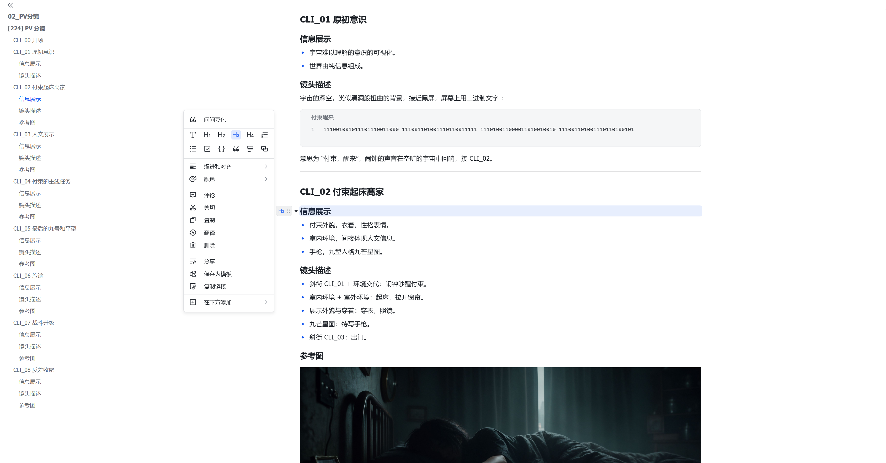

# UI 样式

类似飞书的排版，实时渲染。

亮 / 暗两套配色（文本类软件，长时间读写）。

# 技术栈

Tauri + Rust

# 功能

1. 能添加文件夹，扫描文件树，仅扫描这个文件夹的.md文件。（暂缓：MVP 以「最近打开 + 打开文件对话框」替代，后端 scan 命令已备）
2. 能注册右键菜单，新建 md 文件，能双击用软件打开 md 文件。（打包安装阶段做）
3. 模板与快捷键，核心。✅ 2026-10-18 三层落地
4. 大纲跳转。✅ 2026-10-18 落地

# 进度

- 2026-10-18 MVP 落地：Tauri + Vue3 + CodeMirror 6；混合渲染（Typora 式，光标行显源码）吃 02_UI样式 定稿 token；亮/暗主题；最近打开（localStorage）；新建套文档模板（另存为选位置）；三轴快捷键（Ctrl+方向=方位、+Shift=俯仰、+Alt=景别，顺序按逐轴拼装改值）；规则链下拉菜单（/ 触发、面板强制向上、数字/回车选定、Tab 跳过、Shift+Tab 回退、Esc 中断）；模板配置 = exe 旁 templates/ 目录（docs/*.md 文档模板、menus/*.md 词表、chains.json 规则链），首运行播种，侧栏「模板配置」点击即改。

# 模板层级

1. 创建时模板：整个文档的模板。新建文档即套好提示词骨架，固定段落已预填。
2. 快捷键补全：固定词汇快速上屏。镜头构图词汇按三轴组织——横轴：主体左/中/右；竖轴：俯/仰；Z 轴：近/远。例：输入"雪牧"后按 Ctrl+↑ → "雪牧正前方"。顺序按键逐轴拼装/改值（不做同时按的和弦判定）。
3. 下拉菜单补全：自定义词表面板。输入主体后按 `/` 弹出类别菜单（机位/仰俯/摄影机类型/运镜……，类别与词表均为用户可配置的文件），面板强制向上展开（避开输入法），支持 ↑↓+回车与数字键 1-7 直选；选完一类可链式续接下一类，Esc 中断。
   - 规则链机制：链 = 有序规则列表 + 索引游标，菜单展示当前规则的词表。Tab 跳过当前规则（该段不输出、分隔符自动清理），Shift+Tab 回退上一条规则（可改选或改为跳过），Esc 中断；面板标题显示当前规则名与进度（如"仰俯 · 2/4"）。规则链本身也是配置文件，可增删规则、调顺序。

# MVP

解决我写提示词的问题，重复段落多，模板是核心。