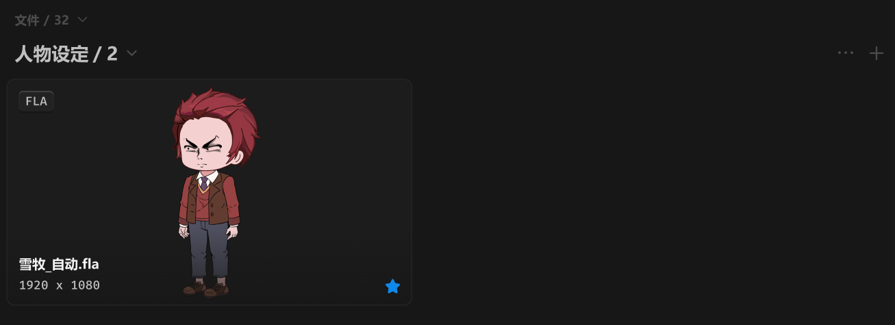
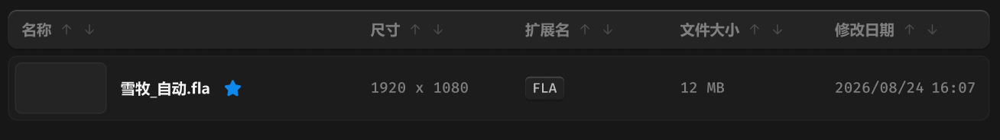

# 中间面板-内容容器-列表容器-文件列表



## 1_卡片显示模式

``` css
/* 文件列表-容器 */

/* Auto layout */
display: flex;
flex-direction: column;
align-items: flex-start;
padding: 0px;
gap: 12px;

width: 856px;
height: 510px;


/* Inside auto layout */
flex: none;
order: 2;
align-self: stretch;
flex-grow: 1;


/* 区块标题 */

/* Auto layout */
display: flex;
flex-direction: row;
justify-content: space-between;
align-items: center;
padding: 0px 0px 0px 8px;
gap: 10px;

width: 856px;
height: 16px;


/* Inside auto layout */
flex: none;
order: 0;
align-self: stretch;
flex-grow: 0;


/* 标题+展开按钮 */

/* Auto layout */
display: flex;
flex-direction: row;
align-items: center;
padding: 0px;
gap: 6px;

width: 73px;
height: 16px;


/* Inside auto layout */
flex: none;
order: 0;
flex-grow: 0;


/* 标题+数量 */

/* Auto layout */
display: flex;
flex-direction: row;
justify-content: center;
align-items: center;
padding: 0px;
gap: 4px;

width: 53px;
height: 16px;


/* Inside auto layout */
flex: none;
order: 0;
flex-grow: 0;


/* 文件 */

width: 24px;
height: 16px;

/* 通用/次要文字-加粗 */
font-family: 'Microsoft YaHei UI';
font-style: normal;
font-weight: 700;
font-size: 12px;
line-height: 16px;
/* identical to box height, or 133% */
display: flex;
align-items: center;
text-align: center;

/* 亮色/四级 */
color: #4D4D4D;


/* Inside auto layout */
flex: none;
order: 0;
flex-grow: 0;


/* / */

width: 6px;
height: 16px;

/* 通用/次要文字-加粗 */
font-family: 'Microsoft YaHei UI';
font-style: normal;
font-weight: 700;
font-size: 12px;
line-height: 16px;
/* identical to box height, or 133% */
display: flex;
align-items: center;
text-align: center;

/* 亮色/四级 */
color: #4D4D4D;


/* Inside auto layout */
flex: none;
order: 1;
flex-grow: 0;


/* 32 */

width: 15px;
height: 16px;

/* 通用/次要文字-加粗 */
font-family: 'Microsoft YaHei UI';
font-style: normal;
font-weight: 700;
font-size: 12px;
line-height: 16px;
/* identical to box height, or 133% */
display: flex;
align-items: center;
text-align: center;

/* 亮色/四级 */
color: #4D4D4D;


/* Inside auto layout */
flex: none;
order: 2;
flex-grow: 0;


/* 展开按钮-icon */

/* Auto layout */
display: flex;
flex-direction: column;
justify-content: center;
align-items: center;
padding: 0px;

width: 14px;
height: 14px;


/* Inside auto layout */
flex: none;
order: 1;
flex-grow: 0;


/* svg */

width: 8px;
height: 4px;


/* Inside auto layout */
flex: none;
order: 0;
flex-grow: 0;


/* Vector */

position: absolute;
left: 21.43%;
right: 50%;
top: 35.71%;
bottom: 7.14%;

/* 亮色/四级 */
border: 1px solid #4D4D4D;
transform: matrix(0, -1, -1, 0, 0, 0);


/* 文件列表 */

/* Auto layout */
display: flex;
flex-direction: column;
align-items: flex-start;
padding: 0px;
gap: 24px;

width: 856px;
height: 482px;


/* Inside auto layout */
flex: none;
order: 1;
align-self: stretch;
flex-grow: 1;


/* 分组 */

/* Auto layout */
display: flex;
flex-direction: column;
align-items: flex-start;
padding: 0px;
gap: 12px;

width: 856px;
height: 482px;


/* Inside auto layout */
flex: none;
order: 0;
align-self: stretch;
flex-grow: 1;


/* 分组标题 */

/* Auto layout */
display: flex;
flex-direction: row;
justify-content: space-between;
align-items: center;
padding: 0px 0px 0px 8px;
gap: 10px;

width: 856px;
height: 26px;


/* Inside auto layout */
flex: none;
order: 0;
align-self: stretch;
flex-grow: 0;


/* 标题+展开按钮 */

/* Auto layout */
display: flex;
flex-direction: row;
align-items: center;
padding: 0px;
gap: 6px;

width: 121px;
height: 26px;


/* Inside auto layout */
flex: none;
order: 0;
flex-grow: 0;


/* 标题+数量 */

/* Auto layout */
display: flex;
flex-direction: row;
justify-content: center;
align-items: center;
padding: 0px;
gap: 4px;

width: 101px;
height: 26px;


/* Inside auto layout */
flex: none;
order: 0;
flex-grow: 0;


/* 人物设定 */

width: 72px;
height: 26px;

/* 通用/标题 */
font-family: 'Microsoft YaHei UI';
font-style: normal;
font-weight: 700;
font-size: 18px;
line-height: 26px;
/* identical to box height, or 144% */
display: flex;
align-items: center;
text-align: center;

/* 亮色/二级 */
color: #BFBFBF;


/* Inside auto layout */
flex: none;
order: 0;
flex-grow: 0;


/* / */

width: 9px;
height: 26px;

/* 通用/标题 */
font-family: 'Microsoft YaHei UI';
font-style: normal;
font-weight: 700;
font-size: 18px;
line-height: 26px;
/* identical to box height, or 144% */
display: flex;
align-items: center;
text-align: center;

/* 亮色/二级 */
color: #BFBFBF;


/* Inside auto layout */
flex: none;
order: 1;
flex-grow: 0;


/* 2 */

width: 12px;
height: 26px;

/* 通用/标题 */
font-family: 'Microsoft YaHei UI';
font-style: normal;
font-weight: 700;
font-size: 18px;
line-height: 26px;
/* identical to box height, or 144% */
display: flex;
align-items: center;
text-align: center;

/* 亮色/二级 */
color: #BFBFBF;


/* Inside auto layout */
flex: none;
order: 2;
flex-grow: 0;


/* 展开按钮-icon */

/* Auto layout */
display: flex;
flex-direction: column;
justify-content: center;
align-items: center;
padding: 0px;

width: 14px;
height: 14px;


/* Inside auto layout */
flex: none;
order: 1;
flex-grow: 0;


/* svg */

width: 8px;
height: 4px;


/* Inside auto layout */
flex: none;
order: 0;
flex-grow: 0;


/* Vector */

position: absolute;
left: 21.43%;
right: 50%;
top: 35.71%;
bottom: 7.14%;

/* 亮色/四级 */
border: 1.5px solid #4D4D4D;
transform: matrix(0, -1, -1, 0, 0, 0);


/* 按钮组 */

/* Auto layout */
display: flex;
flex-direction: row;
align-items: center;
padding: 0px;
gap: 12px;

width: 48px;
height: 18px;


/* Inside auto layout */
flex: none;
order: 1;
flex-grow: 0;


/* 更多-大-icon */

/* Auto layout */
display: flex;
flex-direction: column;
justify-content: center;
align-items: center;
padding: 0px;

width: 18px;
height: 18px;


/* Inside auto layout */
flex: none;
order: 0;
flex-grow: 0;


/* svg */

width: 12px;
height: 1px;


/* Inside auto layout */
flex: none;
order: 0;
flex-grow: 0;


/* Vector */

position: absolute;
left: 49.95%;
right: 50%;
top: 47.22%;
bottom: 47.22%;

/* 亮色/四级 */
border: 2.5px solid #4D4D4D;


/* Vector */

position: absolute;
left: 83.28%;
right: 16.67%;
top: 47.22%;
bottom: 47.22%;

/* 亮色/四级 */
border: 2.5px solid #4D4D4D;


/* Vector */

position: absolute;
left: 16.67%;
right: 83.28%;
top: 47.22%;
bottom: 47.22%;

/* 亮色/四级 */
border: 2.5px solid #4D4D4D;


/* 添加-大-icon */

/* Auto layout */
display: flex;
flex-direction: row;
justify-content: center;
align-items: center;
padding: 0px;

width: 18px;
height: 18px;


/* Inside auto layout */
flex: none;
order: 1;
flex-grow: 0;


/* svg */

width: 12px;
height: 12px;

transform: matrix(1, 0, 0, -1, 0, 0);

/* Inside auto layout */
flex: none;
order: 0;
flex-grow: 0;


/* Vector */

position: absolute;
left: 50%;
right: 50%;
top: 16.67%;
bottom: 16.67%;

/* 亮色/四级 */
border: 1.5px solid #4D4D4D;


/* Vector */

position: absolute;
left: 16.67%;
right: 83.33%;
top: 50%;
bottom: -16.67%;

/* 亮色/四级 */
border: 1.5px solid #4D4D4D;
transform: rotate(90deg);


/* 卡片显示模式 */

/* Auto layout */
display: flex;
flex-direction: row;
align-items: center;
padding: 0px;
gap: 12px;

width: 856px;
height: 222px;


/* Inside auto layout */
flex: none;
order: 1;
align-self: stretch;
flex-grow: 0;


/* 文件卡片 */

box-sizing: border-box;

/* Auto layout */
display: flex;
flex-direction: column;
justify-content: center;
align-items: center;
padding: 0px;
isolation: isolate;

width: 395px;
height: 222px;

/* 通用/二级 */
background: #1C1C1C;
/* 通用/三级 */
border: 1px solid #242424;
border-radius: 8px;

/* Inside auto layout */
flex: none;
order: 0;
flex-grow: 0;


/* 缩略图 */

width: 395px;
height: 222px;

background: url(雪牧.png);

/* Inside auto layout */
flex: none;
order: 0;
flex-grow: 0;
z-index: 0;


/* 名称+简介 */

/* Auto layout */
display: flex;
flex-direction: column;
justify-content: flex-end;
align-items: flex-start;
padding: 24px 12px 12px;
gap: 4px;

position: absolute;
width: 395px;
height: 74px;
left: 0px;
top: 148px;

/* 通用/渐变-2 */
background: linear-gradient(180deg, rgba(23, 23, 23, 0) 0%, rgba(23, 23, 23, 0.8) 100%);

/* Inside auto layout */
flex: none;
order: 1;
flex-grow: 0;
z-index: 1;


/* 雪牧_自动.fla */

width: 79px;
height: 18px;

/* 通用/正文-加粗 */
font-family: 'Microsoft YaHei UI';
font-style: normal;
font-weight: 700;
font-size: 13px;
line-height: 18px;
/* identical to box height, or 138% */
display: flex;
align-items: center;

/* 亮色/一级 */
color: #F2F2F2;


/* Inside auto layout */
flex: none;
order: 0;
flex-grow: 0;


/* 1920 x 1080 */

width: 80px;
height: 16px;

/* 通用/数字 */
font-family: 'Fira Mono';
font-style: normal;
font-weight: 500;
font-size: 12px;
line-height: 16px;
/* identical to box height, or 133% */
display: flex;
align-items: center;

/* 亮色/二级 */
color: #BFBFBF;


/* Inside auto layout */
flex: none;
order: 1;
flex-grow: 0;


/* 原始文件-徽章 */

position: absolute;
width: 14px;
height: 14px;
left: 369px;
top: 196px;


/* Inside auto layout */
flex: none;
order: 2;
flex-grow: 0;
z-index: 2;


/* svg */

position: absolute;
width: 14px;
height: 14px;
left: 369px;
top: 196px;

/* 品牌/常态 */
background: #0F89EC;


/* 徽标 */

/* Auto layout */
display: flex;
flex-direction: row;
justify-content: center;
align-items: center;
padding: 2px 6px;

position: absolute;
width: 34px;
height: 20px;
left: 12px;
top: 12px;

/* 通用/半透明-2 */
background: rgba(41, 41, 41, 0.5);
/* 立体感-背景模糊 */
box-shadow: 0px 2px 1px rgba(0, 0, 0, 0.2), inset 0px 1px 1px rgba(255, 255, 255, 0.2);
backdrop-filter: blur(40px);
/* Note: backdrop-filter has minimal browser support */
border-radius: 4px;

/* Inside auto layout */
flex: none;
order: 3;
flex-grow: 0;
z-index: 3;


/* FLA */

width: 22px;
height: 16px;

/* 通用/数字 */
font-family: 'Fira Mono';
font-style: normal;
font-weight: 500;
font-size: 12px;
line-height: 16px;
/* identical to box height, or 133% */
display: flex;
align-items: center;

/* 亮色/二级 */
color: #BFBFBF;


/* Inside auto layout */
flex: none;
order: 0;
flex-grow: 0;
```



## 2_列表显示模式

``` css
/* 列表显示模式 */

/* Auto layout */
display: flex;
flex-direction: column;
align-items: flex-start;
padding: 0px;
gap: 6px;

width: 856px;
height: 210px;


/* Inside auto layout */
flex: none;
order: 1;
align-self: stretch;
flex-grow: 1;


/* 表头 */

/* Auto layout */
display: flex;
flex-direction: row;
align-items: center;
padding: 8px 12px;
gap: 12px;

width: 856px;
height: 34px;

/* 通用/三级 */
background: #242424;
/* 立体感-通用 */
box-shadow: 0px 2px 1px rgba(0, 0, 0, 0.2), inset 0px 1px 1px rgba(255, 255, 255, 0.2);
border-radius: 8px;

/* Inside auto layout */
flex: none;
order: 0;
align-self: stretch;
flex-grow: 0;


/* 名称 */

/* Auto layout */
display: flex;
flex-direction: row;
align-items: center;
padding: 0px;
gap: 6px;

width: 292px;
height: 18px;


/* Inside auto layout */
flex: none;
order: 0;
flex-grow: 1;


/* 名称 */

width: 26px;
height: 18px;

/* 通用/正文-加粗 */
font-family: 'Microsoft YaHei UI';
font-style: normal;
font-weight: 700;
font-size: 13px;
line-height: 18px;
/* identical to box height, or 138% */
display: flex;
align-items: center;

/* 亮色/三级 */
color: #808080;


/* Inside auto layout */
flex: none;
order: 0;
flex-grow: 0;


/* 箭头-小-icon */

/* Auto layout */
display: flex;
flex-direction: row;
justify-content: center;
align-items: center;
padding: 0px;

width: 14px;
height: 14px;


/* Inside auto layout */
flex: none;
order: 1;
flex-grow: 0;


/* svg */

width: 6.86px;
height: 8px;

transform: matrix(1, 0, 0, -1, 0, 0);

/* Inside auto layout */
flex: none;
order: 0;
flex-grow: 0;


/* Vector */

position: absolute;
left: 50%;
right: 50%;
top: 23.47%;
bottom: 21.43%;

/* 亮色/四级 */
border: 1px solid #4D4D4D;


/* Vector */

position: absolute;
left: 25.51%;
right: 25.51%;
top: 21.43%;
bottom: 54.08%;

/* 亮色/四级 */
border: 1px solid #4D4D4D;


/* 箭头-小-icon */

/* Auto layout */
display: flex;
flex-direction: row;
justify-content: center;
align-items: center;
padding: 0px;

width: 14px;
height: 14px;

transform: rotate(-180deg);

/* Inside auto layout */
flex: none;
order: 2;
flex-grow: 0;


/* svg */

width: 6.86px;
height: 8px;

transform: matrix(-1, 0, 0, 1, 0, 0);

/* Inside auto layout */
flex: none;
order: 0;
flex-grow: 0;


/* Vector */

position: absolute;
left: 50%;
right: 50%;
top: 21.43%;
bottom: 23.47%;

/* 亮色/四级 */
border: 1px solid #4D4D4D;
transform: rotate(-180deg);


/* Vector */

position: absolute;
left: 25.51%;
right: 25.51%;
top: 54.08%;
bottom: 21.43%;

/* 亮色/四级 */
border: 1px solid #4D4D4D;
transform: rotate(-180deg);


/* 尺寸 */

/* Auto layout */
display: flex;
flex-direction: row;
align-items: center;
padding: 0px;
gap: 6px;

width: 123px;
height: 18px;


/* Inside auto layout */
flex: none;
order: 1;
flex-grow: 0;


/* 尺寸 */

width: 26px;
height: 18px;

/* 通用/正文-加粗 */
font-family: 'Microsoft YaHei UI';
font-style: normal;
font-weight: 700;
font-size: 13px;
line-height: 18px;
/* identical to box height, or 138% */
display: flex;
align-items: center;

/* 亮色/三级 */
color: #808080;


/* Inside auto layout */
flex: none;
order: 0;
flex-grow: 0;


/* 箭头-小-icon */

/* Auto layout */
display: flex;
flex-direction: row;
justify-content: center;
align-items: center;
padding: 0px;

width: 14px;
height: 14px;


/* Inside auto layout */
flex: none;
order: 1;
flex-grow: 0;


/* svg */

width: 6.86px;
height: 8px;

transform: matrix(1, 0, 0, -1, 0, 0);

/* Inside auto layout */
flex: none;
order: 0;
flex-grow: 0;


/* Vector */

position: absolute;
left: 50%;
right: 50%;
top: 23.47%;
bottom: 21.43%;

/* 亮色/四级 */
border: 1px solid #4D4D4D;


/* Vector */

position: absolute;
left: 25.51%;
right: 25.51%;
top: 21.43%;
bottom: 54.08%;

/* 亮色/四级 */
border: 1px solid #4D4D4D;


/* 箭头-小-icon */

/* Auto layout */
display: flex;
flex-direction: row;
justify-content: center;
align-items: center;
padding: 0px;

width: 14px;
height: 14px;

transform: rotate(-180deg);

/* Inside auto layout */
flex: none;
order: 2;
flex-grow: 0;


/* svg */

width: 6.86px;
height: 8px;

transform: matrix(-1, 0, 0, 1, 0, 0);

/* Inside auto layout */
flex: none;
order: 0;
flex-grow: 0;


/* Vector */

position: absolute;
left: 50%;
right: 50%;
top: 21.43%;
bottom: 23.47%;

/* 亮色/四级 */
border: 1px solid #4D4D4D;
transform: rotate(-180deg);


/* Vector */

position: absolute;
left: 25.51%;
right: 25.51%;
top: 54.08%;
bottom: 21.43%;

/* 亮色/四级 */
border: 1px solid #4D4D4D;
transform: rotate(-180deg);


/* 格式 */

/* Auto layout */
display: flex;
flex-direction: row;
align-items: center;
padding: 0px;
gap: 6px;

width: 123px;
height: 18px;


/* Inside auto layout */
flex: none;
order: 2;
flex-grow: 0;


/* 扩展名 */

width: 39px;
height: 18px;

/* 通用/正文-加粗 */
font-family: 'Microsoft YaHei UI';
font-style: normal;
font-weight: 700;
font-size: 13px;
line-height: 18px;
/* identical to box height, or 138% */
display: flex;
align-items: center;

/* 亮色/三级 */
color: #808080;


/* Inside auto layout */
flex: none;
order: 0;
flex-grow: 0;


/* 箭头-小-icon */

/* Auto layout */
display: flex;
flex-direction: row;
justify-content: center;
align-items: center;
padding: 0px;

width: 14px;
height: 14px;


/* Inside auto layout */
flex: none;
order: 1;
flex-grow: 0;


/* svg */

width: 6.86px;
height: 8px;

transform: matrix(1, 0, 0, -1, 0, 0);

/* Inside auto layout */
flex: none;
order: 0;
flex-grow: 0;


/* Vector */

position: absolute;
left: 50%;
right: 50%;
top: 23.47%;
bottom: 21.43%;

/* 亮色/四级 */
border: 1px solid #4D4D4D;


/* Vector */

position: absolute;
left: 25.51%;
right: 25.51%;
top: 21.43%;
bottom: 54.08%;

/* 亮色/四级 */
border: 1px solid #4D4D4D;


/* 箭头-小-icon */

/* Auto layout */
display: flex;
flex-direction: row;
justify-content: center;
align-items: center;
padding: 0px;

width: 14px;
height: 14px;

transform: rotate(-180deg);

/* Inside auto layout */
flex: none;
order: 2;
flex-grow: 0;


/* svg */

width: 6.86px;
height: 8px;

transform: matrix(-1, 0, 0, 1, 0, 0);

/* Inside auto layout */
flex: none;
order: 0;
flex-grow: 0;


/* Vector */

position: absolute;
left: 50%;
right: 50%;
top: 21.43%;
bottom: 23.47%;

/* 亮色/四级 */
border: 1px solid #4D4D4D;
transform: rotate(-180deg);


/* Vector */

position: absolute;
left: 25.51%;
right: 25.51%;
top: 54.08%;
bottom: 21.43%;

/* 亮色/四级 */
border: 1px solid #4D4D4D;
transform: rotate(-180deg);


/* 文件大小 */

/* Auto layout */
display: flex;
flex-direction: row;
align-items: center;
padding: 0px;
gap: 6px;

width: 123px;
height: 18px;


/* Inside auto layout */
flex: none;
order: 3;
flex-grow: 0;


/* 文件大小 */

width: 52px;
height: 18px;

/* 通用/正文-加粗 */
font-family: 'Microsoft YaHei UI';
font-style: normal;
font-weight: 700;
font-size: 13px;
line-height: 18px;
/* identical to box height, or 138% */
display: flex;
align-items: center;

/* 亮色/三级 */
color: #808080;


/* Inside auto layout */
flex: none;
order: 0;
flex-grow: 0;


/* 箭头-小-icon */

/* Auto layout */
display: flex;
flex-direction: row;
justify-content: center;
align-items: center;
padding: 0px;

width: 14px;
height: 14px;


/* Inside auto layout */
flex: none;
order: 1;
flex-grow: 0;


/* svg */

width: 6.86px;
height: 8px;

transform: matrix(1, 0, 0, -1, 0, 0);

/* Inside auto layout */
flex: none;
order: 0;
flex-grow: 0;


/* Vector */

position: absolute;
left: 50%;
right: 50%;
top: 23.47%;
bottom: 21.43%;

/* 亮色/四级 */
border: 1px solid #4D4D4D;


/* Vector */

position: absolute;
left: 25.51%;
right: 25.51%;
top: 21.43%;
bottom: 54.08%;

/* 亮色/四级 */
border: 1px solid #4D4D4D;


/* 箭头-小-icon */

/* Auto layout */
display: flex;
flex-direction: row;
justify-content: center;
align-items: center;
padding: 0px;

width: 14px;
height: 14px;

transform: rotate(-180deg);

/* Inside auto layout */
flex: none;
order: 2;
flex-grow: 0;


/* svg */

width: 6.86px;
height: 8px;

transform: matrix(-1, 0, 0, 1, 0, 0);

/* Inside auto layout */
flex: none;
order: 0;
flex-grow: 0;


/* Vector */

position: absolute;
left: 50%;
right: 50%;
top: 21.43%;
bottom: 23.47%;

/* 亮色/四级 */
border: 1px solid #4D4D4D;
transform: rotate(-180deg);


/* Vector */

position: absolute;
left: 25.51%;
right: 25.51%;
top: 54.08%;
bottom: 21.43%;

/* 亮色/四级 */
border: 1px solid #4D4D4D;
transform: rotate(-180deg);


/* 修改时间 */

/* Auto layout */
display: flex;
flex-direction: row;
align-items: center;
padding: 0px;
gap: 6px;

width: 123px;
height: 18px;


/* Inside auto layout */
flex: none;
order: 4;
flex-grow: 0;


/* 修改日期 */

width: 52px;
height: 18px;

/* 通用/正文-加粗 */
font-family: 'Microsoft YaHei UI';
font-style: normal;
font-weight: 700;
font-size: 13px;
line-height: 18px;
/* identical to box height, or 138% */
display: flex;
align-items: center;

/* 亮色/三级 */
color: #808080;


/* Inside auto layout */
flex: none;
order: 0;
flex-grow: 0;


/* 箭头-小-icon */

/* Auto layout */
display: flex;
flex-direction: row;
justify-content: center;
align-items: center;
padding: 0px;

width: 14px;
height: 14px;


/* Inside auto layout */
flex: none;
order: 1;
flex-grow: 0;


/* svg */

width: 6.86px;
height: 8px;

transform: matrix(1, 0, 0, -1, 0, 0);

/* Inside auto layout */
flex: none;
order: 0;
flex-grow: 0;


/* Vector */

position: absolute;
left: 50%;
right: 50%;
top: 23.47%;
bottom: 21.43%;

/* 亮色/四级 */
border: 1px solid #4D4D4D;


/* Vector */

position: absolute;
left: 25.51%;
right: 25.51%;
top: 21.43%;
bottom: 54.08%;

/* 亮色/四级 */
border: 1px solid #4D4D4D;


/* 箭头-小-icon */

/* Auto layout */
display: flex;
flex-direction: row;
justify-content: center;
align-items: center;
padding: 0px;

width: 14px;
height: 14px;

transform: rotate(-180deg);

/* Inside auto layout */
flex: none;
order: 2;
flex-grow: 0;


/* svg */

width: 6.86px;
height: 8px;

transform: matrix(-1, 0, 0, 1, 0, 0);

/* Inside auto layout */
flex: none;
order: 0;
flex-grow: 0;


/* Vector */

position: absolute;
left: 50%;
right: 50%;
top: 21.43%;
bottom: 23.47%;

/* 亮色/四级 */
border: 1px solid #4D4D4D;
transform: rotate(-180deg);


/* Vector */

position: absolute;
left: 25.51%;
right: 25.51%;
top: 54.08%;
bottom: 21.43%;

/* 亮色/四级 */
border: 1px solid #4D4D4D;
transform: rotate(-180deg);


/* 列表-item */

box-sizing: border-box;

/* Auto layout */
display: flex;
flex-direction: row;
align-items: center;
padding: 6px 12px 6px 6px;
gap: 12px;

width: 856px;
height: 57px;

/* 通用/二级 */
background: #1C1C1C;
/* 通用/三级 */
border: 1px solid #242424;
border-radius: 8px;

/* Inside auto layout */
flex: none;
order: 1;
align-self: stretch;
flex-grow: 0;


/* 缩略图容器 */

box-sizing: border-box;

/* Auto layout */
display: flex;
flex-direction: row;
align-items: flex-start;
padding: 0px;

width: 80px;
height: 45px;

/* 通用/三级 */
background: #242424;
/* 通用/五级 */
border: 1px solid #2E2E2E;
border-radius: 6px;

/* Inside auto layout */
flex: none;
order: 0;
flex-grow: 0;


/* 名称+徽章 */

/* Auto layout */
display: flex;
flex-direction: row;
align-items: center;
padding: 0px;
gap: 12px;

width: 206px;
height: 18px;


/* Inside auto layout */
flex: none;
order: 1;
flex-grow: 1;


/* 雪牧_自动.fla */

width: 79px;
height: 18px;

/* 通用/正文-加粗 */
font-family: 'Microsoft YaHei UI';
font-style: normal;
font-weight: 700;
font-size: 13px;
line-height: 18px;
/* identical to box height, or 138% */
display: flex;
align-items: center;

/* 亮色/一级 */
color: #F2F2F2;


/* Inside auto layout */
flex: none;
order: 0;
flex-grow: 0;


/* 原始文件-徽章 */

width: 14px;
height: 14px;


/* Inside auto layout */
flex: none;
order: 1;
flex-grow: 0;


/* svg */

position: absolute;
width: 14px;
height: 14px;
left: 91px;
top: 2px;

/* 品牌/常态 */
background: #0F89EC;


/* 尺寸 */

/* Auto layout */
display: flex;
flex-direction: row;
align-items: center;
padding: 0px;
gap: 6px;

width: 123px;
height: 18px;


/* Inside auto layout */
flex: none;
order: 2;
flex-grow: 0;


/* 1920 x 1080 */

width: 86px;
height: 18px;

/* 通用/数字-大 */
font-family: 'Fira Mono';
font-style: normal;
font-weight: 500;
font-size: 13px;
line-height: 18px;
/* identical to box height, or 138% */
display: flex;
align-items: center;

/* 亮色/三级 */
color: #808080;


/* Inside auto layout */
flex: none;
order: 0;
flex-grow: 0;


/* 徽章容器 */

/* Auto layout */
display: flex;
flex-direction: row;
align-items: center;
padding: 0px;

width: 123px;
height: 20px;


/* Inside auto layout */
flex: none;
order: 3;
flex-grow: 0;


/* 徽标 */

/* Auto layout */
display: flex;
flex-direction: row;
justify-content: center;
align-items: center;
padding: 2px 6px;

width: 34px;
height: 20px;

/* 通用/半透明-2 */
background: rgba(41, 41, 41, 0.5);
/* 立体感-背景模糊 */
box-shadow: 0px 2px 1px rgba(0, 0, 0, 0.2), inset 0px 1px 1px rgba(255, 255, 255, 0.2);
backdrop-filter: blur(40px);
/* Note: backdrop-filter has minimal browser support */
border-radius: 4px;

/* Inside auto layout */
flex: none;
order: 0;
flex-grow: 0;


/* FLA */

width: 22px;
height: 16px;

/* 通用/数字 */
font-family: 'Fira Mono';
font-style: normal;
font-weight: 500;
font-size: 12px;
line-height: 16px;
/* identical to box height, or 133% */
display: flex;
align-items: center;

/* 亮色/二级 */
color: #BFBFBF;


/* Inside auto layout */
flex: none;
order: 0;
flex-grow: 0;


/* 文件大小 */

/* Auto layout */
display: flex;
flex-direction: row;
align-items: center;
padding: 0px;

width: 123px;
height: 18px;


/* Inside auto layout */
flex: none;
order: 4;
flex-grow: 0;


/* 12 MB */

width: 39px;
height: 18px;

/* 通用/数字-大 */
font-family: 'Fira Mono';
font-style: normal;
font-weight: 500;
font-size: 13px;
line-height: 18px;
/* identical to box height, or 138% */
display: flex;
align-items: center;

/* 亮色/三级 */
color: #808080;


/* Inside auto layout */
flex: none;
order: 0;
flex-grow: 0;


/* 修改时间 */

/* Auto layout */
display: flex;
flex-direction: row;
align-items: center;
padding: 0px;
gap: 6px;

width: 123px;
height: 18px;


/* Inside auto layout */
flex: none;
order: 5;
flex-grow: 0;


/* 日期 */

width: 78px;
height: 18px;

/* 通用/数字-大 */
font-family: 'Fira Mono';
font-style: normal;
font-weight: 500;
font-size: 13px;
line-height: 18px;
/* identical to box height, or 138% */
display: flex;
align-items: center;

/* 亮色/三级 */
color: #808080;


/* Inside auto layout */
flex: none;
order: 0;
flex-grow: 0;


/* 时间 */

width: 39px;
height: 18px;

/* 通用/数字-大 */
font-family: 'Fira Mono';
font-style: normal;
font-weight: 500;
font-size: 13px;
line-height: 18px;
/* identical to box height, or 138% */
display: flex;
align-items: center;

/* 亮色/三级 */
color: #808080;


/* Inside auto layout */
flex: none;
order: 1;
flex-grow: 0;
```

