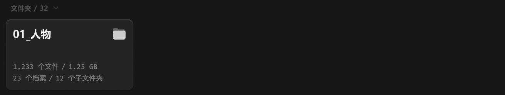

# 中间面板-内容容器-列表容器-文件夹列表



``` css
/* 文件夹列表-容器 */

/* Auto layout */
display: flex;
flex-direction: column;
align-items: flex-start;
padding: 0px;
gap: 12px;

width: 856px;
height: 150px;


/* Inside auto layout */
flex: none;
order: 0;
align-self: stretch;
flex-grow: 0;


/* 区块标题 */

/* Auto layout */
display: flex;
flex-direction: row;
justify-content: space-between;
align-items: center;
padding: 0px 0px 0px 8px;
gap: 10px;

width: 856px;
height: 16px;


/* Inside auto layout */
flex: none;
order: 0;
align-self: stretch;
flex-grow: 0;


/* 标题+展开按钮 */

/* Auto layout */
display: flex;
flex-direction: row;
align-items: center;
padding: 0px;
gap: 6px;

width: 85px;
height: 16px;


/* Inside auto layout */
flex: none;
order: 0;
flex-grow: 0;


/* 标题+数量 */

/* Auto layout */
display: flex;
flex-direction: row;
justify-content: center;
align-items: center;
padding: 0px;
gap: 4px;

width: 65px;
height: 16px;


/* Inside auto layout */
flex: none;
order: 0;
flex-grow: 0;


/* 文件夹 */

width: 36px;
height: 16px;

/* 通用/次要文字-加粗 */
font-family: 'Microsoft YaHei UI';
font-style: normal;
font-weight: 700;
font-size: 12px;
line-height: 16px;
/* identical to box height, or 133% */
display: flex;
align-items: center;
text-align: center;

/* 亮色/四级 */
color: #4D4D4D;


/* Inside auto layout */
flex: none;
order: 0;
flex-grow: 0;


/* / */

width: 6px;
height: 16px;

/* 通用/次要文字-加粗 */
font-family: 'Microsoft YaHei UI';
font-style: normal;
font-weight: 700;
font-size: 12px;
line-height: 16px;
/* identical to box height, or 133% */
display: flex;
align-items: center;
text-align: center;

/* 亮色/四级 */
color: #4D4D4D;


/* Inside auto layout */
flex: none;
order: 1;
flex-grow: 0;


/* 32 */

width: 15px;
height: 16px;

/* 通用/次要文字-加粗 */
font-family: 'Microsoft YaHei UI';
font-style: normal;
font-weight: 700;
font-size: 12px;
line-height: 16px;
/* identical to box height, or 133% */
display: flex;
align-items: center;
text-align: center;

/* 亮色/四级 */
color: #4D4D4D;


/* Inside auto layout */
flex: none;
order: 2;
flex-grow: 0;


/* 展开按钮-icon */

/* Auto layout */
display: flex;
flex-direction: column;
justify-content: center;
align-items: center;
padding: 0px;

width: 14px;
height: 14px;


/* Inside auto layout */
flex: none;
order: 1;
flex-grow: 0;


/* svg */

width: 8px;
height: 4px;


/* Inside auto layout */
flex: none;
order: 0;
flex-grow: 0;


/* Vector */

position: absolute;
left: 21.43%;
right: 50%;
top: 35.71%;
bottom: 7.14%;

/* 亮色/四级 */
border: 1px solid #4D4D4D;
transform: matrix(0, -1, -1, 0, 0, 0);


/* 文件夹列表 */

/* Auto layout */
display: flex;
flex-direction: row;
align-items: flex-start;
padding: 0px;
gap: 12px;

width: 856px;
height: 122px;


/* Inside auto layout */
flex: none;
order: 1;
align-self: stretch;
flex-grow: 0;


/* 文件夹卡片 */

/* Auto layout */
display: flex;
flex-direction: column;
align-items: flex-start;
padding: 12px;
gap: 36px;

width: 220px;
height: 122px;

/* 通用/三级 */
background: #242424;
/* 立体感-通用 */
box-shadow: 0px 2px 1px rgba(0, 0, 0, 0.2), inset 0px 1px 1px rgba(255, 255, 255, 0.2);
border-radius: 8px;

/* Inside auto layout */
flex: none;
order: 0;
flex-grow: 0;


/* 名称 */

/* Auto layout */
display: flex;
flex-direction: row;
justify-content: space-between;
align-items: center;
padding: 0px;
gap: 8px;

width: 196px;
height: 26px;


/* Inside auto layout */
flex: none;
order: 0;
align-self: stretch;
flex-grow: 0;


/* 01_人物 */

width: 67px;
height: 26px;

/* 通用/标题 */
font-family: 'Microsoft YaHei UI';
font-style: normal;
font-weight: 700;
font-size: 18px;
line-height: 26px;
/* identical to box height, or 144% */
display: flex;
align-items: center;

/* 亮色/一级 */
color: #F2F2F2;


/* Inside auto layout */
flex: none;
order: 0;
flex-grow: 0;


/* 文件夹-大-icon */

/* Auto layout */
display: flex;
flex-direction: column;
justify-content: center;
align-items: center;
padding: 0px;

width: 24px;
height: 24px;


/* Inside auto layout */
flex: none;
order: 1;
flex-grow: 0;


/* svg */

width: 22px;
height: 19.8px;


/* Inside auto layout */
flex: none;
order: 0;
flex-grow: 0;


/* Vector */

position: absolute;
left: 4.17%;
right: 4.17%;
top: 8.75%;
bottom: 8.75%;

/* 自定义/常态-2 */
background: #666666;


/* Vector */

position: absolute;
left: 4.17%;
right: 4.17%;
top: 27.08%;
bottom: 8.75%;

/* 自定义/常态-1 */
background: #CCCCCC;


/* 简介 */

/* Auto layout */
display: flex;
flex-direction: column;
align-items: flex-start;
padding: 0px;
gap: 4px;

width: 196px;
height: 36px;


/* Inside auto layout */
flex: none;
order: 1;
align-self: stretch;
flex-grow: 0;


/* 文件+容量 */

/* Auto layout */
display: flex;
flex-direction: row;
justify-content: center;
align-items: center;
padding: 0px;
gap: 4px;

width: 147px;
height: 16px;


/* Inside auto layout */
flex: none;
order: 0;
flex-grow: 0;


/* 1,233 个文件 */

width: 80px;
height: 16px;

/* 通用/数字 */
font-family: 'Fira Mono';
font-style: normal;
font-weight: 500;
font-size: 12px;
line-height: 16px;
/* identical to box height, or 133% */
display: flex;
align-items: center;

/* 亮色/三级 */
color: #808080;


/* Inside auto layout */
flex: none;
order: 0;
flex-grow: 0;


/* / */

width: 8px;
height: 16px;

/* 通用/数字 */
font-family: 'Fira Mono';
font-style: normal;
font-weight: 500;
font-size: 12px;
line-height: 16px;
/* identical to box height, or 133% */
display: flex;
align-items: center;

/* 亮色/三级 */
color: #808080;


/* Inside auto layout */
flex: none;
order: 1;
flex-grow: 0;


/* 1.25 GB */

width: 51px;
height: 16px;

/* 通用/数字 */
font-family: 'Fira Mono';
font-style: normal;
font-weight: 500;
font-size: 12px;
line-height: 16px;
/* identical to box height, or 133% */
display: flex;
align-items: center;

/* 亮色/三级 */
color: #808080;


/* Inside auto layout */
flex: none;
order: 2;
flex-grow: 0;


/* 档案数量+子文件夹数量 */

/* Auto layout */
display: flex;
flex-direction: row;
justify-content: center;
align-items: center;
padding: 0px;
gap: 4px;

width: 156px;
height: 16px;


/* Inside auto layout */
flex: none;
order: 1;
flex-grow: 0;


/* 23 个档案 */

width: 58px;
height: 16px;

/* 通用/数字 */
font-family: 'Fira Mono';
font-style: normal;
font-weight: 500;
font-size: 12px;
line-height: 16px;
/* identical to box height, or 133% */
display: flex;
align-items: center;

/* 亮色/三级 */
color: #808080;


/* Inside auto layout */
flex: none;
order: 0;
flex-grow: 0;


/* / */

width: 8px;
height: 16px;

/* 通用/数字 */
font-family: 'Fira Mono';
font-style: normal;
font-weight: 500;
font-size: 12px;
line-height: 16px;
/* identical to box height, or 133% */
display: flex;
align-items: center;

/* 亮色/三级 */
color: #808080;


/* Inside auto layout */
flex: none;
order: 1;
flex-grow: 0;


/* 12 个子文件夹 */

width: 82px;
height: 16px;

/* 通用/数字 */
font-family: 'Fira Mono';
font-style: normal;
font-weight: 500;
font-size: 12px;
line-height: 16px;
/* identical to box height, or 133% */
display: flex;
align-items: center;

/* 亮色/三级 */
color: #808080;


/* Inside auto layout */
flex: none;
order: 2;
flex-grow: 0;
```

