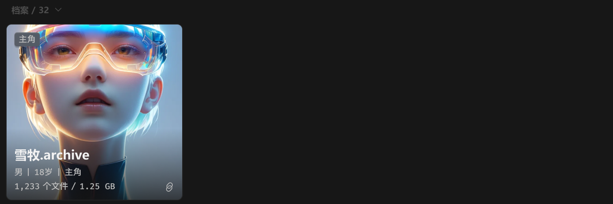

# 中间面板-内容容器-列表容器-档案列表



``` css
/* 档案列表-容器 */

/* Auto layout */
display: flex;
flex-direction: column;
align-items: flex-start;
padding: 0px;
gap: 12px;

width: 856px;
height: 278px;


/* Inside auto layout */
flex: none;
order: 1;
align-self: stretch;
flex-grow: 0;


/* 区块标题 */

/* Auto layout */
display: flex;
flex-direction: row;
justify-content: space-between;
align-items: center;
padding: 0px 0px 0px 8px;
gap: 10px;

width: 856px;
height: 16px;


/* Inside auto layout */
flex: none;
order: 0;
align-self: stretch;
flex-grow: 0;


/* 标题+展开按钮 */

/* Auto layout */
display: flex;
flex-direction: row;
align-items: center;
padding: 0px;
gap: 6px;

width: 73px;
height: 16px;


/* Inside auto layout */
flex: none;
order: 0;
flex-grow: 0;


/* 标题+数量 */

/* Auto layout */
display: flex;
flex-direction: row;
justify-content: center;
align-items: center;
padding: 0px;
gap: 4px;

width: 53px;
height: 16px;


/* Inside auto layout */
flex: none;
order: 0;
flex-grow: 0;


/* 档案 */

width: 24px;
height: 16px;

/* 通用/次要文字-加粗 */
font-family: 'Microsoft YaHei UI';
font-style: normal;
font-weight: 700;
font-size: 12px;
line-height: 16px;
/* identical to box height, or 133% */
display: flex;
align-items: center;
text-align: center;

/* 亮色/四级 */
color: #4D4D4D;


/* Inside auto layout */
flex: none;
order: 0;
flex-grow: 0;


/* / */

width: 6px;
height: 16px;

/* 通用/次要文字-加粗 */
font-family: 'Microsoft YaHei UI';
font-style: normal;
font-weight: 700;
font-size: 12px;
line-height: 16px;
/* identical to box height, or 133% */
display: flex;
align-items: center;
text-align: center;

/* 亮色/四级 */
color: #4D4D4D;


/* Inside auto layout */
flex: none;
order: 1;
flex-grow: 0;


/* 32 */

width: 15px;
height: 16px;

/* 通用/次要文字-加粗 */
font-family: 'Microsoft YaHei UI';
font-style: normal;
font-weight: 700;
font-size: 12px;
line-height: 16px;
/* identical to box height, or 133% */
display: flex;
align-items: center;
text-align: center;

/* 亮色/四级 */
color: #4D4D4D;


/* Inside auto layout */
flex: none;
order: 2;
flex-grow: 0;


/* 展开按钮-icon */

/* Auto layout */
display: flex;
flex-direction: column;
justify-content: center;
align-items: center;
padding: 0px;

width: 14px;
height: 14px;


/* Inside auto layout */
flex: none;
order: 1;
flex-grow: 0;


/* svg */

width: 8px;
height: 4px;


/* Inside auto layout */
flex: none;
order: 0;
flex-grow: 0;


/* Vector */

position: absolute;
left: 21.43%;
right: 50%;
top: 35.71%;
bottom: 7.14%;

/* 亮色/四级 */
border: 1px solid #4D4D4D;
transform: matrix(0, -1, -1, 0, 0, 0);


/* 档案列表 */

/* Auto layout */
display: flex;
flex-direction: row;
align-items: flex-start;
padding: 0px;
gap: 12px;

width: 856px;
height: 250px;


/* Inside auto layout */
flex: none;
order: 1;
align-self: stretch;
flex-grow: 0;


/* 档案卡片 */

box-sizing: border-box;

/* Auto layout */
display: flex;
flex-direction: column;
justify-content: center;
align-items: center;
padding: 0px;
isolation: isolate;

width: 250px;
height: 250px;

/* 通用/二级 */
background: #1C1C1C;
/* 通用/三级 */
border: 1px solid #242424;
border-radius: 8px;

/* Inside auto layout */
flex: none;
order: 0;
flex-grow: 0;


/* 封面图 */

width: 250px;
height: 438px;

background: url(image.png);

/* Inside auto layout */
flex: none;
order: 0;
align-self: stretch;
flex-grow: 0;
z-index: 0;


/* 名称+简介 */

/* Auto layout */
display: flex;
flex-direction: column;
justify-content: flex-end;
align-items: flex-start;
padding: 24px 12px 12px;
gap: 4px;

position: absolute;
width: 250px;
height: 102px;
left: 0px;
top: 148px;

/* 通用/渐变-2 */
background: linear-gradient(180deg, rgba(23, 23, 23, 0) 0%, rgba(23, 23, 23, 0.8) 100%);

/* Inside auto layout */
flex: none;
order: 1;
flex-grow: 0;
z-index: 1;


/* 雪牧.archive */

width: 107px;
height: 26px;

/* 通用/标题 */
font-family: 'Microsoft YaHei UI';
font-style: normal;
font-weight: 700;
font-size: 18px;
line-height: 26px;
/* identical to box height, or 144% */
display: flex;
align-items: center;

/* 亮色/一级 */
color: #F2F2F2;


/* Inside auto layout */
flex: none;
order: 0;
flex-grow: 0;


/* 属性标签 */

/* Auto layout */
display: flex;
flex-direction: row;
justify-content: center;
align-items: center;
padding: 0px;
gap: 4px;

width: 95px;
height: 16px;


/* Inside auto layout */
flex: none;
order: 1;
flex-grow: 0;


/* 男 */

width: 12px;
height: 16px;

/* 通用/数字 */
font-family: 'Fira Mono';
font-style: normal;
font-weight: 500;
font-size: 12px;
line-height: 16px;
/* identical to box height, or 133% */
display: flex;
align-items: center;

/* 亮色/二级 */
color: #BFBFBF;


/* Inside auto layout */
flex: none;
order: 0;
flex-grow: 0;


/* | */

width: 8px;
height: 16px;

/* 通用/数字 */
font-family: 'Fira Mono';
font-style: normal;
font-weight: 500;
font-size: 12px;
line-height: 16px;
/* identical to box height, or 133% */
display: flex;
align-items: center;

/* 亮色/二级 */
color: #BFBFBF;


/* Inside auto layout */
flex: none;
order: 1;
flex-grow: 0;


/* 18岁 */

width: 27px;
height: 16px;

/* 通用/数字 */
font-family: 'Fira Mono';
font-style: normal;
font-weight: 500;
font-size: 12px;
line-height: 16px;
/* identical to box height, or 133% */
display: flex;
align-items: center;

/* 亮色/二级 */
color: #BFBFBF;


/* Inside auto layout */
flex: none;
order: 2;
flex-grow: 0;


/* | */

width: 8px;
height: 16px;

/* 通用/数字 */
font-family: 'Fira Mono';
font-style: normal;
font-weight: 500;
font-size: 12px;
line-height: 16px;
/* identical to box height, or 133% */
display: flex;
align-items: center;

/* 亮色/二级 */
color: #BFBFBF;


/* Inside auto layout */
flex: none;
order: 3;
flex-grow: 0;


/* 主角 */

width: 24px;
height: 16px;

/* 通用/数字 */
font-family: 'Fira Mono';
font-style: normal;
font-weight: 500;
font-size: 12px;
line-height: 16px;
/* identical to box height, or 133% */
display: flex;
align-items: center;

/* 亮色/二级 */
color: #BFBFBF;


/* Inside auto layout */
flex: none;
order: 4;
flex-grow: 0;


/* 文件数量 */

/* Auto layout */
display: flex;
flex-direction: row;
justify-content: center;
align-items: center;
padding: 0px;
gap: 4px;

width: 143px;
height: 16px;


/* Inside auto layout */
flex: none;
order: 2;
flex-grow: 0;


/* 1,233 */

width: 36px;
height: 16px;

/* 通用/数字 */
font-family: 'Fira Mono';
font-style: normal;
font-weight: 500;
font-size: 12px;
line-height: 16px;
/* identical to box height, or 133% */
display: flex;
align-items: center;

/* 亮色/二级 */
color: #BFBFBF;


/* Inside auto layout */
flex: none;
order: 0;
flex-grow: 0;


/* 个文件 */

width: 36px;
height: 16px;

/* 通用/数字 */
font-family: 'Fira Mono';
font-style: normal;
font-weight: 500;
font-size: 12px;
line-height: 16px;
/* identical to box height, or 133% */
display: flex;
align-items: center;

/* 亮色/二级 */
color: #BFBFBF;


/* Inside auto layout */
flex: none;
order: 1;
flex-grow: 0;


/* / */

width: 8px;
height: 16px;

/* 通用/数字 */
font-family: 'Fira Mono';
font-style: normal;
font-weight: 500;
font-size: 12px;
line-height: 16px;
/* identical to box height, or 133% */
display: flex;
align-items: center;

/* 亮色/二级 */
color: #BFBFBF;


/* Inside auto layout */
flex: none;
order: 2;
flex-grow: 0;


/* 1.25 GB */

width: 51px;
height: 16px;

font-family: 'Fira Mono';
font-style: normal;
font-weight: 500;
font-size: 12px;
line-height: 16px;
/* identical to box height, or 133% */
display: flex;
align-items: center;

/* 亮色/二级 */
color: #BFBFBF;


/* Inside auto layout */
flex: none;
order: 3;
flex-grow: 0;


/* 链接文件-徽章 */

position: absolute;
width: 14px;
height: 14px;
left: 224px;
top: 224px;


/* Inside auto layout */
flex: none;
order: 2;
flex-grow: 0;
z-index: 2;


/* svg */

position: absolute;
width: 8.4px;
height: 12px;
left: 2.8px;
top: 1px;


/* Vector */

position: absolute;
left: 20%;
right: 24.29%;
top: 37.14%;
bottom: 7.14%;

/* 亮色/二级 */
border: 1px solid #BFBFBF;


/* Vector */

position: absolute;
left: 24.29%;
right: 20%;
top: 7.14%;
bottom: 37.14%;

/* 亮色/二级 */
border: 1px solid #BFBFBF;


/* 徽标 */

/* Auto layout */
display: flex;
flex-direction: row;
justify-content: center;
align-items: center;
padding: 2px 6px;

position: absolute;
width: 36px;
height: 20px;
left: 12px;
top: 12px;

/* 通用/半透明-2 */
background: rgba(41, 41, 41, 0.5);
/* 立体感-背景模糊 */
box-shadow: 0px 2px 1px rgba(0, 0, 0, 0.2), inset 0px 1px 1px rgba(255, 255, 255, 0.2);
backdrop-filter: blur(40px);
/* Note: backdrop-filter has minimal browser support */
border-radius: 4px;

/* Inside auto layout */
flex: none;
order: 3;
flex-grow: 0;
z-index: 3;


/* 主角 */

width: 24px;
height: 16px;

/* 通用/数字 */
font-family: 'Fira Mono';
font-style: normal;
font-weight: 500;
font-size: 12px;
line-height: 16px;
/* identical to box height, or 133% */
display: flex;
align-items: center;

/* 亮色/二级 */
color: #BFBFBF;


/* Inside auto layout */
flex: none;
order: 0;
flex-grow: 0;
```

