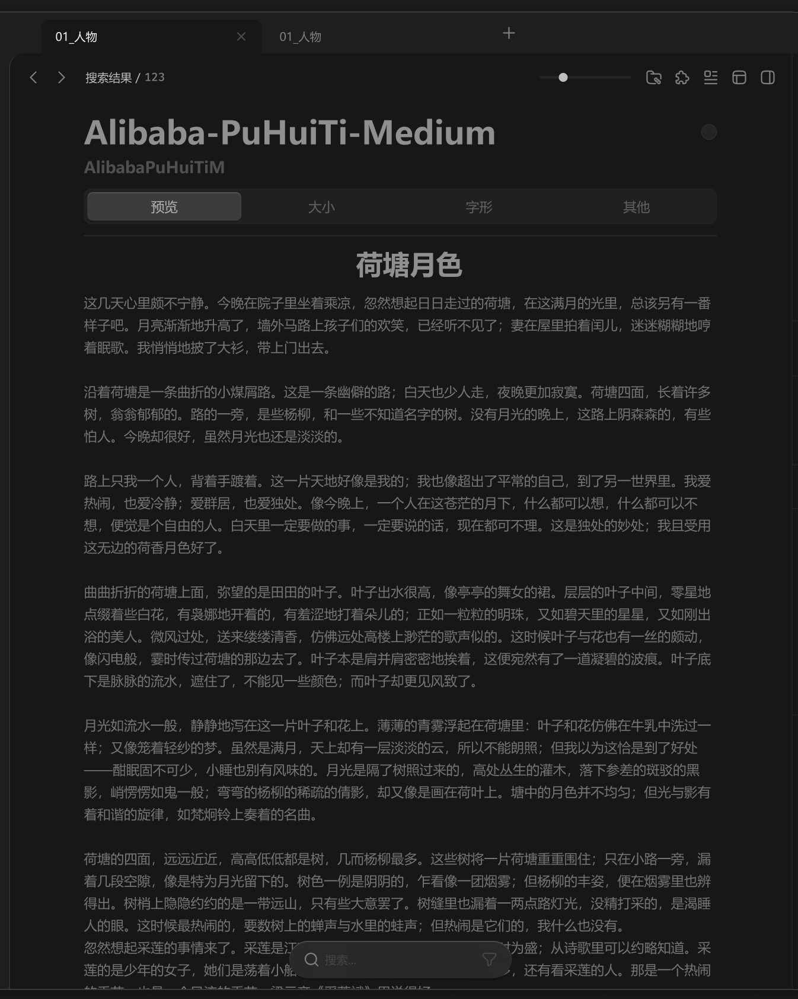

# 中间面板-内容容器-字体预览



``` css
/* 字体预览 */

/* Auto layout */
display: flex;
flex-direction: column;
align-items: flex-start;
padding: 12px 12px 0px;
gap: 24px;

width: 880px;
height: 998px;

/* 通用/一级 */
background: #171717;

/* Inside auto layout */
flex: none;
order: 5;
align-self: stretch;
flex-grow: 1;
z-index: 5;


/* 显示范围 */

/* Auto layout */
display: flex;
flex-direction: column;
align-items: flex-start;
padding: 0px 72px;
gap: 12px;

width: 856px;
height: 986px;

opacity: 0.72;

/* Inside auto layout */
flex: none;
order: 0;
align-self: stretch;
flex-grow: 1;


/* 字体名称+安装按钮 */

/* Auto layout */
display: flex;
flex-direction: column;
align-items: flex-start;
padding: 0px;
gap: 4px;

width: 712px;
height: 74.03px;


/* Inside auto layout */
flex: none;
order: 0;
align-self: stretch;
flex-grow: 0;


/* 名称+安装按钮 */

/* Auto layout */
display: flex;
flex-direction: row;
justify-content: space-between;
align-items: center;
padding: 0px;
gap: 10px;

width: 712px;
height: 44.74px;


/* Inside auto layout */
flex: none;
order: 0;
align-self: stretch;
flex-grow: 0;


/* Alibaba-PuHuiTi-Medium */

width: 694px;
height: 46px;

/* 通用/超大标题 */
font-family: 'Microsoft YaHei UI';
font-style: normal;
font-weight: 700;
font-size: 36px;
line-height: 46px;
/* identical to box height, or 128% */

/* MarkDown/标题 */
color: #BFBFBF;


/* Inside auto layout */
flex: none;
order: 0;
flex-grow: 1;


/* 安装-按钮 */

box-sizing: border-box;

/* Auto layout */
display: flex;
flex-direction: row;
justify-content: center;
align-items: center;
padding: 0px;

width: 18px;
height: 18px;

/* 通用/四级 */
background: #292929;
/* 通用/六级 */
border: 1px solid #333333;
border-radius: 99px;

/* Inside auto layout */
flex: none;
order: 1;
flex-grow: 0;


/* AlibabaPuHuiTiM */

width: 712px;
height: 25.29px;

/* 通用/标题 */
font-family: 'Microsoft YaHei UI';
font-style: normal;
font-weight: 700;
font-size: 18px;
line-height: 26px;
/* identical to box height, or 144% */

/* MarkDown/引用 */
color: #666666;


/* Inside auto layout */
flex: none;
order: 1;
align-self: stretch;
flex-grow: 0;


/* 模式切换-按钮容器 */

/* Auto layout */
display: flex;
flex-direction: row;
justify-content: center;
align-items: center;
padding: 4px;
gap: 4px;

width: 712px;
height: 40px;

/* 通用/三级 */
background: #242424;
border-radius: 8px;

/* Inside auto layout */
flex: none;
order: 1;
align-self: stretch;
flex-grow: 0;


/* 预览-按钮 */

/* Auto layout */
display: flex;
flex-direction: row;
justify-content: center;
align-items: center;
padding: 6px;

width: 173px;
height: 32px;

/* 亮色/半透明-1 */
background: rgba(242, 242, 242, 0.18);
/* 立体感-通用 */
box-shadow: 0px 2px 1px rgba(0, 0, 0, 0.2), inset 0px 1px 1px rgba(255, 255, 255, 0.2);
border-radius: 6px;

/* Inside auto layout */
flex: none;
order: 0;
flex-grow: 1;


/* 预览 */

width: 30px;
height: 20px;

/* 通用/按钮文字 */
font-family: 'Microsoft YaHei UI';
font-style: normal;
font-weight: 400;
font-size: 15px;
line-height: 20px;
/* identical to box height, or 133% */

/* 亮色/一级 */
color: #F2F2F2;


/* Inside auto layout */
flex: none;
order: 0;
flex-grow: 0;


/* 大小-按钮 */

/* Auto layout */
display: flex;
flex-direction: row;
justify-content: center;
align-items: center;
padding: 6px;

width: 173px;
height: 32px;

border-radius: 6px;

/* Inside auto layout */
flex: none;
order: 1;
flex-grow: 1;


/* 大小 */

width: 30px;
height: 20px;

/* 通用/按钮文字 */
font-family: 'Microsoft YaHei UI';
font-style: normal;
font-weight: 400;
font-size: 15px;
line-height: 20px;
/* identical to box height, or 133% */

/* 亮色/三级 */
color: #808080;


/* Inside auto layout */
flex: none;
order: 0;
flex-grow: 0;


/* 字形-按钮 */

/* Auto layout */
display: flex;
flex-direction: row;
justify-content: center;
align-items: center;
padding: 6px;

width: 173px;
height: 32px;

border-radius: 6px;

/* Inside auto layout */
flex: none;
order: 2;
flex-grow: 1;


/* 字形 */

width: 30px;
height: 20px;

/* 通用/按钮文字 */
font-family: 'Microsoft YaHei UI';
font-style: normal;
font-weight: 400;
font-size: 15px;
line-height: 20px;
/* identical to box height, or 133% */

/* 亮色/三级 */
color: #808080;


/* Inside auto layout */
flex: none;
order: 0;
flex-grow: 0;


/* 其他-按钮 */

/* Auto layout */
display: flex;
flex-direction: row;
justify-content: center;
align-items: center;
padding: 6px;

width: 173px;
height: 32px;

border-radius: 6px;

/* Inside auto layout */
flex: none;
order: 3;
flex-grow: 1;


/* 其他 */

width: 30px;
height: 20px;

/* 通用/按钮文字 */
font-family: 'Microsoft YaHei UI';
font-style: normal;
font-weight: 400;
font-size: 15px;
line-height: 20px;
/* identical to box height, or 133% */

/* 亮色/三级 */
color: #808080;


/* Inside auto layout */
flex: none;
order: 0;
flex-grow: 0;


/* 预览文章 */

box-sizing: border-box;

/* Auto layout */
display: flex;
flex-direction: column;
align-items: flex-start;
padding: 12px 0px;
gap: 12px;

width: 712px;
height: 847.97px;

/* 通用/四级 */
border-top: 2px solid #292929;

/* Inside auto layout */
flex: none;
order: 2;
align-self: stretch;
flex-grow: 1;


/* 荷塘月色 */

width: 732px;
height: 40px;

/* MarkDown/H1 */
font-family: 'Microsoft YaHei';
font-style: normal;
font-weight: 700;
font-size: 30px;
line-height: 40px;
/* identical to box height, or 133% */
text-align: center;

/* MarkDown/标题 */
color: #BFBFBF;


/* Inside auto layout */
flex: none;
order: 0;
flex-grow: 0;


/* 这几天心里颇不宁静。今晚在院子里坐着乘凉，忽然想起日日走过的荷塘，在这满月的光里，总该另有一番样子吧。月亮渐渐地升高了，墙外马路上孩子们的欢笑，已经听不见了；妻在屋里拍着闰儿，迷迷糊糊地哼着眠歌。我悄悄地披了大衫，带上门出去。 沿着荷塘是一条曲折的小煤屑路。这是一条幽僻的路；白天也少人走，夜晚更加寂寞。荷塘四面，长着许多树，翁翁郁郁的。路的一旁，是些杨柳，和一些不知道名字的树。没有月光的晚上，这路上阴森森的，有些怕人。今晚却很好，虽然月光也还是淡淡的。 路上只我一个人，背着手踱着。这一片天地好像是我的；我也像超出了平常的自己，到了另一世界里。我爱热闹，也爱冷静；爱群居，也爱独处。像今晚上，一个人在这苍茫的月下，什么都可以想，什么都可以不想，便觉是个自由的人。白天里一定要做的事，一定要说的话，现在都可不理。这是独处的妙处；我且受用这无边的荷香月色好了。 曲曲折折的荷塘上面，弥望的是田田的叶子。叶子出水很高，像亭亭的舞女的裙。层层的叶子中间，零星地点缀着些白花，有袅娜地开着的，有羞涩地打着朵儿的；正如一粒粒的明珠，又如碧天里的星星，又如刚出浴的美人。微风过处，送来缕缕清香，仿佛远处高楼上渺茫的歌声似的。这时候叶子与花也有一丝的颇动，像闪电般，霎时传过荷塘的那边去了。叶子本是肩并肩密密地挨着，这便宛然有了一道凝碧的波痕。叶子底下是脉脉的流水，遮住了，不能见一些颜色；而叶子却更见风致了。 月光如流水一般，静静地泻在这一片叶子和花上。薄薄的青雾浮起在荷塘里：叶子和花仿佛在牛乳中洗过一样；又像笼着轻纱的梦。虽然是满月，天上却有一层淡淡的云，所以不能朗照；但我以为这恰是到了好处——酣眠固不可少，小睡也别有风味的。月光是隔了树照过来的，高处丛生的灌木，落下参差的斑驳的黑影，峭愣愣如鬼一般；弯弯的杨柳的稀疏的倩影，却又像是画在荷叶上。塘中的月色并不均匀；但光与影有着和谐的旋律，如梵炯铃上奏着的名曲。 荷塘的四面，远远近近，高高低低都是树，几而杨柳最多。这些树将一片荷塘重重围住；只在小路一旁，漏着几段空隙，像是特为月光留下的。树色一例是阴阴的，乍看像一团烟雾；但杨柳的丰姿，便在烟雾里也辨得出。树梢上隐隐约约的是一带远山，只有些大意罢了。树缝里也漏着一两点路灯光，没精打采的，是渴睡人的眼。这时候最热闹的，要数树上的蝉声与水里的蛙声；但热闹是它们的，我什么也没有。 忽然想起采莲的事情来了。采莲是江南的旧俗。似乎很早就有，而六朝时为盛；从诗歌里可以约略知道。采莲的是少年的女子，她们是荡着小船，唱着艳歌去的。采莲人不用说很多，还有看采莲的人。那是一个热闹的季节，也是一个风流的季节。梁元帝《采莲斌》里说得好： 于是妖童媛女，荡舟心许：鷁首徐回，兼传羽杯；櫂将移而藻挂，船欲动而萍开。尔其纤腰束素，迁延顾步；夏始春余，叶嫩花初，恐沾裘而浅笑，畏倾船而敛裾。 可见当时嬉游的光景了。这真是有趣的事，可惜我们现在早已无福消受了。 于是又记起《西州曲》里的句子： 采莲南塘秋，莲花过人头。尹低头弄莲子，莲子清如水。 今晚若有采莲人，这儿的莲花也算得“过人头”了；只不见一些流水的影子，是不行的；这令我到底惦着江南了——这样想着，猛一抬头，不觉已是自己的门前；轻轻地推门进去，什么声息也没有，妻已睡熟好久了。 */

width: 712px;
height: 1000px;

/* MarkDown/正文 */
font-family: 'Microsoft YaHei';
font-style: normal;
font-weight: 400;
font-size: 15px;
line-height: 25px;
/* or 167% */

/* MarkDown/正文 */
color: #999999;


/* Inside auto layout */
flex: none;
order: 1;
align-self: stretch;
flex-grow: 0;


/* 其他 */

box-sizing: border-box;

/* Auto layout */
display: flex;
flex-direction: column;
align-items: flex-start;
padding: 12px 0px;

display: none;
width: 712px;
height: 847.97px;

/* 通用/四级 */
border-top: 2px solid #292929;

/* Inside auto layout */
flex: none;
order: 3;
align-self: stretch;
flex-grow: 1;


/* 信息列表 */

box-sizing: border-box;

/* Auto layout */
display: flex;
flex-direction: column;
align-items: flex-start;
padding: 0px;

width: 712px;
height: 414px;

/* 通用/二级 */
background: #1C1C1C;
/* 通用/三级 */
border: 1px solid #242424;
border-radius: 8px;

/* Inside auto layout */
flex: none;
order: 0;
align-self: stretch;
flex-grow: 0;


/* 名称 */

/* Auto layout */
display: flex;
flex-direction: row;
justify-content: space-between;
align-items: center;
padding: 12px 16px;
gap: 10px;

width: 712px;
height: 46px;

/* 通用/二级 */
background: #1C1C1C;

/* Inside auto layout */
flex: none;
order: 0;
align-self: stretch;
flex-grow: 0;


/* 名称 */

width: 32px;
height: 22px;

/* 通用/按钮文字-大 */
font-family: 'Microsoft YaHei UI';
font-style: normal;
font-weight: 700;
font-size: 16px;
line-height: 22px;
/* identical to box height, or 138% */

/* 亮色/三级 */
color: #808080;


/* Inside auto layout */
flex: none;
order: 0;
flex-grow: 0;


/* Alibaba-PuHuiTi-Medium */

width: 183px;
height: 20px;

/* 通用/按钮文字 */
font-family: 'Microsoft YaHei UI';
font-style: normal;
font-weight: 400;
font-size: 15px;
line-height: 20px;
/* identical to box height, or 133% */

/* 亮色/二级 */
color: #BFBFBF;


/* Inside auto layout */
flex: none;
order: 1;
flex-grow: 0;


/* 全名 */

box-sizing: border-box;

/* Auto layout */
display: flex;
flex-direction: row;
justify-content: space-between;
align-items: center;
padding: 12px 16px;
gap: 10px;

width: 712px;
height: 46px;

/* 通用/二级 */
background: #1C1C1C;
/* 通用/三级 */
border-top: 1px solid #242424;

/* Inside auto layout */
flex: none;
order: 1;
align-self: stretch;
flex-grow: 0;


/* 全名 */

width: 32px;
height: 22px;

/* 通用/按钮文字-大 */
font-family: 'Microsoft YaHei UI';
font-style: normal;
font-weight: 700;
font-size: 16px;
line-height: 22px;
/* identical to box height, or 138% */

/* 亮色/三级 */
color: #808080;


/* Inside auto layout */
flex: none;
order: 0;
flex-grow: 0;


/* 阿里巴巴普惠体-M */

width: 127px;
height: 20px;

/* 通用/按钮文字 */
font-family: 'Microsoft YaHei UI';
font-style: normal;
font-weight: 400;
font-size: 15px;
line-height: 20px;
/* identical to box height, or 133% */

/* 亮色/二级 */
color: #BFBFBF;


/* Inside auto layout */
flex: none;
order: 1;
flex-grow: 0;


/* 系列 */

box-sizing: border-box;

/* Auto layout */
display: flex;
flex-direction: row;
justify-content: space-between;
align-items: center;
padding: 12px 16px;
gap: 10px;

width: 712px;
height: 46px;

/* 通用/二级 */
background: #1C1C1C;
/* 通用/三级 */
border-top: 1px solid #242424;

/* Inside auto layout */
flex: none;
order: 2;
align-self: stretch;
flex-grow: 0;


/* 系列 */

width: 32px;
height: 22px;

/* 通用/按钮文字-大 */
font-family: 'Microsoft YaHei UI';
font-style: normal;
font-weight: 700;
font-size: 16px;
line-height: 22px;
/* identical to box height, or 138% */

/* 亮色/三级 */
color: #808080;


/* Inside auto layout */
flex: none;
order: 0;
flex-grow: 0;


/* 阿里巴巴普惠体 M */

width: 125px;
height: 20px;

/* 通用/按钮文字 */
font-family: 'Microsoft YaHei UI';
font-style: normal;
font-weight: 400;
font-size: 15px;
line-height: 20px;
/* identical to box height, or 133% */

/* 亮色/二级 */
color: #BFBFBF;


/* Inside auto layout */
flex: none;
order: 1;
flex-grow: 0;


/* 样式 */

box-sizing: border-box;

/* Auto layout */
display: flex;
flex-direction: row;
justify-content: space-between;
align-items: center;
padding: 12px 16px;
gap: 10px;

width: 712px;
height: 46px;

/* 通用/二级 */
background: #1C1C1C;
/* 通用/三级 */
border-top: 1px solid #242424;

/* Inside auto layout */
flex: none;
order: 3;
align-self: stretch;
flex-grow: 0;


/* 样式 */

width: 32px;
height: 22px;

/* 通用/按钮文字-大 */
font-family: 'Microsoft YaHei UI';
font-style: normal;
font-weight: 700;
font-size: 16px;
line-height: 22px;
/* identical to box height, or 138% */

/* 亮色/三级 */
color: #808080;


/* Inside auto layout */
flex: none;
order: 0;
flex-grow: 0;


/* Medium */

width: 61px;
height: 20px;

/* 通用/按钮文字 */
font-family: 'Microsoft YaHei UI';
font-style: normal;
font-weight: 400;
font-size: 15px;
line-height: 20px;
/* identical to box height, or 133% */

/* 亮色/二级 */
color: #BFBFBF;


/* Inside auto layout */
flex: none;
order: 1;
flex-grow: 0;


/* 版本 */

box-sizing: border-box;

/* Auto layout */
display: flex;
flex-direction: row;
justify-content: space-between;
align-items: center;
padding: 12px 16px;
gap: 10px;

width: 712px;
height: 46px;

/* 通用/二级 */
background: #1C1C1C;
/* 通用/三级 */
border-top: 1px solid #242424;

/* Inside auto layout */
flex: none;
order: 4;
align-self: stretch;
flex-grow: 0;


/* 版本 */

width: 32px;
height: 22px;

/* 通用/按钮文字-大 */
font-family: 'Microsoft YaHei UI';
font-style: normal;
font-weight: 700;
font-size: 16px;
line-height: 22px;
/* identical to box height, or 138% */

/* 亮色/三级 */
color: #808080;


/* Inside auto layout */
flex: none;
order: 0;
flex-grow: 0;


/* Version 1.00 */

width: 88px;
height: 20px;

/* 通用/按钮文字 */
font-family: 'Microsoft YaHei UI';
font-style: normal;
font-weight: 400;
font-size: 15px;
line-height: 20px;
/* identical to box height, or 133% */

/* 亮色/二级 */
color: #BFBFBF;


/* Inside auto layout */
flex: none;
order: 1;
flex-grow: 0;


/* 制造商 */

box-sizing: border-box;

/* Auto layout */
display: flex;
flex-direction: row;
justify-content: space-between;
align-items: center;
padding: 12px 16px;
gap: 10px;

width: 712px;
height: 46px;

/* 通用/二级 */
background: #1C1C1C;
/* 通用/三级 */
border-top: 1px solid #242424;

/* Inside auto layout */
flex: none;
order: 5;
align-self: stretch;
flex-grow: 0;


/* 制造商 */

width: 48px;
height: 22px;

/* 通用/按钮文字-大 */
font-family: 'Microsoft YaHei UI';
font-style: normal;
font-weight: 700;
font-size: 16px;
line-height: 22px;
/* identical to box height, or 138% */

/* 亮色/三级 */
color: #808080;


/* Inside auto layout */
flex: none;
order: 0;
flex-grow: 0;


/* Alibaba Design；汉仪字库 */

width: 184px;
height: 20px;

/* 通用/按钮文字 */
font-family: 'Microsoft YaHei UI';
font-style: normal;
font-weight: 400;
font-size: 15px;
line-height: 20px;
/* identical to box height, or 133% */

/* 亮色/二级 */
color: #BFBFBF;


/* Inside auto layout */
flex: none;
order: 1;
flex-grow: 0;


/* 版权 */

box-sizing: border-box;

/* Auto layout */
display: flex;
flex-direction: row;
justify-content: space-between;
align-items: center;
padding: 12px 16px;
gap: 10px;

width: 712px;
height: 46px;

/* 通用/二级 */
background: #1C1C1C;
/* 通用/三级 */
border-top: 1px solid #242424;

/* Inside auto layout */
flex: none;
order: 6;
align-self: stretch;
flex-grow: 0;


/* 版权 */

width: 32px;
height: 22px;

/* 通用/按钮文字-大 */
font-family: 'Microsoft YaHei UI';
font-style: normal;
font-weight: 700;
font-size: 16px;
line-height: 22px;
/* identical to box height, or 138% */

/* 亮色/三级 */
color: #808080;


/* Inside auto layout */
flex: none;
order: 0;
flex-grow: 0;


/* (c) 2019 阿里巴巴（中国）有限公司，版权所有 */

width: 317px;
height: 20px;

/* 通用/按钮文字 */
font-family: 'Microsoft YaHei UI';
font-style: normal;
font-weight: 400;
font-size: 15px;
line-height: 20px;
/* identical to box height, or 133% */

/* 亮色/二级 */
color: #BFBFBF;


/* Inside auto layout */
flex: none;
order: 1;
flex-grow: 0;


/* 商标 */

box-sizing: border-box;

/* Auto layout */
display: flex;
flex-direction: row;
justify-content: space-between;
align-items: center;
padding: 12px 16px;
gap: 10px;

width: 712px;
height: 46px;

/* 通用/二级 */
background: #1C1C1C;
/* 通用/三级 */
border-top: 1px solid #242424;

/* Inside auto layout */
flex: none;
order: 7;
align-self: stretch;
flex-grow: 0;


/* 商标 */

width: 32px;
height: 22px;

/* 通用/按钮文字-大 */
font-family: 'Microsoft YaHei UI';
font-style: normal;
font-weight: 700;
font-size: 16px;
line-height: 22px;
/* identical to box height, or 138% */

/* 亮色/三级 */
color: #808080;


/* Inside auto layout */
flex: none;
order: 0;
flex-grow: 0;


/* 阿里巴巴、Alibaba是阿里巴巴集团在中国及其他国家或地区的商标或注册商标 */

width: 519px;
height: 20px;

/* 通用/按钮文字 */
font-family: 'Microsoft YaHei UI';
font-style: normal;
font-weight: 400;
font-size: 15px;
line-height: 20px;
/* identical to box height, or 133% */

/* 亮色/二级 */
color: #BFBFBF;


/* Inside auto layout */
flex: none;
order: 1;
flex-grow: 0;


/* 字数 */

box-sizing: border-box;

/* Auto layout */
display: flex;
flex-direction: row;
justify-content: space-between;
align-items: center;
padding: 12px 16px;
gap: 10px;

width: 712px;
height: 46px;

/* 通用/二级 */
background: #1C1C1C;
/* 通用/三级 */
border-top: 1px solid #242424;

/* Inside auto layout */
flex: none;
order: 8;
align-self: stretch;
flex-grow: 0;


/* 字数 */

width: 32px;
height: 22px;

/* 通用/按钮文字-大 */
font-family: 'Microsoft YaHei UI';
font-style: normal;
font-weight: 700;
font-size: 16px;
line-height: 22px;
/* identical to box height, or 138% */

/* 亮色/三级 */
color: #808080;


/* Inside auto layout */
flex: none;
order: 0;
flex-grow: 0;


/* 28,987 */

width: 48px;
height: 20px;

/* 通用/按钮文字 */
font-family: 'Microsoft YaHei UI';
font-style: normal;
font-weight: 400;
font-size: 15px;
line-height: 20px;
/* identical to box height, or 133% */

/* 亮色/二级 */
color: #BFBFBF;


/* Inside auto layout */
flex: none;
order: 1;
flex-grow: 0;
```

