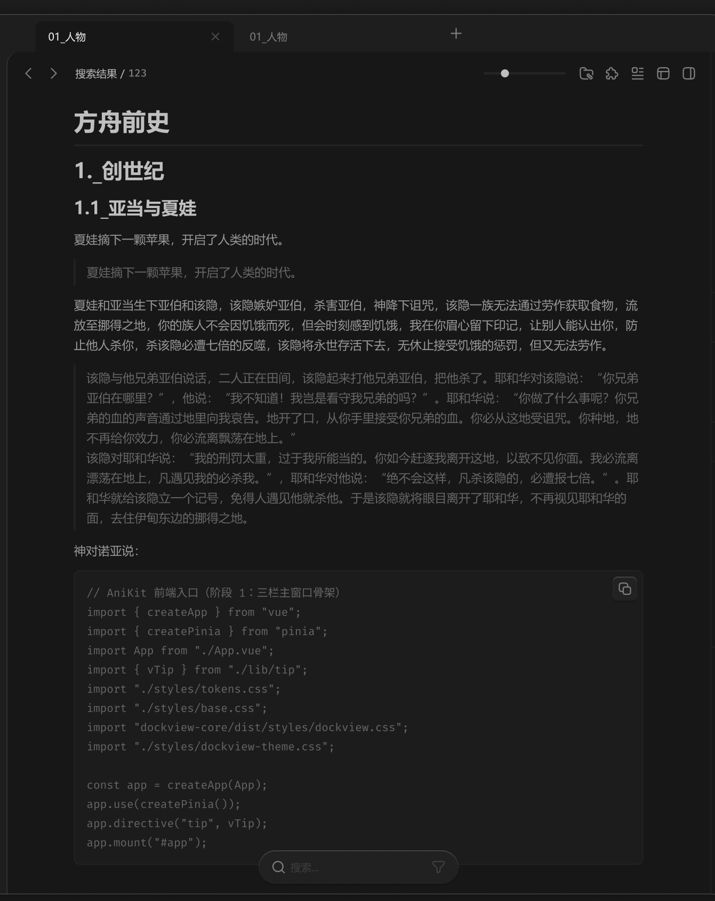

# 中间面板-内容容器-文本编辑



``` css
/* 文本编辑 */

/* Auto layout */
display: flex;
flex-direction: column;
align-items: flex-start;
padding: 12px 12px 0px;
gap: 24px;

width: 880px;
height: 998px;

/* 通用/一级 */
background: #171717;

/* Inside auto layout */
flex: none;
order: 6;
align-self: stretch;
flex-grow: 1;
z-index: 6;


/* 输入框范围 */

/* Auto layout */
display: flex;
flex-direction: column;
align-items: flex-start;
padding: 0px 72px;
gap: 12px;

width: 856px;
height: 986px;


/* Inside auto layout */
flex: none;
order: 0;
align-self: stretch;
flex-grow: 1;


/* 方舟前史 */

width: 712px;
height: 40px;

/* MarkDown/H1 */
font-family: 'Microsoft YaHei';
font-style: normal;
font-weight: 700;
font-size: 30px;
line-height: 40px;
/* identical to box height, or 133% */

/* MarkDown/标题 */
color: #BFBFBF;


/* Inside auto layout */
flex: none;
order: 0;
align-self: stretch;
flex-grow: 0;


/* Line 7 */

width: 712px;
height: 0px;

/* MarkDown/标题 */
background: #BFBFBF;
/* 通用/三级 */
border: 2px solid #242424;

/* Inside auto layout */
flex: none;
order: 1;
align-self: stretch;
flex-grow: 0;


/* 1._创世纪 */

width: 712px;
height: 36px;

/* MarkDown/H2 */
font-family: 'Microsoft YaHei';
font-style: normal;
font-weight: 700;
font-size: 26px;
line-height: 36px;
/* identical to box height, or 138% */

/* MarkDown/标题 */
color: #BFBFBF;


/* Inside auto layout */
flex: none;
order: 2;
align-self: stretch;
flex-grow: 0;


/* 1.1_亚当与夏娃 */

width: 712px;
height: 32px;

/* MarkDown/H3 */
font-family: 'Microsoft YaHei';
font-style: normal;
font-weight: 700;
font-size: 22px;
line-height: 32px;
/* identical to box height, or 145% */

/* MarkDown/标题 */
color: #BFBFBF;


/* Inside auto layout */
flex: none;
order: 3;
align-self: stretch;
flex-grow: 0;


/* 夏娃摘下一颗苹果，开启了人类的时代。 */

width: 712px;
height: 25px;

/* MarkDown/正文 */
font-family: 'Microsoft YaHei';
font-style: normal;
font-weight: 400;
font-size: 15px;
line-height: 25px;
/* identical to box height, or 167% */

/* MarkDown/正文 */
color: #999999;


/* Inside auto layout */
flex: none;
order: 4;
align-self: stretch;
flex-grow: 0;


/* 引用 */

box-sizing: border-box;

/* Auto layout */
display: flex;
flex-direction: row;
align-items: center;
padding: 4px 0px 4px 16px;
gap: 4px;

width: 712px;
height: 33px;

/* 通用/三级 */
border-left: 2px solid #242424;

/* Inside auto layout */
flex: none;
order: 5;
align-self: stretch;
flex-grow: 0;


/* 夏娃摘下一颗苹果，开启了人类的时代。 */

width: 270px;
height: 25px;

/* MarkDown/正文 */
font-family: 'Microsoft YaHei';
font-style: normal;
font-weight: 400;
font-size: 15px;
line-height: 25px;
/* identical to box height, or 167% */

/* MarkDown/引用 */
color: #666666;


/* Inside auto layout */
flex: none;
order: 0;
flex-grow: 0;


/* 夏娃和亚当生下亚伯和该隐，该隐嫉妒亚伯，杀害亚伯，神降下诅咒，该隐一族无法通过劳作获取食物，流放至挪得之地，你的族人不会因饥饿而死，但会时刻感到饥饿，我在你眉心留下印记，让别人能认出你，防止他人杀你，杀该隐必遭七倍的反噬，该隐将永世存活下去，无休止接受饥饿的惩罚，但又无法劳作。 */

width: 712px;
height: 75px;

/* MarkDown/正文 */
font-family: 'Microsoft YaHei';
font-style: normal;
font-weight: 400;
font-size: 15px;
line-height: 25px;
/* or 167% */

/* MarkDown/正文 */
color: #999999;


/* Inside auto layout */
flex: none;
order: 6;
align-self: stretch;
flex-grow: 0;


/* 引用 */

box-sizing: border-box;

/* Auto layout */
display: flex;
flex-direction: row;
justify-content: center;
align-items: center;
padding: 4px 0px 4px 16px;
gap: 4px;

width: 712px;
height: 208px;

/* 通用/三级 */
border-left: 2px solid #242424;

/* Inside auto layout */
flex: none;
order: 7;
align-self: stretch;
flex-grow: 0;


/* 该隐与他兄弟亚伯说话，二人正在田间，该隐起来打他兄弟亚伯，把他杀了。耶和华对该隐说：“你兄弟亚伯在哪里？”，他说：“我不知道！我岂是看守我兄弟的吗？”。耶和华说：“你做了什么事呢？你兄弟的血的声音通过地里向我哀告。地开了口，从你手里接受你兄弟的血。你必从这地受诅咒。你种地，地不再给你效力，你必流离飘荡在地上。” 该隐对耶和华说：“我的刑罚太重，过于我所能当的。你如今赶逐我离开这地，以致不见你面。我必流离漂荡在地上，凡遇见我的必杀我。”，耶和华对他说：“绝不会这样，凡杀该隐的，必遭报七倍。”。耶和华就给该隐立一个记号，免得人遇见他就杀他。于是该隐就将眼目离开了耶和华，不再视见耶和华的面，去住伊甸东边的挪得之地。 */

width: 696px;
height: 200px;

/* MarkDown/正文 */
font-family: 'Microsoft YaHei';
font-style: normal;
font-weight: 400;
font-size: 15px;
line-height: 25px;
/* or 167% */

/* MarkDown/引用 */
color: #666666;


/* Inside auto layout */
flex: none;
order: 0;
flex-grow: 1;


/* 神对诺亚说： */

width: 712px;
height: 25px;

/* MarkDown/正文 */
font-family: 'Microsoft YaHei';
font-style: normal;
font-weight: 400;
font-size: 15px;
line-height: 25px;
/* identical to box height, or 167% */

/* MarkDown/正文 */
color: #999999;


/* Inside auto layout */
flex: none;
order: 8;
align-self: stretch;
flex-grow: 0;


/* 代码块 */

box-sizing: border-box;

/* Auto layout */
display: flex;
flex-direction: row;
justify-content: center;
align-items: center;
padding: 16px;
gap: 4px;
isolation: isolate;

width: 712px;
height: 368px;

/* 通用/二级 */
background: #1C1C1C;
/* 通用/三级 */
border: 1px solid #242424;
border-radius: 8px;

/* Inside auto layout */
flex: none;
order: 9;
align-self: stretch;
flex-grow: 0;


/* // AniKit 前端入口（阶段 1：三栏主窗口骨架） import { createApp } from "vue"; import { createPinia } from "pinia"; import App from "./App.vue"; import { vTip } from "./lib/tip"; import "./styles/tokens.css"; import "./styles/base.css"; import "dockview-core/dist/styles/dockview.css"; import "./styles/dockview-theme.css"; const app = createApp(App); app.use(createPinia()); app.directive("tip", vTip); app.mount("#app"); */

width: 680px;
height: 336px;

/* MarkDown/代码块 */
font-family: 'Fira Mono';
font-style: normal;
font-weight: 400;
font-size: 14px;
line-height: 24px;
/* or 171% */

/* MarkDown/引用 */
color: #666666;


/* Inside auto layout */
flex: none;
order: 0;
flex-grow: 1;
z-index: 0;


/* 复制提示词-按钮 */

/* Auto layout */
display: flex;
flex-direction: row;
justify-content: center;
align-items: center;
padding: 6px;

position: absolute;
width: 30px;
height: 30px;
left: 674px;
top: 8px;

/* 通用/半透明-2 */
background: rgba(41, 41, 41, 0.5);
/* 立体感-通用 */
box-shadow: 0px 2px 1px rgba(0, 0, 0, 0.2), inset 0px 1px 1px rgba(255, 255, 255, 0.2);
border-radius: 6px;

/* Inside auto layout */
flex: none;
order: 1;
flex-grow: 0;
z-index: 1;


/* 复制-icon */

/* Auto layout */
display: flex;
flex-direction: row;
justify-content: center;
align-items: center;
padding: 0px;

width: 18px;
height: 18px;


/* Inside auto layout */
flex: none;
order: 0;
flex-grow: 0;


/* svg */

width: 14px;
height: 14px;


/* Inside auto layout */
flex: none;
order: 0;
flex-grow: 0;


/* Rectangle 1703 */

position: absolute;
left: 38.33%;
right: 11.11%;
top: 38.33%;
bottom: 11.11%;

/* 亮色/三级 */
border: 1.5px solid #808080;
border-radius: 3px;


/* Rectangle 1704 */

position: absolute;
left: 11.11%;
right: 30.56%;
top: 11.11%;
bottom: 30.56%;

/* 亮色/三级 */
border: 1.5px solid #808080;
```

