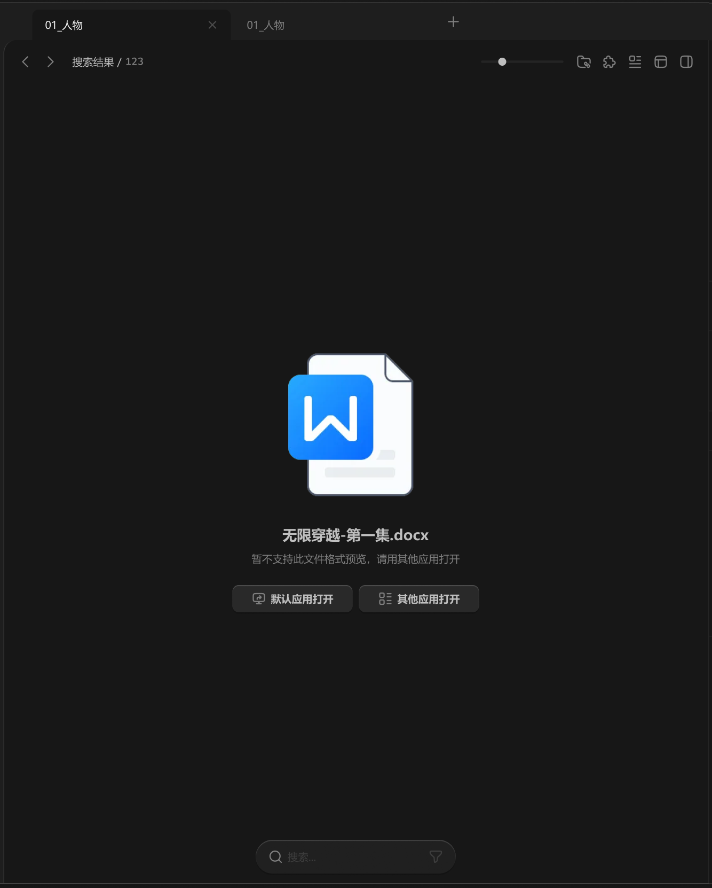

# 中间面板-内容容器-此文件不支持预览



``` css
/* 此文件不支持预览 */

/* Auto layout */
display: flex;
flex-direction: column;
justify-content: center;
align-items: center;
padding: 12px 12px 0px;
gap: 24px;

width: 880px;
height: 998px;

/* 通用/一级 */
background: #171717;

/* Inside auto layout */
flex: none;
order: 3;
align-self: stretch;
flex-grow: 1;
z-index: 3;


/* 图标+提示+按钮 */

/* Auto layout */
display: flex;
flex-direction: column;
align-items: center;
padding: 0px 0px 24px;
gap: 24px;

width: 308px;
height: 358px;


/* Inside auto layout */
flex: none;
order: 0;
flex-grow: 0;


/* shell-icon */

width: 200px;
height: 200px;

background: url(docx.png);

/* Inside auto layout */
flex: none;
order: 0;
flex-grow: 0;


/* 标题+提示文字 */

/* Auto layout */
display: flex;
flex-direction: column;
align-items: center;
padding: 0px;
gap: 8px;

width: 260px;
height: 52px;


/* Inside auto layout */
flex: none;
order: 1;
flex-grow: 0;


/* 无限穿越-第一集.docx */

width: 183px;
height: 26px;

/* 通用/标题 */
font-family: 'Microsoft YaHei UI';
font-style: normal;
font-weight: 700;
font-size: 18px;
line-height: 26px;
/* identical to box height, or 144% */

/* 亮色/二级 */
color: #BFBFBF;


/* Inside auto layout */
flex: none;
order: 0;
flex-grow: 0;


/* 暂不支持此文件格式预览，请用其他应用打开 */

width: 260px;
height: 18px;

/* 通用/正文 */
font-family: 'Microsoft YaHei UI';
font-style: normal;
font-weight: 400;
font-size: 13px;
line-height: 18px;
/* identical to box height, or 138% */

/* 亮色/三级 */
color: #808080;


/* Inside auto layout */
flex: none;
order: 1;
flex-grow: 0;


/* 按钮组 */

/* Auto layout */
display: flex;
flex-direction: row;
align-items: flex-start;
padding: 0px;
gap: 8px;

width: 308px;
height: 34px;


/* Inside auto layout */
flex: none;
order: 2;
flex-grow: 0;


/* 默认应用打开-按钮 */

/* Auto layout */
display: flex;
flex-direction: row;
justify-content: center;
align-items: center;
padding: 8px 24px;
gap: 6px;

width: 150px;
height: 34px;

/* 通用/四级 */
background: #292929;
/* 立体感-通用 */
box-shadow: 0px 2px 1px rgba(0, 0, 0, 0.2), inset 0px 1px 1px rgba(255, 255, 255, 0.2);
border-radius: 8px;

/* Inside auto layout */
flex: none;
order: 0;
flex-grow: 0;


/* 默认应用打开-icon */

/* Auto layout */
display: flex;
flex-direction: row;
justify-content: center;
align-items: center;
padding: 0px;

width: 18px;
height: 18px;


/* Inside auto layout */
flex: none;
order: 0;
flex-grow: 0;


/* svg */

width: 14px;
height: 12.6px;


/* Inside auto layout */
flex: none;
order: 0;
flex-grow: 0;


/* Vector 9606 */

position: absolute;
left: 34.44%;
right: 34.44%;
top: 69.44%;
bottom: 15%;

/* 亮色/三级 */
border: 1.5px solid #808080;


/* Vector 9495 */

position: absolute;
left: 11.11%;
right: 11.11%;
top: 15%;
bottom: 30.56%;

/* 亮色/三级 */
border: 1.5px solid #808080;


/* Vector */

position: absolute;
left: 38.33%;
right: 34.44%;
top: 30.56%;
bottom: 46.11%;

/* 亮色/三级 */
border: 1.5px solid #808080;


/* 默认应用打开 */

width: 78px;
height: 18px;

/* 通用/正文-加粗 */
font-family: 'Microsoft YaHei UI';
font-style: normal;
font-weight: 700;
font-size: 13px;
line-height: 18px;
/* identical to box height, or 138% */
display: flex;
align-items: center;

/* 亮色/二级 */
color: #BFBFBF;


/* Inside auto layout */
flex: none;
order: 1;
flex-grow: 0;


/* 其他应用打开-按钮 */

/* Auto layout */
display: flex;
flex-direction: row;
justify-content: center;
align-items: center;
padding: 8px 24px;
gap: 6px;

width: 150px;
height: 34px;

/* 通用/四级 */
background: #292929;
/* 立体感-通用 */
box-shadow: 0px 2px 1px rgba(0, 0, 0, 0.2), inset 0px 1px 1px rgba(255, 255, 255, 0.2);
border-radius: 8px;

/* Inside auto layout */
flex: none;
order: 1;
flex-grow: 0;


/* 其他应用打开-icon */

/* Auto layout */
display: flex;
flex-direction: row;
justify-content: center;
align-items: center;
padding: 0px;

width: 18px;
height: 18px;


/* Inside auto layout */
flex: none;
order: 0;
flex-grow: 0;


/* svg */

width: 14px;
height: 14px;


/* Inside auto layout */
flex: none;
order: 0;
flex-grow: 0;


/* Vector */

position: absolute;
left: 11.11%;
right: 58.64%;
top: 11.11%;
bottom: 58.64%;

/* 亮色/三级 */
border: 1.5px solid #808080;


/* Vector */

position: absolute;
left: 11.11%;
right: 58.64%;
top: 58.64%;
bottom: 11.11%;

/* 亮色/三级 */
border: 1.5px solid #808080;


/* Vector */

position: absolute;
left: 62.96%;
right: 11.11%;
top: 15.43%;
bottom: 84.57%;

/* 亮色/三级 */
border: 1.5px solid #808080;


/* Vector */

position: absolute;
left: 62.96%;
right: 11.11%;
top: 62.96%;
bottom: 37.04%;

/* 亮色/三级 */
border: 1.5px solid #808080;


/* Vector */

position: absolute;
left: 62.96%;
right: 11.11%;
top: 37.04%;
bottom: 62.96%;

/* 亮色/三级 */
border: 1.5px solid #808080;


/* Vector */

position: absolute;
left: 62.96%;
right: 11.11%;
top: 84.57%;
bottom: 15.43%;

/* 亮色/三级 */
border: 1.5px solid #808080;


/* 其他应用打开 */

width: 78px;
height: 18px;

/* 通用/正文-加粗 */
font-family: 'Microsoft YaHei UI';
font-style: normal;
font-weight: 700;
font-size: 13px;
line-height: 18px;
/* identical to box height, or 138% */
display: flex;
align-items: center;

/* 亮色/二级 */
color: #BFBFBF;


/* Inside auto layout */
flex: none;
order: 1;
flex-grow: 0;
```

