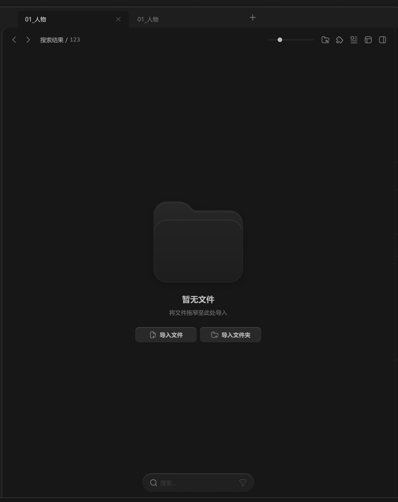

# 中间面板-内容容器-空文件夹



``` css
/* 空文件夹 */

/* Auto layout */
display: flex;
flex-direction: column;
justify-content: center;
align-items: center;
padding: 12px 12px 0px;
gap: 24px;

width: 880px;
height: 998px;

/* 通用/一级 */
background: #171717;

/* Inside auto layout */
flex: none;
order: 4;
align-self: stretch;
flex-grow: 1;
z-index: 4;


/* 图标+提示+按钮 */

/* Auto layout */
display: flex;
flex-direction: column;
align-items: center;
padding: 0px 0px 24px;
gap: 24px;

width: 282px;
height: 339.4px;


/* Inside auto layout */
flex: none;
order: 0;
flex-grow: 0;


/* 空文件夹-icon */

width: 200px;
height: 181.4px;

opacity: 0.6;
/* 小阴影 */
filter: drop-shadow(0px 4px 20px rgba(0, 0, 0, 0.4));

/* Inside auto layout */
flex: none;
order: 0;
flex-grow: 0;


/* Vector */

box-sizing: border-box;

position: absolute;
left: 14.54%;
right: 14.54%;
top: 0%;
bottom: 46.55%;

/* 通用/渐变-1 */
background: linear-gradient(180deg, #333333 0%, #1C1C1C 100%);
/* 亮色/半透明-3 */
border: 1px solid rgba(242, 242, 242, 0.06);
box-shadow: inset 0px 4px 2px rgba(255, 255, 255, 0.05);


/* Vector */

box-sizing: border-box;

position: absolute;
left: 14.54%;
right: 14.54%;
top: 11.88%;
bottom: 46.55%;

/* 通用/半透明-2 */
background: rgba(41, 41, 41, 0.5);
/* 亮色/半透明-3 */
border: 1px solid rgba(242, 242, 242, 0.06);
box-shadow: inset 0px 2px 1px rgba(255, 255, 255, 0.1);


/* 标题+提示文字 */

/* Auto layout */
display: flex;
flex-direction: column;
align-items: center;
padding: 0px;
gap: 8px;

width: 130px;
height: 52px;


/* Inside auto layout */
flex: none;
order: 1;
flex-grow: 0;


/* 暂无文件 */

width: 72px;
height: 26px;

/* 通用/标题 */
font-family: 'Microsoft YaHei UI';
font-style: normal;
font-weight: 700;
font-size: 18px;
line-height: 26px;
/* identical to box height, or 144% */

/* 亮色/二级 */
color: #BFBFBF;


/* Inside auto layout */
flex: none;
order: 0;
flex-grow: 0;


/* 将文件拖窄至此处导入 */

width: 130px;
height: 18px;

/* 通用/正文 */
font-family: 'Microsoft YaHei UI';
font-style: normal;
font-weight: 400;
font-size: 13px;
line-height: 18px;
/* identical to box height, or 138% */

/* 亮色/三级 */
color: #808080;


/* Inside auto layout */
flex: none;
order: 1;
flex-grow: 0;


/* 按钮组 */

/* Auto layout */
display: flex;
flex-direction: row;
align-items: flex-start;
padding: 0px;
gap: 8px;

width: 282px;
height: 34px;


/* Inside auto layout */
flex: none;
order: 2;
flex-grow: 0;


/* 导入文件-按钮 */

/* Auto layout */
display: flex;
flex-direction: row;
justify-content: center;
align-items: center;
padding: 8px 24px;
gap: 6px;

width: 137px;
height: 34px;

/* 通用/四级 */
background: #292929;
/* 立体感-通用 */
box-shadow: 0px 2px 1px rgba(0, 0, 0, 0.2), inset 0px 1px 1px rgba(255, 255, 255, 0.2);
border-radius: 8px;

/* Inside auto layout */
flex: none;
order: 0;
flex-grow: 0;


/* 导入文件-icon */

/* Auto layout */
display: flex;
flex-direction: row;
justify-content: center;
align-items: center;
padding: 0px;

width: 18px;
height: 18px;


/* Inside auto layout */
flex: none;
order: 0;
flex-grow: 0;


/* svg */

width: 11.2px;
height: 14px;


/* Inside auto layout */
flex: none;
order: 0;
flex-grow: 0;


/* Vector */

position: absolute;
left: 18.89%;
right: 18.89%;
top: 11.11%;
bottom: 11.11%;

/* 亮色/三级 */
border: 1.5px solid #808080;


/* Vector */

position: absolute;
left: 50%;
right: 18.89%;
top: 65.56%;
bottom: 11.11%;

/* 亮色/三级 */
border: 1.5px solid #808080;


/* 导入文件 */

width: 52px;
height: 18px;

/* 通用/正文-加粗 */
font-family: 'Microsoft YaHei UI';
font-style: normal;
font-weight: 700;
font-size: 13px;
line-height: 18px;
/* identical to box height, or 138% */
display: flex;
align-items: center;

/* 亮色/二级 */
color: #BFBFBF;


/* Inside auto layout */
flex: none;
order: 1;
flex-grow: 0;


/* 导入文件夹-按钮 */

/* Auto layout */
display: flex;
flex-direction: row;
justify-content: center;
align-items: center;
padding: 8px 24px;
gap: 6px;

width: 137px;
height: 34px;

/* 通用/四级 */
background: #292929;
/* 立体感-通用 */
box-shadow: 0px 2px 1px rgba(0, 0, 0, 0.2), inset 0px 1px 1px rgba(255, 255, 255, 0.2);
border-radius: 8px;

/* Inside auto layout */
flex: none;
order: 1;
flex-grow: 0;


/* 导入文件夹-icon */

/* Auto layout */
display: flex;
flex-direction: row;
justify-content: center;
align-items: center;
padding: 0px;

width: 18px;
height: 18px;


/* Inside auto layout */
flex: none;
order: 0;
flex-grow: 0;


/* svg */

width: 14px;
height: 12.6px;


/* Inside auto layout */
flex: none;
order: 0;
flex-grow: 0;


/* Vector */

position: absolute;
left: 57.78%;
right: 11.11%;
top: 61.67%;
bottom: 15%;

/* 亮色/三级 */
border: 1.5px solid #808080;


/* Vector */

position: absolute;
left: 11.11%;
right: 11.11%;
top: 15%;
bottom: 15%;

/* 亮色/三级 */
border: 1.5px solid #808080;


/* 导入文件夹 */

width: 65px;
height: 18px;

/* 通用/正文-加粗 */
font-family: 'Microsoft YaHei UI';
font-style: normal;
font-weight: 700;
font-size: 13px;
line-height: 18px;
/* identical to box height, or 138% */
display: flex;
align-items: center;

/* 亮色/二级 */
color: #BFBFBF;


/* Inside auto layout */
flex: none;
order: 1;
flex-grow: 0;
```

