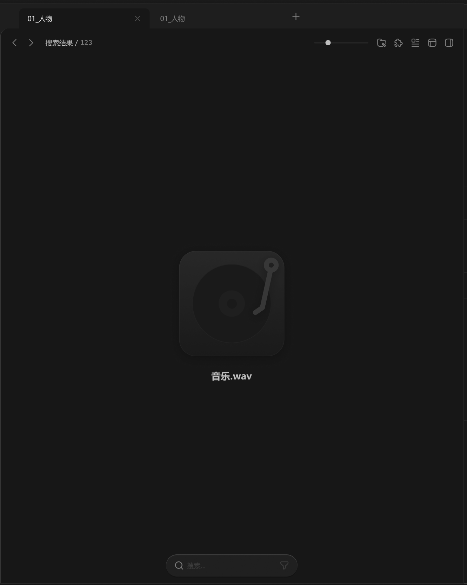

# 中间面板-内容容器-音乐预览



只在播放条上放波形图即可，预览界面无需波形图。

``` css
/* 音乐预览 */

/* Auto layout */
display: flex;
flex-direction: column;
justify-content: center;
align-items: center;
padding: 12px 12px 0px;
gap: 24px;

width: 880px;
height: 998px;

/* 通用/一级 */
background: #171717;

/* Inside auto layout */
flex: none;
order: 2;
align-self: stretch;
flex-grow: 1;
z-index: 2;


/* 图标+提示 */

/* Auto layout */
display: flex;
flex-direction: column;
align-items: center;
padding: 0px 0px 24px;
gap: 24px;

width: 200px;
height: 274px;


/* Inside auto layout */
flex: none;
order: 0;
flex-grow: 0;


/* 唱片-icon */

width: 200px;
height: 200px;

opacity: 0.6;
/* 小阴影 */
filter: drop-shadow(0px 4px 20px rgba(0, 0, 0, 0.4));

/* Inside auto layout */
flex: none;
order: 0;
flex-grow: 0;


/* 底色 */

box-sizing: border-box;

position: absolute;
width: 200px;
height: 200px;
left: 0px;
top: 0px;

/* 通用/渐变-1 */
background: linear-gradient(180deg, #333333 0%, #1C1C1C 100%);
/* 亮色/半透明-3 */
border: 1px solid rgba(242, 242, 242, 0.06);
border-radius: 32px;


/* 转盘 */

position: absolute;
width: 150px;
height: 150px;
left: 25px;
top: 25px;


/* Vector */

box-sizing: border-box;

position: absolute;
width: 150px;
height: 150px;
left: calc(50% - 150px/2);
top: calc(50% - 150px/2 - 37px);

/* 通用/二级 */
background: #1C1C1C;
/* 亮色/半透明-3 */
border: 1px solid rgba(242, 242, 242, 0.06);


/* Vector */

position: absolute;
width: 50px;
height: 50px;
left: calc(50% - 50px/2 + 0px);
top: calc(50% - 50px/2 - 37px);

/* 通用/三级 */
background: #242424;


/* Vector */

position: absolute;
width: 18.75px;
height: 18.75px;
left: calc(50% - 18.75px/2 + 0.38px);
top: calc(50% - 18.75px/2 - 36.62px);

/* 通用/二级 */
background: #1C1C1C;


/* 指针 */

position: absolute;
width: 48.92px;
height: 108.59px;
left: 140.2px;
top: 13px;

filter: drop-shadow(0px 4px 20px rgba(0, 0, 0, 0.4));


/* Vector */

position: absolute;
left: 80.5%;
right: 5.44%;
top: 4.74%;
bottom: 84.99%;

/* 亮色/四级 */
background: #4D4D4D;


/* Vector */

position: absolute;
left: 70.1%;
right: 10.8%;
top: 11.77%;
bottom: 55.63%;

/* 亮色/四级 */
background: #4D4D4D;


/* 音乐.wav */

width: 78px;
height: 26px;

/* 通用/标题 */
font-family: 'Microsoft YaHei UI';
font-style: normal;
font-weight: 700;
font-size: 18px;
line-height: 26px;
/* identical to box height, or 144% */

/* 亮色/二级 */
color: #BFBFBF;


/* Inside auto layout */
flex: none;
order: 1;
flex-grow: 0;
```