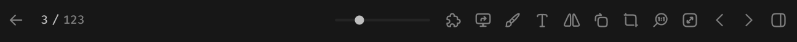

# 中间面板-内容容器-预览工具栏



> 根据上下文，选择保留的按钮

``` css
/* 预览工具栏 */

/* Auto layout */
display: flex;
flex-direction: row;
justify-content: space-between;
align-items: center;
padding: 12px;
gap: 10px;

width: 880px;
height: 54px;

/* 通用/一级 */
background: #171717;
border-radius: 0px;

/* Inside auto layout */
flex: none;
order: 1;
align-self: stretch;
flex-grow: 0;
z-index: 1;


/* 面包屑导航 */

/* Auto layout */
display: flex;
flex-direction: row;
align-items: center;
padding: 0px;
gap: 12px;

width: 90px;
height: 30px;


/* Inside auto layout */
flex: none;
order: 0;
flex-grow: 0;


/* 返回-按钮 */

/* Auto layout */
display: flex;
flex-direction: row;
align-items: center;
padding: 6px;

width: 30px;
height: 30px;

border-radius: 6px;

/* Inside auto layout */
flex: none;
order: 0;
flex-grow: 0;


/* 箭头-大-icon */

/* Auto layout */
display: flex;
flex-direction: row;
justify-content: center;
align-items: center;
padding: 0px;

width: 18px;
height: 18px;

transform: rotate(-90deg);

/* Inside auto layout */
flex: none;
order: 0;
flex-grow: 0;


/* svg */

width: 10.29px;
height: 12px;

transform: matrix(0, -1, -1, 0, 0, 0);

/* Inside auto layout */
flex: none;
order: 0;
flex-grow: 0;


/* Vector */

position: absolute;
left: 19.05%;
right: 80.95%;
top: 50%;
bottom: -14.29%;

/* 亮色/三级 */
border: 1.5px solid #808080;
transform: rotate(-90deg);


/* Vector */

position: absolute;
left: 16.67%;
right: 26.19%;
top: 21.43%;
bottom: 50%;

/* 亮色/三级 */
border: 1.5px solid #808080;
transform: rotate(-90deg);


/* 搜索结果 */

/* Auto layout */
display: flex;
flex-direction: row;
align-items: center;
padding: 0px;
gap: 4px;

width: 48px;
height: 18px;


/* Inside auto layout */
flex: none;
order: 1;
flex-grow: 0;


/* 3 */

width: 8px;
height: 18px;

/* 通用/数字-大 */
font-family: 'Fira Mono';
font-style: normal;
font-weight: 500;
font-size: 13px;
line-height: 18px;
/* identical to box height, or 138% */

/* 亮色/二级 */
color: #BFBFBF;


/* Inside auto layout */
flex: none;
order: 0;
flex-grow: 0;


/* / */

width: 8px;
height: 18px;

/* 通用/数字-大 */
font-family: 'Fira Mono';
font-style: normal;
font-weight: 500;
font-size: 13px;
line-height: 18px;
/* identical to box height, or 138% */

/* 亮色/二级 */
color: #BFBFBF;


/* Inside auto layout */
flex: none;
order: 1;
flex-grow: 0;


/* 123 */

width: 24px;
height: 18px;

/* 通用/数字-大 */
font-family: 'Fira Mono';
font-style: normal;
font-weight: 500;
font-size: 13px;
line-height: 18px;
/* identical to box height, or 138% */

/* 亮色/三级 */
color: #808080;


/* Inside auto layout */
flex: none;
order: 2;
flex-grow: 0;


/* 尺寸滑块+按钮组 */

/* Auto layout */
display: flex;
flex-direction: row;
justify-content: flex-end;
align-items: center;
padding: 0px;
gap: 12px;

width: 494px;
height: 30px;


/* Inside auto layout */
flex: none;
order: 1;
flex-grow: 0;


/* 尺寸滑块 */

width: 100px;
height: 10px;


/* Inside auto layout */
flex: none;
order: 0;
flex-grow: 0;


/* 滑轨 */

position: absolute;
width: 100px;
height: 0px;
left: 0px;
top: 15px;

/* 通用/三级 */
border: 3px solid #242424;


/* 圆形按钮 */

position: absolute;
width: 10px;
height: 10px;
left: 20px;
top: 10px;

/* 亮色/二级 */
background: #BFBFBF;


/* 按钮组 */

/* Auto layout */
display: flex;
flex-direction: row;
align-items: center;
padding: 0px;
gap: 2px;

width: 382px;
height: 30px;


/* Inside auto layout */
flex: none;
order: 1;
flex-grow: 0;


/* 插件-按钮 */

/* Auto layout */
display: flex;
flex-direction: row;
justify-content: center;
align-items: center;
padding: 6px;

width: 30px;
height: 30px;

border-radius: 6px;
transform: matrix(-1, 0, 0, 1, 0, 0);

/* Inside auto layout */
flex: none;
order: 0;
flex-grow: 0;


/* 插件-icon */

/* Auto layout */
display: flex;
flex-direction: column;
justify-content: center;
align-items: center;
padding: 0px;

width: 18px;
height: 18px;


/* Inside auto layout */
flex: none;
order: 0;
flex-grow: 0;


/* svg */

width: 14px;
height: 14px;


/* Inside auto layout */
flex: none;
order: 0;
flex-grow: 0;


/* Vector */

position: absolute;
left: 11.11%;
right: 11.11%;
top: 11.11%;
bottom: 11.11%;

/* 亮色/三级 */
border: 1.5px solid #808080;


/* 默认应用打开-按钮 */

/* Auto layout */
display: flex;
flex-direction: row;
justify-content: center;
align-items: center;
padding: 6px;

width: 30px;
height: 30px;

border-radius: 6px;
transform: matrix(-1, 0, 0, 1, 0, 0);

/* Inside auto layout */
flex: none;
order: 1;
flex-grow: 0;


/* 默认应用打开-icon */

/* Auto layout */
display: flex;
flex-direction: row;
justify-content: center;
align-items: center;
padding: 0px;

width: 18px;
height: 18px;


/* Inside auto layout */
flex: none;
order: 0;
flex-grow: 0;


/* svg */

width: 15px;
height: 13.5px;


/* Inside auto layout */
flex: none;
order: 0;
flex-grow: 0;


/* Vector 9606 */

position: absolute;
left: 33.33%;
right: 33.33%;
top: 70.83%;
bottom: 12.5%;

/* 亮色/三级 */
border: 1.5px solid #808080;


/* Vector 9495 */

position: absolute;
left: 8.33%;
right: 8.33%;
top: 12.5%;
bottom: 29.17%;

/* 亮色/三级 */
border: 1.5px solid #808080;


/* Vector */

position: absolute;
left: 37.5%;
right: 33.33%;
top: 29.17%;
bottom: 45.83%;

/* 亮色/三级 */
border: 1.5px solid #808080;


/* 自由绘制-按钮 */

/* Auto layout */
display: flex;
flex-direction: row;
justify-content: center;
align-items: center;
padding: 6px;

width: 30px;
height: 30px;

border-radius: 6px;
transform: matrix(-1, 0, 0, 1, 0, 0);

/* Inside auto layout */
flex: none;
order: 2;
flex-grow: 0;


/* 画笔-icon */

/* Auto layout */
display: flex;
flex-direction: column;
justify-content: center;
align-items: center;
padding: 0px;

width: 18px;
height: 18px;

transform: matrix(-1, 0, 0, 1, 0, 0);

/* Inside auto layout */
flex: none;
order: 0;
flex-grow: 0;


/* Vector */

width: 14px;
height: 14px;

/* 亮色/三级 */
border: 1.5px solid #808080;

/* Inside auto layout */
flex: none;
order: 0;
flex-grow: 0;


/* 输入文本-按钮 */

/* Auto layout */
display: flex;
flex-direction: row;
justify-content: center;
align-items: center;
padding: 6px;

width: 30px;
height: 30px;

border-radius: 6px;
transform: matrix(-1, 0, 0, 1, 0, 0);

/* Inside auto layout */
flex: none;
order: 3;
flex-grow: 0;


/* text.icon */

/* Auto layout */
display: flex;
flex-direction: column;
align-items: center;
padding: 3px 5px;

width: 18px;
height: 18px;


/* Inside auto layout */
flex: none;
order: 0;
flex-grow: 0;


/* svg */

width: 10.11px;
height: 13px;


/* Inside auto layout */
flex: none;
order: 0;
flex-grow: 0;


/* Vector */

position: absolute;
width: 10.11px;
height: 13px;
left: 3.94px;
top: 3px;

/* 亮色/三级 */
border: 1.5px solid #808080;


/* Vector */

position: absolute;
width: 4.33px;
height: 0px;
left: 6.83px;
top: 16px;

/* 亮色/三级 */
border: 1.5px solid #808080;


/* 水平翻转-按钮 */

/* Auto layout */
display: flex;
flex-direction: row;
justify-content: center;
align-items: center;
padding: 6px;

width: 30px;
height: 30px;

border-radius: 6px;
transform: matrix(-1, 0, 0, 1, 0, 0);

/* Inside auto layout */
flex: none;
order: 4;
flex-grow: 0;


/* 水平翻转-icon */

/* Auto layout */
display: flex;
flex-direction: row;
justify-content: center;
align-items: center;
padding: 0px;
gap: 3px;

width: 18px;
height: 18px;


/* Inside auto layout */
flex: none;
order: 0;
flex-grow: 0;


/* svg */

width: 16px;
height: 13px;


/* Inside auto layout */
flex: none;
order: 0;
flex-grow: 0;


/* Union */

position: absolute;
width: 6.72px;
height: 13px;
left: 1px;
top: 2.5px;

/* 亮色/三级 */
border: 1.5px solid #808080;


/* Union */

position: absolute;
width: 6.72px;
height: 13px;
left: 10.28px;
top: 2.5px;

/* 亮色/三级 */
border: 1.5px solid #808080;


/* 顺时针旋转-按钮 */

/* Auto layout */
display: flex;
flex-direction: row;
justify-content: center;
align-items: center;
padding: 6px;

width: 30px;
height: 30px;

border-radius: 6px;
transform: matrix(-1, 0, 0, 1, 0, 0);

/* Inside auto layout */
flex: none;
order: 5;
flex-grow: 0;


/* 顺时针旋转-icon */

/* Auto layout */
display: flex;
flex-direction: row;
justify-content: center;
align-items: center;
padding: 0px;
gap: 3px;

width: 18px;
height: 18px;


/* Inside auto layout */
flex: none;
order: 0;
flex-grow: 0;


/* svg */

width: 12.6px;
height: 14px;


/* Inside auto layout */
flex: none;
order: 0;
flex-grow: 0;


/* Rectangle 1876 */

position: absolute;
left: 30.56%;
right: 15%;
top: 34.44%;
bottom: 11.11%;

/* 亮色/三级 */
border: 1.5px solid #808080;


/* Vector */

position: absolute;
left: 15%;
right: 50%;
top: 11.11%;
bottom: 46.11%;

/* 亮色/三级 */
border: 1.5px solid #808080;


/* 裁剪图片-按钮 */

/* Auto layout */
display: flex;
flex-direction: row;
justify-content: center;
align-items: center;
padding: 6px;

width: 30px;
height: 30px;

border-radius: 6px;
transform: matrix(-1, 0, 0, 1, 0, 0);

/* Inside auto layout */
flex: none;
order: 6;
flex-grow: 0;


/* 裁剪图片-icon */

/* Auto layout */
display: flex;
flex-direction: row;
justify-content: center;
align-items: center;
padding: 0px;
gap: 3px;

width: 18px;
height: 18px;


/* Inside auto layout */
flex: none;
order: 0;
flex-grow: 0;


/* svg */

width: 14px;
height: 14px;


/* Inside auto layout */
flex: none;
order: 0;
flex-grow: 0;


/* Vector 4472 */

position: absolute;
left: 18.89%;
right: 11.11%;
top: 11.11%;
bottom: 18.89%;

/* 亮色/三级 */
border: 1.5px solid #808080;


/* Vector 4473 */

position: absolute;
left: 11.11%;
right: 18.89%;
top: 18.89%;
bottom: 11.11%;

/* 亮色/三级 */
border: 1.5px solid #808080;
border-radius: 4px;


/* 原图大小-按钮 */

/* Auto layout */
display: flex;
flex-direction: row;
justify-content: center;
align-items: center;
padding: 6px;

width: 30px;
height: 30px;

border-radius: 6px;
transform: matrix(-1, 0, 0, 1, 0, 0);

/* Inside auto layout */
flex: none;
order: 7;
flex-grow: 0;


/* 原图大小-icon */

/* Auto layout */
display: flex;
flex-direction: row;
justify-content: center;
align-items: center;
padding: 0px;
gap: 3px;

width: 18px;
height: 18px;


/* Inside auto layout */
flex: none;
order: 0;
flex-grow: 0;


/* svg */

width: 14px;
height: 14px;


/* Inside auto layout */
flex: none;
order: 0;
flex-grow: 0;


/* Ellipse 1119 */

position: absolute;
left: 22.78%;
right: 11.11%;
top: 11.11%;
bottom: 22.78%;

/* 亮色/三级 */
border: 1.5px solid #808080;


/* Vector 9619 */

position: absolute;
left: 11.11%;
right: 69.44%;
top: 69.44%;
bottom: 11.11%;

/* 亮色/三级 */
border: 1.5px solid #808080;


/* Vector 9620 */

position: absolute;
left: 38.33%;
right: 57.78%;
top: 34.44%;
bottom: 46.11%;

/* 亮色/三级 */
border: 1.5px solid #808080;


/* Vector 9621 */

position: absolute;
left: 67.5%;
right: 28.61%;
top: 34.44%;
bottom: 46.11%;

/* 亮色/三级 */
border: 1.5px solid #808080;


/* Vector */

position: absolute;
left: 55.83%;
right: 44.17%;
top: 38.33%;
bottom: 49.96%;

/* 亮色/三级 */
border: 1.5px solid #808080;


/* 适合屏幕-按钮 */

/* Auto layout */
display: flex;
flex-direction: row;
justify-content: center;
align-items: center;
padding: 6px;

width: 30px;
height: 30px;

border-radius: 6px;
transform: matrix(-1, 0, 0, 1, 0, 0);

/* Inside auto layout */
flex: none;
order: 8;
flex-grow: 0;


/* 适合屏幕-icon */

/* Auto layout */
display: flex;
flex-direction: row;
justify-content: center;
align-items: center;
padding: 0px;
gap: 3px;

width: 18px;
height: 18px;


/* Inside auto layout */
flex: none;
order: 0;
flex-grow: 0;


/* svg */

width: 14px;
height: 14px;


/* Inside auto layout */
flex: none;
order: 0;
flex-grow: 0;


/* Vector */

position: absolute;
left: 33.63%;
right: 33.63%;
top: 33.63%;
bottom: 33.63%;

/* 亮色/三级 */
border: 1.5px solid #808080;


/* Rectangle 2058 */

position: absolute;
left: 11.11%;
right: 11.11%;
top: 11.11%;
bottom: 11.11%;

/* 亮色/三级 */
border: 1.5px solid #808080;
border-radius: 18px;


/* 上一个文件-按钮 */

/* Auto layout */
display: flex;
flex-direction: row;
justify-content: center;
align-items: center;
padding: 6px;

width: 30px;
height: 30px;

border-radius: 6px;
transform: matrix(-1, 0, 0, 1, 0, 0);

/* Inside auto layout */
flex: none;
order: 9;
flex-grow: 0;


/* 尖括号-icon */

/* Auto layout */
display: flex;
flex-direction: row;
justify-content: center;
align-items: center;
padding: 0px;

width: 18px;
height: 18px;


/* Inside auto layout */
flex: none;
order: 0;
flex-grow: 0;


/* svg */

width: 6px;
height: 12px;


/* Inside auto layout */
flex: none;
order: 0;
flex-grow: 0;


/* Vector */

position: absolute;
left: 33.33%;
right: 33.33%;
top: 16.67%;
bottom: 16.67%;

/* 亮色/三级 */
border: 1.5px solid #808080;


/* 下一个文件-按钮 */

/* Auto layout */
display: flex;
flex-direction: row;
justify-content: center;
align-items: center;
padding: 6px;

width: 30px;
height: 30px;

border-radius: 6px;

/* Inside auto layout */
flex: none;
order: 10;
flex-grow: 0;


/* 尖括号-icon */

/* Auto layout */
display: flex;
flex-direction: row;
justify-content: center;
align-items: center;
padding: 0px;

width: 18px;
height: 18px;

transform: matrix(-1, 0, 0, 1, 0, 0);

/* Inside auto layout */
flex: none;
order: 0;
flex-grow: 0;


/* svg */

width: 6px;
height: 12px;

transform: matrix(-1, 0, 0, 1, 0, 0);

/* Inside auto layout */
flex: none;
order: 0;
flex-grow: 0;


/* Vector */

position: absolute;
left: 33.33%;
right: 33.33%;
top: 16.67%;
bottom: 16.67%;

/* 亮色/三级 */
border: 1.5px solid #808080;
transform: matrix(-1, 0, 0, 1, 0, 0);


/* 展开详细信息-按钮 */

/* Auto layout */
display: flex;
flex-direction: row;
justify-content: center;
align-items: center;
padding: 6px;

width: 30px;
height: 30px;

border-radius: 6px;
transform: matrix(-1, 0, 0, 1, 0, 0);

/* Inside auto layout */
flex: none;
order: 11;
flex-grow: 0;


/* 展开详细信息-icon */

/* Auto layout */
display: flex;
flex-direction: row;
justify-content: center;
align-items: center;
padding: 0px;

width: 18px;
height: 18px;

transform: matrix(-1, 0, 0, 1, 0, 0);

/* Inside auto layout */
flex: none;
order: 0;
flex-grow: 0;


/* svg */

width: 14px;
height: 14px;

transform: matrix(-1, 0, 0, 1, 0, 0);

/* Inside auto layout */
flex: none;
order: 0;
flex-grow: 0;


/* Vector 4065 */

position: absolute;
left: 11.11%;
right: 11.11%;
top: 11.11%;
bottom: 11.11%;

/* 亮色/三级 */
border: 1.5px solid #808080;
transform: matrix(1, 0, 0, -1, 0, 0);


/* Vector 4066 */

position: absolute;
left: 62.28%;
right: 37.72%;
top: 11.11%;
bottom: 11.11%;

/* 亮色/三级 */
border: 1.5px solid #808080;
border-radius: 5px;
transform: matrix(1, 0, 0, -1, 0, 0);
```

