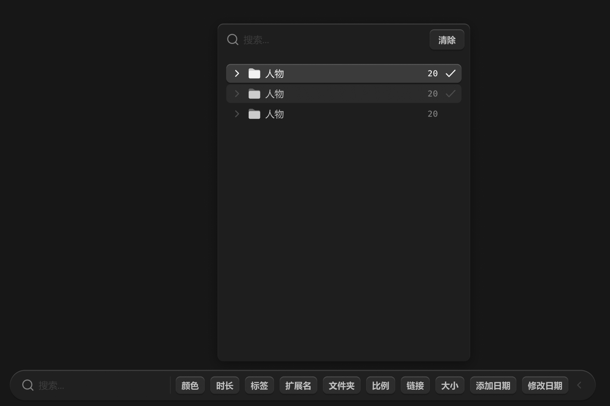

# 筛选-文件夹



所有类型的筛选弹窗与悬浮栏保持 12px 间距。

可以多选文件夹，清除按钮不是清空输入，而是清空所有文件夹的选中。

列表太长的时候加滚轮。

``` css
/* 筛选-文件夹 */

/* Auto layout */
display: flex;
flex-direction: column;
justify-content: center;
align-items: flex-start;
padding: 0px;

position: absolute;
width: 350px;
height: 468px;
left: 323px;
top: 518px;

/* 通用/半透明-1 */
background: rgba(31, 31, 31, 0.93);
/* 立体感-模糊-大阴影 */
box-shadow: 0px 4px 20px rgba(0, 0, 0, 0.4), inset 0px 1px 1px rgba(255, 255, 255, 0.2);
backdrop-filter: blur(40px);
/* Note: backdrop-filter has minimal browser support */
border-radius: 8px;


/* 搜索框+清除按钮 */

/* Auto layout */
display: flex;
flex-direction: row;
align-items: center;
padding: 8px 8px 8px 12px;
gap: 8px;

width: 350px;
height: 44px;


/* Inside auto layout */
flex: none;
order: 0;
align-self: stretch;
flex-grow: 0;


/* 搜索框 */

/* Auto layout */
display: flex;
flex-direction: row;
align-items: center;
padding: 0px;
gap: 6px;

width: 274px;
height: 28px;


/* Inside auto layout */
flex: none;
order: 0;
flex-grow: 1;


/* 搜索-icon */

/* Auto layout */
display: flex;
flex-direction: row;
justify-content: center;
align-items: center;
padding: 0px;

width: 18px;
height: 18px;


/* Inside auto layout */
flex: none;
order: 0;
flex-grow: 0;


/* svg */

width: 14px;
height: 14px;

transform: matrix(1, 0, 0, -1, 0, 0);

/* Inside auto layout */
flex: none;
order: 0;
flex-grow: 0;


/* Vector */

position: absolute;
left: 71.61%;
right: 11.11%;
top: 71.61%;
bottom: 11.11%;

/* 亮色/三级 */
border: 1.5px solid #808080;


/* Vector */

position: absolute;
left: 11.11%;
right: 19.75%;
top: 11.11%;
bottom: 19.75%;

/* 亮色/三级 */
border: 1.5px solid #808080;


/* 搜索... */

width: 36px;
height: 18px;

/* 通用/正文 */
font-family: 'Microsoft YaHei UI';
font-style: normal;
font-weight: 400;
font-size: 13px;
line-height: 18px;
/* identical to box height, or 138% */

/* 亮色/半透明-2 */
color: rgba(242, 242, 242, 0.14);


/* Inside auto layout */
flex: none;
order: 1;
flex-grow: 0;


/* 清除-按钮 */

/* Auto layout */
display: flex;
flex-direction: row;
justify-content: center;
align-items: center;
padding: 6px 12px;

width: 48px;
height: 28px;

/* 通用/四级 */
background: #292929;
/* 立体感-通用 */
box-shadow: 0px 2px 1px rgba(0, 0, 0, 0.2), inset 0px 1px 1px rgba(255, 255, 255, 0.2);
border-radius: 6px;

/* Inside auto layout */
flex: none;
order: 1;
flex-grow: 0;


/* 清除 */

width: 24px;
height: 16px;

/* 通用/次要文字-加粗 */
font-family: 'Microsoft YaHei UI';
font-style: normal;
font-weight: 700;
font-size: 12px;
line-height: 16px;
/* identical to box height, or 133% */
display: flex;
align-items: center;

/* 亮色/二级 */
color: #BFBFBF;


/* Inside auto layout */
flex: none;
order: 0;
flex-grow: 0;


/* 树形容器 */

/* Auto layout */
display: flex;
flex-direction: column;
align-items: flex-start;
padding: 12px;
gap: 2px;

width: 350px;
height: 424px;


/* Inside auto layout */
flex: none;
order: 1;
align-self: stretch;
flex-grow: 1;


/* 文件夹-选中-item */

/* Auto layout */
display: flex;
flex-direction: row;
justify-content: space-between;
align-items: center;
padding: 4px 6px;
gap: 6px;

width: 326px;
height: 26px;

/* 亮色/半透明-2 */
background: rgba(242, 242, 242, 0.14);
/* 立体感-通用 */
box-shadow: 0px 2px 1px rgba(0, 0, 0, 0.2), inset 0px 1px 1px rgba(255, 255, 255, 0.2);
border-radius: 6px;

/* Inside auto layout */
flex: none;
order: 0;
align-self: stretch;
flex-grow: 0;


/* 展开按钮+图标+名称 */

/* Auto layout */
display: flex;
flex-direction: row;
align-items: center;
padding: 0px;
gap: 6px;

width: 74px;
height: 18px;


/* Inside auto layout */
flex: none;
order: 0;
flex-grow: 0;


/* 展开按钮-icon */

/* Auto layout */
display: flex;
flex-direction: column;
justify-content: center;
align-items: center;
padding: 0px;

width: 18px;
height: 18px;

transform: rotate(-90deg);

/* Inside auto layout */
flex: none;
order: 0;
flex-grow: 0;


/* svg */

width: 8px;
height: 4px;

transform: rotate(-90deg);

/* Inside auto layout */
flex: none;
order: 0;
flex-grow: 0;


/* Vector */

position: absolute;
left: 38.89%;
right: 38.89%;
top: 27.78%;
bottom: 27.78%;

/* 亮色/一级 */
border: 1.5px solid #F2F2F2;
transform: matrix(-1, 0, 0, 1, 0, 0);


/* 文件夹-关闭-icon */

/* Auto layout */
display: flex;
flex-direction: column;
justify-content: center;
align-items: center;
padding: 0px;

width: 18px;
height: 18px;


/* Inside auto layout */
flex: none;
order: 1;
flex-grow: 0;


/* svg */

width: 16px;
height: 14px;


/* Inside auto layout */
flex: none;
order: 0;
flex-grow: 0;


/* Rectangle 17755 */

position: absolute;
width: 16px;
height: 14px;
left: 1px;
top: 2px;

/* 自定义/常态-1 */
background: #CCCCCC;
border-radius: 2px;


/* Rectangle 17756 */

position: absolute;
width: 16px;
height: 10.77px;
left: 1px;
top: 5.23px;

/* 图标/常态-1 */
background: #F2F2F2;
border-radius: 2px;


/* 人物 */

width: 26px;
height: 18px;

/* 通用/正文 */
font-family: 'Microsoft YaHei UI';
font-style: normal;
font-weight: 400;
font-size: 13px;
line-height: 18px;
/* identical to box height, or 138% */

/* 亮色/一级 */
color: #F2F2F2;


/* Inside auto layout */
flex: none;
order: 2;
flex-grow: 0;


/* 数量+对勾 */

/* Auto layout */
display: flex;
flex-direction: row;
justify-content: center;
align-items: center;
padding: 0px;
gap: 8px;

width: 41px;
height: 18px;


/* Inside auto layout */
flex: none;
order: 1;
flex-grow: 0;


/* 20 */

width: 15px;
height: 16px;

/* 通用/数字 */
font-family: 'Fira Mono';
font-style: normal;
font-weight: 500;
font-size: 12px;
line-height: 16px;
/* identical to box height, or 133% */

/* 亮色/一级 */
color: #F2F2F2;


/* Inside auto layout */
flex: none;
order: 0;
flex-grow: 0;


/* 对勾-icon */

/* Auto layout */
display: flex;
flex-direction: column;
justify-content: center;
align-items: center;
padding: 0px;

width: 18px;
height: 18px;


/* Inside auto layout */
flex: none;
order: 1;
flex-grow: 0;


/* svg */

width: 12px;
height: 8.7px;


/* Inside auto layout */
flex: none;
order: 0;
flex-grow: 0;


/* Vector 6663 */

position: absolute;
left: 16.67%;
right: 16.67%;
top: 25.83%;
bottom: 25.83%;

/* 亮色/一级 */
border: 1.5px solid #F2F2F2;


/* 文件夹-选中-item */

/* Auto layout */
display: flex;
flex-direction: row;
justify-content: space-between;
align-items: center;
padding: 4px 6px;
gap: 6px;

width: 326px;
height: 26px;

/* 亮色/半透明-3 */
background: rgba(242, 242, 242, 0.06);
border-radius: 6px;

/* Inside auto layout */
flex: none;
order: 1;
align-self: stretch;
flex-grow: 0;


/* 展开按钮+图标+名称 */

/* Auto layout */
display: flex;
flex-direction: row;
align-items: center;
padding: 0px;
gap: 6px;

width: 74px;
height: 18px;


/* Inside auto layout */
flex: none;
order: 0;
flex-grow: 0;


/* 展开按钮-icon */

/* Auto layout */
display: flex;
flex-direction: column;
justify-content: center;
align-items: center;
padding: 0px;

width: 18px;
height: 18px;

transform: rotate(-90deg);

/* Inside auto layout */
flex: none;
order: 0;
flex-grow: 0;


/* svg */

width: 8px;
height: 4px;

transform: rotate(-90deg);

/* Inside auto layout */
flex: none;
order: 0;
flex-grow: 0;


/* Vector */

position: absolute;
left: 38.89%;
right: 38.89%;
top: 27.78%;
bottom: 27.78%;

/* 亮色/四级 */
border: 1.5px solid #4D4D4D;
transform: matrix(-1, 0, 0, 1, 0, 0);


/* 文件夹-关闭-icon */

/* Auto layout */
display: flex;
flex-direction: column;
justify-content: center;
align-items: center;
padding: 0px;

width: 18px;
height: 18px;


/* Inside auto layout */
flex: none;
order: 1;
flex-grow: 0;


/* svg */

width: 16px;
height: 14px;


/* Inside auto layout */
flex: none;
order: 0;
flex-grow: 0;


/* Rectangle 17755 */

position: absolute;
width: 16px;
height: 14px;
left: 1px;
top: 2px;

/* 自定义/常态-2 */
background: #666666;
border-radius: 2px;


/* Rectangle 17756 */

position: absolute;
width: 16px;
height: 10.77px;
left: 1px;
top: 5.23px;

/* 自定义/常态-1 */
background: #CCCCCC;
border-radius: 2px;


/* 人物 */

width: 26px;
height: 18px;

/* 通用/正文 */
font-family: 'Microsoft YaHei UI';
font-style: normal;
font-weight: 400;
font-size: 13px;
line-height: 18px;
/* identical to box height, or 138% */

/* 亮色/二级 */
color: #BFBFBF;


/* Inside auto layout */
flex: none;
order: 2;
flex-grow: 0;


/* 数量+对勾 */

/* Auto layout */
display: flex;
flex-direction: row;
justify-content: center;
align-items: center;
padding: 0px;
gap: 8px;

width: 41px;
height: 18px;


/* Inside auto layout */
flex: none;
order: 1;
flex-grow: 0;


/* 20 */

width: 15px;
height: 16px;

/* 通用/数字 */
font-family: 'Fira Mono';
font-style: normal;
font-weight: 500;
font-size: 12px;
line-height: 16px;
/* identical to box height, or 133% */

/* 亮色/三级 */
color: #808080;


/* Inside auto layout */
flex: none;
order: 0;
flex-grow: 0;


/* 对勾-icon */

/* Auto layout */
display: flex;
flex-direction: column;
justify-content: center;
align-items: center;
padding: 0px;

width: 18px;
height: 18px;


/* Inside auto layout */
flex: none;
order: 1;
flex-grow: 0;


/* svg */

width: 12px;
height: 8.7px;


/* Inside auto layout */
flex: none;
order: 0;
flex-grow: 0;


/* Vector 6663 */

position: absolute;
left: 16.67%;
right: 16.67%;
top: 25.83%;
bottom: 25.83%;

/* 亮色/四级 */
border: 1.5px solid #4D4D4D;


/* 文件夹-选中-item */

/* Auto layout */
display: flex;
flex-direction: row;
justify-content: space-between;
align-items: center;
padding: 4px 6px;
gap: 6px;

width: 326px;
height: 26px;

border-radius: 6px;

/* Inside auto layout */
flex: none;
order: 2;
align-self: stretch;
flex-grow: 0;


/* 展开按钮+图标+名称 */

/* Auto layout */
display: flex;
flex-direction: row;
align-items: center;
padding: 0px;
gap: 6px;

width: 74px;
height: 18px;


/* Inside auto layout */
flex: none;
order: 0;
flex-grow: 0;


/* 展开按钮-icon */

/* Auto layout */
display: flex;
flex-direction: column;
justify-content: center;
align-items: center;
padding: 0px;

width: 18px;
height: 18px;

transform: rotate(-90deg);

/* Inside auto layout */
flex: none;
order: 0;
flex-grow: 0;


/* svg */

width: 8px;
height: 4px;

transform: rotate(-90deg);

/* Inside auto layout */
flex: none;
order: 0;
flex-grow: 0;


/* Vector */

position: absolute;
left: 38.89%;
right: 38.89%;
top: 27.78%;
bottom: 27.78%;

/* 亮色/四级 */
border: 1.5px solid #4D4D4D;
transform: matrix(-1, 0, 0, 1, 0, 0);


/* 文件夹-关闭-icon */

/* Auto layout */
display: flex;
flex-direction: column;
justify-content: center;
align-items: center;
padding: 0px;

width: 18px;
height: 18px;


/* Inside auto layout */
flex: none;
order: 1;
flex-grow: 0;


/* svg */

width: 16px;
height: 14px;


/* Inside auto layout */
flex: none;
order: 0;
flex-grow: 0;


/* Rectangle 17755 */

position: absolute;
width: 16px;
height: 14px;
left: 1px;
top: 2px;

/* 自定义/常态-2 */
background: #666666;
border-radius: 2px;


/* Rectangle 17756 */

position: absolute;
width: 16px;
height: 10.77px;
left: 1px;
top: 5.23px;

/* 自定义/常态-1 */
background: #CCCCCC;
border-radius: 2px;


/* 人物 */

width: 26px;
height: 18px;

/* 通用/正文 */
font-family: 'Microsoft YaHei UI';
font-style: normal;
font-weight: 400;
font-size: 13px;
line-height: 18px;
/* identical to box height, or 138% */

/* 亮色/二级 */
color: #BFBFBF;


/* Inside auto layout */
flex: none;
order: 2;
flex-grow: 0;


/* 数量+对勾 */

/* Auto layout */
display: flex;
flex-direction: row;
justify-content: center;
align-items: center;
padding: 0px;
gap: 8px;

width: 41px;
height: 18px;


/* Inside auto layout */
flex: none;
order: 1;
flex-grow: 0;


/* 20 */

width: 15px;
height: 16px;

/* 通用/数字 */
font-family: 'Fira Mono';
font-style: normal;
font-weight: 500;
font-size: 12px;
line-height: 16px;
/* identical to box height, or 133% */

/* 亮色/三级 */
color: #808080;


/* Inside auto layout */
flex: none;
order: 0;
flex-grow: 0;


/* 对勾-icon */

/* Auto layout */
display: flex;
flex-direction: column;
justify-content: center;
align-items: center;
padding: 0px;

width: 18px;
height: 18px;

opacity: 0;

/* Inside auto layout */
flex: none;
order: 1;
flex-grow: 0;


/* svg */

width: 12px;
height: 8.7px;


/* Inside auto layout */
flex: none;
order: 0;
flex-grow: 0;


/* Vector 6663 */

position: absolute;
left: 16.67%;
right: 16.67%;
top: 25.83%;
bottom: 25.83%;

/* 亮色/一级 */
border: 1.5px solid #F2F2F2;
```
