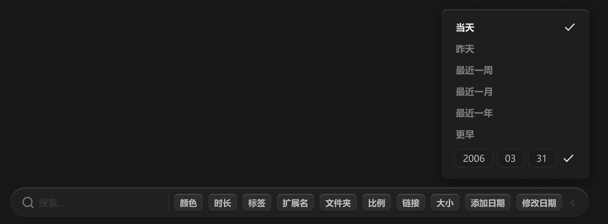

# 筛选-日期



所有类型的筛选弹窗与悬浮栏保持 12px 间距。

可以多选 item。

最后一行为自定义输入。

``` css
/* 筛选-日期 */

/* Auto layout */
display: flex;
flex-direction: column;
justify-content: center;
align-items: flex-start;
padding: 12px;
gap: 4px;

position: absolute;
width: 207px;
height: 238px;
left: 640px;
top: 748px;

/* 通用/半透明-1 */
background: rgba(31, 31, 31, 0.93);
/* 立体感-模糊-大阴影 */
box-shadow: 0px 4px 20px rgba(0, 0, 0, 0.4), inset 0px 1px 1px rgba(255, 255, 255, 0.2);
backdrop-filter: blur(40px);
/* Note: backdrop-filter has minimal browser support */
border-radius: 8px;


/* 当天 */

/* Auto layout */
display: flex;
flex-direction: row;
align-items: center;
padding: 4px 6px 4px 8px;
gap: 8px;

width: 183px;
height: 26px;

border-radius: 6px;

/* Inside auto layout */
flex: none;
order: 0;
align-self: stretch;
flex-grow: 0;


/* 当天 */

width: 143px;
height: 18px;

/* 通用/正文-加粗 */
font-family: 'Microsoft YaHei UI';
font-style: normal;
font-weight: 700;
font-size: 13px;
line-height: 18px;
/* identical to box height, or 138% */
display: flex;
align-items: center;

/* 亮色/一级 */
color: #F2F2F2;


/* Inside auto layout */
flex: none;
order: 0;
flex-grow: 0;


/* 对勾-icon */

/* Auto layout */
display: flex;
flex-direction: column;
justify-content: center;
align-items: center;
padding: 0px;

width: 18px;
height: 18px;


/* Inside auto layout */
flex: none;
order: 1;
flex-grow: 0;


/* svg */

width: 12px;
height: 8.7px;


/* Inside auto layout */
flex: none;
order: 0;
flex-grow: 0;


/* Vector 6663 */

position: absolute;
left: 16.67%;
right: 16.67%;
top: 25.83%;
bottom: 25.83%;

/* 亮色/一级 */
border: 1.5px solid #F2F2F2;


/* 昨天 */

/* Auto layout */
display: flex;
flex-direction: row;
align-items: center;
padding: 4px 6px 4px 8px;
gap: 8px;

width: 183px;
height: 26px;

border-radius: 6px;

/* Inside auto layout */
flex: none;
order: 1;
align-self: stretch;
flex-grow: 0;


/* 昨天 */

width: 143px;
height: 18px;

/* 通用/正文-加粗 */
font-family: 'Microsoft YaHei UI';
font-style: normal;
font-weight: 700;
font-size: 13px;
line-height: 18px;
/* identical to box height, or 138% */
display: flex;
align-items: center;

/* 亮色/三级 */
color: #808080;


/* Inside auto layout */
flex: none;
order: 0;
flex-grow: 0;


/* 对勾-icon */

/* Auto layout */
display: flex;
flex-direction: column;
justify-content: center;
align-items: center;
padding: 0px;

width: 18px;
height: 18px;

opacity: 0;

/* Inside auto layout */
flex: none;
order: 1;
flex-grow: 0;


/* svg */

width: 12px;
height: 8.7px;


/* Inside auto layout */
flex: none;
order: 0;
flex-grow: 0;


/* Vector 6663 */

position: absolute;
left: 16.67%;
right: 16.67%;
top: 25.83%;
bottom: 25.83%;

/* 亮色/一级 */
border: 1.5px solid #F2F2F2;


/* 最近一周 */

/* Auto layout */
display: flex;
flex-direction: row;
align-items: center;
padding: 4px 6px 4px 8px;
gap: 8px;

width: 183px;
height: 26px;

border-radius: 6px;

/* Inside auto layout */
flex: none;
order: 2;
align-self: stretch;
flex-grow: 0;


/* 最近一周 */

width: 143px;
height: 18px;

/* 通用/正文-加粗 */
font-family: 'Microsoft YaHei UI';
font-style: normal;
font-weight: 700;
font-size: 13px;
line-height: 18px;
/* identical to box height, or 138% */
display: flex;
align-items: center;

/* 亮色/三级 */
color: #808080;


/* Inside auto layout */
flex: none;
order: 0;
flex-grow: 0;


/* 对勾-icon */

/* Auto layout */
display: flex;
flex-direction: column;
justify-content: center;
align-items: center;
padding: 0px;

width: 18px;
height: 18px;

opacity: 0;

/* Inside auto layout */
flex: none;
order: 1;
flex-grow: 0;


/* svg */

width: 12px;
height: 8.7px;


/* Inside auto layout */
flex: none;
order: 0;
flex-grow: 0;


/* Vector 6663 */

position: absolute;
left: 16.67%;
right: 16.67%;
top: 25.83%;
bottom: 25.83%;

/* 亮色/一级 */
border: 1.5px solid #F2F2F2;


/* 最近一月 */

/* Auto layout */
display: flex;
flex-direction: row;
align-items: center;
padding: 4px 6px 4px 8px;
gap: 8px;

width: 183px;
height: 26px;

border-radius: 6px;

/* Inside auto layout */
flex: none;
order: 3;
align-self: stretch;
flex-grow: 0;


/* 最近一月 */

width: 143px;
height: 18px;

/* 通用/正文-加粗 */
font-family: 'Microsoft YaHei UI';
font-style: normal;
font-weight: 700;
font-size: 13px;
line-height: 18px;
/* identical to box height, or 138% */
display: flex;
align-items: center;

/* 亮色/三级 */
color: #808080;


/* Inside auto layout */
flex: none;
order: 0;
flex-grow: 0;


/* 对勾-icon */

/* Auto layout */
display: flex;
flex-direction: column;
justify-content: center;
align-items: center;
padding: 0px;

width: 18px;
height: 18px;

opacity: 0;

/* Inside auto layout */
flex: none;
order: 1;
flex-grow: 0;


/* svg */

width: 12px;
height: 8.7px;


/* Inside auto layout */
flex: none;
order: 0;
flex-grow: 0;


/* Vector 6663 */

position: absolute;
left: 16.67%;
right: 16.67%;
top: 25.83%;
bottom: 25.83%;

/* 亮色/一级 */
border: 1.5px solid #F2F2F2;


/* 最近一年 */

/* Auto layout */
display: flex;
flex-direction: row;
align-items: center;
padding: 4px 6px 4px 8px;
gap: 8px;

width: 183px;
height: 26px;

border-radius: 6px;

/* Inside auto layout */
flex: none;
order: 4;
align-self: stretch;
flex-grow: 0;


/* 最近一年 */

width: 143px;
height: 18px;

/* 通用/正文-加粗 */
font-family: 'Microsoft YaHei UI';
font-style: normal;
font-weight: 700;
font-size: 13px;
line-height: 18px;
/* identical to box height, or 138% */
display: flex;
align-items: center;

/* 亮色/三级 */
color: #808080;


/* Inside auto layout */
flex: none;
order: 0;
flex-grow: 0;


/* 对勾-icon */

/* Auto layout */
display: flex;
flex-direction: column;
justify-content: center;
align-items: center;
padding: 0px;

width: 18px;
height: 18px;

opacity: 0;

/* Inside auto layout */
flex: none;
order: 1;
flex-grow: 0;


/* svg */

width: 12px;
height: 8.7px;


/* Inside auto layout */
flex: none;
order: 0;
flex-grow: 0;


/* Vector 6663 */

position: absolute;
left: 16.67%;
right: 16.67%;
top: 25.83%;
bottom: 25.83%;

/* 亮色/一级 */
border: 1.5px solid #F2F2F2;


/* 更早 */

/* Auto layout */
display: flex;
flex-direction: row;
align-items: center;
padding: 4px 6px 4px 8px;
gap: 8px;

width: 183px;
height: 26px;

border-radius: 6px;

/* Inside auto layout */
flex: none;
order: 5;
align-self: stretch;
flex-grow: 0;


/* 更早 */

width: 143px;
height: 18px;

/* 通用/正文-加粗 */
font-family: 'Microsoft YaHei UI';
font-style: normal;
font-weight: 700;
font-size: 13px;
line-height: 18px;
/* identical to box height, or 138% */
display: flex;
align-items: center;

/* 亮色/三级 */
color: #808080;


/* Inside auto layout */
flex: none;
order: 0;
flex-grow: 0;


/* 对勾-icon */

/* Auto layout */
display: flex;
flex-direction: column;
justify-content: center;
align-items: center;
padding: 0px;

width: 18px;
height: 18px;

opacity: 0;

/* Inside auto layout */
flex: none;
order: 1;
flex-grow: 0;


/* svg */

width: 12px;
height: 8.7px;


/* Inside auto layout */
flex: none;
order: 0;
flex-grow: 0;


/* Vector 6663 */

position: absolute;
left: 16.67%;
right: 16.67%;
top: 25.83%;
bottom: 25.83%;

/* 亮色/一级 */
border: 1.5px solid #F2F2F2;


/* 自定义 */

/* Auto layout */
display: flex;
flex-direction: row;
align-items: center;
padding: 4px 6px;
gap: 8px;

width: 181px;
height: 34px;

border-radius: 6px;

/* Inside auto layout */
flex: none;
order: 6;
flex-grow: 0;


/* 输入框 */

/* Auto layout */
display: flex;
flex-direction: row;
align-items: center;
padding: 0px;
gap: 4px;

width: 143px;
height: 26px;


/* Inside auto layout */
flex: none;
order: 0;
flex-grow: 0;


/* 年 */

box-sizing: border-box;

/* Auto layout */
display: flex;
flex-direction: row;
justify-content: center;
align-items: center;
padding: 4px 12px;

width: 55px;
height: 26px;

/* 通用/二级 */
background: #1C1C1C;
/* 亮色/半透明-3 */
border: 1px solid rgba(242, 242, 242, 0.06);
border-radius: 8px;

/* Inside auto layout */
flex: none;
order: 0;
flex-grow: 0;


/* 名称 */

width: 31px;
height: 18px;

/* 通用/正文 */
font-family: 'Microsoft YaHei UI';
font-style: normal;
font-weight: 400;
font-size: 13px;
line-height: 18px;
/* identical to box height, or 138% */
display: flex;
align-items: center;

/* 亮色/二级 */
color: #BFBFBF;


/* Inside auto layout */
flex: none;
order: 0;
flex-grow: 0;


/* 月 */

box-sizing: border-box;

/* Auto layout */
display: flex;
flex-direction: row;
justify-content: center;
align-items: center;
padding: 4px 12px;

width: 40px;
height: 26px;

/* 通用/二级 */
background: #1C1C1C;
/* 亮色/半透明-3 */
border: 1px solid rgba(242, 242, 242, 0.06);
border-radius: 8px;

/* Inside auto layout */
flex: none;
order: 1;
flex-grow: 0;


/* 名称 */

width: 16px;
height: 18px;

/* 通用/正文 */
font-family: 'Microsoft YaHei UI';
font-style: normal;
font-weight: 400;
font-size: 13px;
line-height: 18px;
/* identical to box height, or 138% */
display: flex;
align-items: center;

/* 亮色/二级 */
color: #BFBFBF;


/* Inside auto layout */
flex: none;
order: 0;
flex-grow: 0;


/* 日 */

box-sizing: border-box;

/* Auto layout */
display: flex;
flex-direction: row;
justify-content: center;
align-items: center;
padding: 4px 12px;

width: 40px;
height: 26px;

/* 通用/二级 */
background: #1C1C1C;
/* 亮色/半透明-3 */
border: 1px solid rgba(242, 242, 242, 0.06);
border-radius: 8px;

/* Inside auto layout */
flex: none;
order: 2;
flex-grow: 0;


/* 名称 */

width: 16px;
height: 18px;

/* 通用/正文 */
font-family: 'Microsoft YaHei UI';
font-style: normal;
font-weight: 400;
font-size: 13px;
line-height: 18px;
/* identical to box height, or 138% */
display: flex;
align-items: center;

/* 亮色/二级 */
color: #BFBFBF;


/* Inside auto layout */
flex: none;
order: 0;
flex-grow: 0;


/* 对勾-icon */

/* Auto layout */
display: flex;
flex-direction: column;
justify-content: center;
align-items: center;
padding: 0px;

width: 18px;
height: 18px;


/* Inside auto layout */
flex: none;
order: 1;
flex-grow: 0;


/* svg */

width: 12px;
height: 8.7px;


/* Inside auto layout */
flex: none;
order: 0;
flex-grow: 0;


/* Vector 6663 */

position: absolute;
left: 16.67%;
right: 16.67%;
top: 25.83%;
bottom: 25.83%;

/* 亮色/一级 */
border: 1.5px solid #F2F2F2;
```

