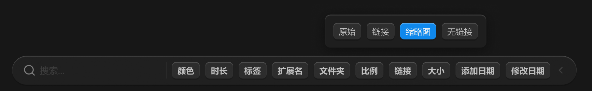

# 筛选-链接



所有类型的筛选弹窗与悬浮栏保持 12px 间距。

可以多选标签。

``` css
/* 筛选-链接 */

/* Auto layout */
display: flex;
flex-direction: row;
align-items: center;
padding: 12px;
gap: 8px;

position: absolute;
width: 232px;
height: 48px;
left: 485px;
top: 938px;

/* 通用/半透明-1 */
background: rgba(31, 31, 31, 0.93);
/* 立体感-模糊-大阴影 */
box-shadow: 0px 4px 20px rgba(0, 0, 0, 0.4), inset 0px 1px 1px rgba(255, 255, 255, 0.2);
backdrop-filter: blur(40px);
/* Note: backdrop-filter has minimal browser support */
border-radius: 8px;


/* 静态图 */

/* Auto layout */
display: flex;
flex-direction: row;
justify-content: center;
align-items: center;
padding: 4px 8px;

width: 40px;
height: 24px;

/* 通用/五级 */
background: #2E2E2E;
/* 立体感-通用 */
box-shadow: 0px 2px 1px rgba(0, 0, 0, 0.2), inset 0px 1px 1px rgba(255, 255, 255, 0.2);
border-radius: 6px;

/* Inside auto layout */
flex: none;
order: 0;
flex-grow: 0;


/* 原始 */

width: 24px;
height: 16px;

/* 通用/次要文字 */
font-family: 'Microsoft YaHei UI';
font-style: normal;
font-weight: 400;
font-size: 12px;
line-height: 16px;
/* identical to box height, or 133% */
display: flex;
align-items: center;

/* 亮色/二级 */
color: #BFBFBF;


/* Inside auto layout */
flex: none;
order: 0;
flex-grow: 0;


/* 动图 */

/* Auto layout */
display: flex;
flex-direction: row;
justify-content: center;
align-items: center;
padding: 4px 8px;

width: 40px;
height: 24px;

/* 通用/五级 */
background: #2E2E2E;
/* 立体感-通用 */
box-shadow: 0px 2px 1px rgba(0, 0, 0, 0.2), inset 0px 1px 1px rgba(255, 255, 255, 0.2);
border-radius: 6px;

/* Inside auto layout */
flex: none;
order: 1;
flex-grow: 0;


/* 链接 */

width: 24px;
height: 16px;

/* 通用/次要文字 */
font-family: 'Microsoft YaHei UI';
font-style: normal;
font-weight: 400;
font-size: 12px;
line-height: 16px;
/* identical to box height, or 133% */
display: flex;
align-items: center;

/* 亮色/二级 */
color: #BFBFBF;


/* Inside auto layout */
flex: none;
order: 0;
flex-grow: 0;


/* 动图 */

/* Auto layout */
display: flex;
flex-direction: row;
justify-content: center;
align-items: center;
padding: 4px 8px;

width: 52px;
height: 24px;

/* 品牌/常态 */
background: #0F89EC;
/* 立体感-主要按钮 */
box-shadow: 0px 2px 1px rgba(0, 0, 0, 0.2), inset 0px 1px 1px rgba(255, 255, 255, 0.4);
border-radius: 6px;

/* Inside auto layout */
flex: none;
order: 2;
flex-grow: 0;


/* 缩略图 */

width: 36px;
height: 16px;

/* 通用/次要文字 */
font-family: 'Microsoft YaHei UI';
font-style: normal;
font-weight: 400;
font-size: 12px;
line-height: 16px;
/* identical to box height, or 133% */
display: flex;
align-items: center;

/* 亮色/一级 */
color: #F2F2F2;


/* Inside auto layout */
flex: none;
order: 0;
flex-grow: 0;


/* 序列帧 */

/* Auto layout */
display: flex;
flex-direction: row;
justify-content: center;
align-items: center;
padding: 4px 8px;

width: 52px;
height: 24px;

/* 通用/五级 */
background: #2E2E2E;
/* 立体感-通用 */
box-shadow: 0px 2px 1px rgba(0, 0, 0, 0.2), inset 0px 1px 1px rgba(255, 255, 255, 0.2);
border-radius: 6px;

/* Inside auto layout */
flex: none;
order: 3;
flex-grow: 0;


/* 无链接 */

width: 36px;
height: 16px;

/* 通用/次要文字 */
font-family: 'Microsoft YaHei UI';
font-style: normal;
font-weight: 400;
font-size: 12px;
line-height: 16px;
/* identical to box height, or 133% */
display: flex;
align-items: center;

/* 亮色/二级 */
color: #BFBFBF;


/* Inside auto layout */
flex: none;
order: 0;
flex-grow: 0;
```

