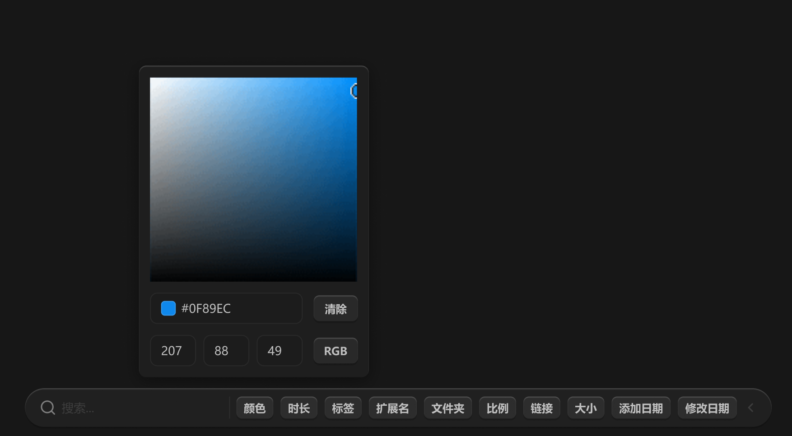

# 筛选-颜色



所有类型的筛选弹窗与悬浮栏保持 12px 间距。

清除按钮点击后清空颜色筛选，清空后色块变成白色加一条斜杠。

## 1_点击-模式切换

RGB-HSL 之间互相切换

``` css
/* 筛选-颜色 */

/* Auto layout */
display: flex;
flex-direction: column;
align-items: flex-start;
padding: 12px;
gap: 12px;

position: absolute;
width: 250px;
height: 339px;
left: 159px;
top: 647px;

/* 通用/半透明-1 */
background: rgba(31, 31, 31, 0.93);
/* 立体感-模糊-大阴影 */
box-shadow: 0px 4px 20px rgba(0, 0, 0, 0.4), inset 0px 1px 1px rgba(255, 255, 255, 0.2);
backdrop-filter: blur(40px);
/* Note: backdrop-filter has minimal browser support */
border-radius: 8px;


/* 色盘 */

width: 226px;
height: 223px;

background: url(image.png);

/* Inside auto layout */
flex: none;
order: 0;
flex-grow: 0;


/* HEX+清除 */

/* Auto layout */
display: flex;
flex-direction: row;
align-items: center;
padding: 0px;
gap: 12px;

width: 226px;
height: 34px;


/* Inside auto layout */
flex: none;
order: 1;
align-self: stretch;
flex-grow: 0;


/* HEX输入框 */

box-sizing: border-box;

/* Auto layout */
display: flex;
flex-direction: row;
align-items: center;
padding: 8px 12px;
gap: 6px;

width: 166px;
height: 34px;

/* 通用/二级 */
background: #1C1C1C;
/* 亮色/半透明-3 */
border: 1px solid rgba(242, 242, 242, 0.06);
border-radius: 8px;

/* Inside auto layout */
flex: none;
order: 0;
flex-grow: 1;


/* Rectangle 17760 */

box-sizing: border-box;

width: 16px;
height: 16px;

/* 品牌/常态 */
background: #0F89EC;
/* 亮色/半透明-1 */
border: 1px solid rgba(242, 242, 242, 0.18);
border-radius: 4px;

/* Inside auto layout */
flex: none;
order: 0;
flex-grow: 0;


/* 名称 */

width: 54px;
height: 18px;

/* 通用/正文 */
font-family: 'Microsoft YaHei UI';
font-style: normal;
font-weight: 400;
font-size: 13px;
line-height: 18px;
/* identical to box height, or 138% */
display: flex;
align-items: center;

/* 亮色/二级 */
color: #BFBFBF;


/* Inside auto layout */
flex: none;
order: 1;
flex-grow: 0;


/* 清除-按钮 */

/* Auto layout */
display: flex;
flex-direction: row;
justify-content: center;
align-items: center;
padding: 6px 12px;

width: 48px;
height: 28px;

/* 通用/四级 */
background: #292929;
/* 立体感-通用 */
box-shadow: 0px 2px 1px rgba(0, 0, 0, 0.2), inset 0px 1px 1px rgba(255, 255, 255, 0.2);
border-radius: 6px;

/* Inside auto layout */
flex: none;
order: 1;
flex-grow: 0;


/* 清除 */

width: 24px;
height: 16px;

/* 通用/次要文字-加粗 */
font-family: 'Microsoft YaHei UI';
font-style: normal;
font-weight: 700;
font-size: 12px;
line-height: 16px;
/* identical to box height, or 133% */
display: flex;
align-items: center;

/* 亮色/二级 */
color: #BFBFBF;


/* Inside auto layout */
flex: none;
order: 0;
flex-grow: 0;


/* RGB+HSL */

/* Auto layout */
display: flex;
flex-direction: row;
align-items: center;
padding: 0px;
gap: 12px;

width: 226px;
height: 34px;


/* Inside auto layout */
flex: none;
order: 2;
align-self: stretch;
flex-grow: 0;


/* 输入框 */

/* Auto layout */
display: flex;
flex-direction: row;
align-items: center;
padding: 0px;
gap: 8px;

width: 166px;
height: 34px;


/* Inside auto layout */
flex: none;
order: 0;
flex-grow: 1;


/* R */

box-sizing: border-box;

/* Auto layout */
display: flex;
flex-direction: row;
align-items: center;
padding: 8px 12px;

width: 50px;
height: 34px;

/* 通用/二级 */
background: #1C1C1C;
/* 亮色/半透明-3 */
border: 1px solid rgba(242, 242, 242, 0.06);
border-radius: 8px;

/* Inside auto layout */
flex: none;
order: 0;
flex-grow: 1;


/* 名称 */

width: 23px;
height: 18px;

/* 通用/正文 */
font-family: 'Microsoft YaHei UI';
font-style: normal;
font-weight: 400;
font-size: 13px;
line-height: 18px;
/* identical to box height, or 138% */
display: flex;
align-items: center;

/* 亮色/二级 */
color: #BFBFBF;


/* Inside auto layout */
flex: none;
order: 0;
flex-grow: 0;


/* G */

box-sizing: border-box;

/* Auto layout */
display: flex;
flex-direction: row;
align-items: center;
padding: 8px 12px;

width: 50px;
height: 34px;

/* 通用/二级 */
background: #1C1C1C;
/* 亮色/半透明-3 */
border: 1px solid rgba(242, 242, 242, 0.06);
border-radius: 8px;

/* Inside auto layout */
flex: none;
order: 1;
flex-grow: 1;


/* 名称 */

width: 16px;
height: 18px;

/* 通用/正文 */
font-family: 'Microsoft YaHei UI';
font-style: normal;
font-weight: 400;
font-size: 13px;
line-height: 18px;
/* identical to box height, or 138% */
display: flex;
align-items: center;

/* 亮色/二级 */
color: #BFBFBF;


/* Inside auto layout */
flex: none;
order: 0;
flex-grow: 0;


/* B */

box-sizing: border-box;

/* Auto layout */
display: flex;
flex-direction: row;
align-items: center;
padding: 8px 12px;

width: 50px;
height: 34px;

/* 通用/二级 */
background: #1C1C1C;
/* 亮色/半透明-3 */
border: 1px solid rgba(242, 242, 242, 0.06);
border-radius: 8px;

/* Inside auto layout */
flex: none;
order: 2;
flex-grow: 1;


/* 名称 */

width: 16px;
height: 18px;

/* 通用/正文 */
font-family: 'Microsoft YaHei UI';
font-style: normal;
font-weight: 400;
font-size: 13px;
line-height: 18px;
/* identical to box height, or 138% */
display: flex;
align-items: center;

/* 亮色/二级 */
color: #BFBFBF;


/* Inside auto layout */
flex: none;
order: 0;
flex-grow: 0;


/* RGB切换-按钮 */

/* Auto layout */
display: flex;
flex-direction: row;
justify-content: center;
align-items: center;
padding: 6px 12px;

width: 48px;
height: 28px;

/* 通用/四级 */
background: #292929;
/* 立体感-通用 */
box-shadow: 0px 2px 1px rgba(0, 0, 0, 0.2), inset 0px 1px 1px rgba(255, 255, 255, 0.2);
border-radius: 6px;

/* Inside auto layout */
flex: none;
order: 1;
flex-grow: 0;


/* RGB */

width: 26px;
height: 16px;

/* 通用/次要文字-加粗 */
font-family: 'Microsoft YaHei UI';
font-style: normal;
font-weight: 700;
font-size: 12px;
line-height: 16px;
/* identical to box height, or 133% */
display: flex;
align-items: center;

/* 亮色/二级 */
color: #BFBFBF;


/* Inside auto layout */
flex: none;
order: 0;
flex-grow: 0;
```

