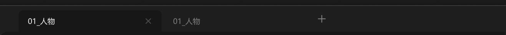

# 中间面板-标签栏



选中状态的标签需要和中间面板无缝连接，连接处肩膀处两个反弧平滑衔接；hover 另外一个标签时，要是正常的 6px 的圆角矩形，距离四周有间距。

``` css
/* 标签栏 */

/* Auto layout */
display: flex;
flex-direction: row;
align-items: flex-start;
padding: 8px 24px 0px 36px;
gap: 12px;

width: 880px;
height: 46px;


/* Inside auto layout */
flex: none;
order: 0;
align-self: stretch;
flex-grow: 0;


/* 标签页 */

/* Auto layout */
display: flex;
flex-direction: row;
align-items: center;
padding: 0px;
gap: 4px;

width: 499px;
height: 38px;


/* Inside auto layout */
flex: none;
order: 0;
flex-grow: 0;


/* 标签页-选中 */

/* Auto layout */
display: flex;
flex-direction: row;
justify-content: space-between;
align-items: center;
padding: 0px 16px;
gap: 8px;

width: 248px;
height: 38px;

/* 通用/一级 */
background: #171717;
border-radius: 8px 8px 0px 0px;

/* Inside auto layout */
flex: none;
order: 0;
flex-grow: 0;


/* 01_人物 */

width: 48px;
height: 18px;

/* 通用/正文 */
font-family: 'Microsoft YaHei UI';
font-style: normal;
font-weight: 400;
font-size: 13px;
line-height: 18px;
/* identical to box height, or 138% */

/* 亮色/一级 */
color: #F2F2F2;


/* Inside auto layout */
flex: none;
order: 0;
flex-grow: 0;


/* 关闭-小-icon */

/* Auto layout */
display: flex;
flex-direction: row;
justify-content: center;
align-items: center;
padding: 0px;

width: 14px;
height: 14px;


/* Inside auto layout */
flex: none;
order: 1;
flex-grow: 0;


/* svg */

width: 8px;
height: 8px;


/* Inside auto layout */
flex: none;
order: 0;
flex-grow: 0;


/* Vector */

position: absolute;
left: 21.43%;
right: 21.43%;
top: 21.43%;
bottom: 21.43%;

/* 亮色/四级 */
border: 1.5px solid #4D4D4D;


/* 标签页-未选中 */

/* Auto layout */
display: flex;
flex-direction: row;
justify-content: space-between;
align-items: center;
padding: 0px 16px;
gap: 8px;

width: 247px;
height: 38px;

border-radius: 8px 8px 0px 0px;

/* Inside auto layout */
flex: none;
order: 1;
flex-grow: 0;


/* 01_人物 */

width: 48px;
height: 18px;

/* 通用/正文 */
font-family: 'Microsoft YaHei UI';
font-style: normal;
font-weight: 400;
font-size: 13px;
line-height: 18px;
/* identical to box height, or 138% */

/* 亮色/三级 */
color: #808080;


/* Inside auto layout */
flex: none;
order: 0;
flex-grow: 0;


/* 关闭-小-icon */

/* Auto layout */
display: flex;
flex-direction: row;
justify-content: center;
align-items: center;
padding: 0px;

width: 14px;
height: 14px;

opacity: 0;

/* Inside auto layout */
flex: none;
order: 1;
flex-grow: 0;


/* svg */

width: 8px;
height: 8px;


/* Inside auto layout */
flex: none;
order: 0;
flex-grow: 0;


/* Vector */

position: absolute;
left: 21.43%;
right: 21.43%;
top: 21.43%;
bottom: 21.43%;

/* 亮色/四级 */
border: 1.5px solid #4D4D4D;


/* 添加新标签页-按钮 */

/* Auto layout */
display: flex;
flex-direction: row;
justify-content: center;
align-items: center;
padding: 6px;

width: 30px;
height: 30px;

border-radius: 6px;

/* Inside auto layout */
flex: none;
order: 1;
flex-grow: 0;


/* 添加-大-icon */

/* Auto layout */
display: flex;
flex-direction: row;
justify-content: center;
align-items: center;
padding: 0px;

width: 18px;
height: 18px;


/* Inside auto layout */
flex: none;
order: 0;
flex-grow: 0;


/* svg */

width: 12px;
height: 12px;

transform: matrix(1, 0, 0, -1, 0, 0);

/* Inside auto layout */
flex: none;
order: 0;
flex-grow: 0;


/* Vector */

position: absolute;
left: 50%;
right: 50%;
top: 16.67%;
bottom: 16.67%;

/* 亮色/三级 */
border: 1.5px solid #808080;


/* Vector */

position: absolute;
left: 16.67%;
right: 83.33%;
top: 50%;
bottom: -16.67%;

/* 亮色/三级 */
border: 1.5px solid #808080;
transform: rotate(90deg);
```

