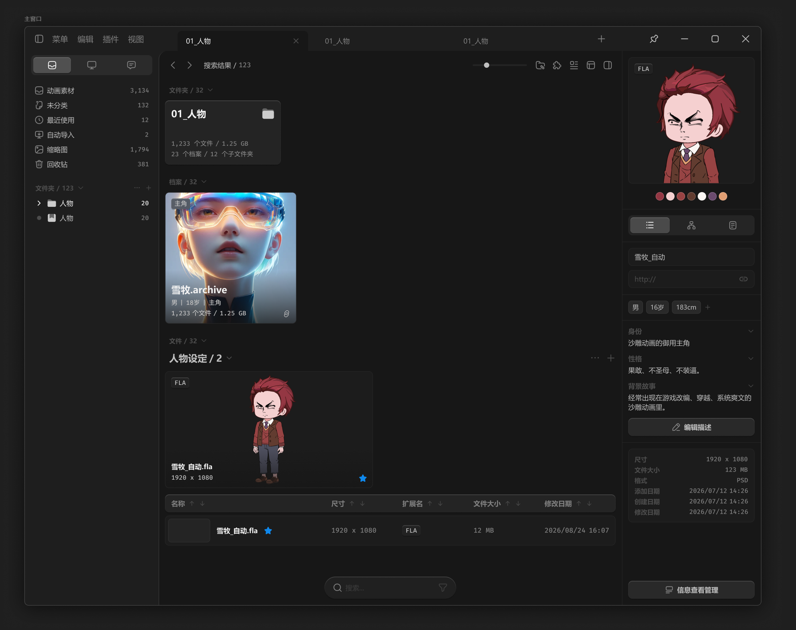

# 主窗口



背景半透明和模糊效果，实际需要接入 window11 的“云母”效果，而非参考 css 里的模糊。

要考虑其他版本的window 系统的兜底方案。

``` css
/* 主窗口 */

box-sizing: border-box;

/* Auto layout */
display: flex;
flex-direction: row;
align-items: flex-start;
padding: 0px;

position: relative;
width: 1400px;
height: 1100px;

/* 通用/半透明-1 */
background: rgba(31, 31, 31, 0.93);
/* 亮色/半透明-1 */
border: 1px solid rgba(242, 242, 242, 0.18);
box-shadow: 0px 4px 40px rgba(0, 0, 0, 0.6);
backdrop-filter: blur(125px);
/* Note: backdrop-filter has minimal browser support */
border-radius: 8px;
```

