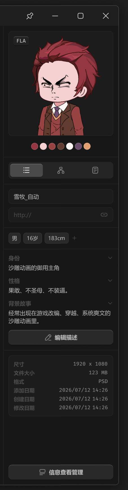

# 右侧边栏-总容器



``` css
/* 详细信息 */

box-sizing: border-box;

/* Auto layout */
display: flex;
flex-direction: column;
justify-content: flex-end;
align-items: flex-start;
padding: 0px;

width: 264px;
height: 1052px;

/* 通用/一级 */
background: #171717;
/* 通用/三级 */
border-left: 1px solid #242424;

/* Inside auto layout */
flex: none;
order: 2;
align-self: stretch;
flex-grow: 1;
```

