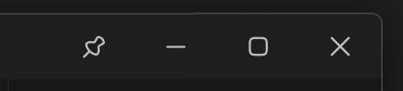

# 右侧边栏-窗口控制



## 1_hover

关闭-background-color：状态 / 禁止

background-color：亮色 / 半透明-3

``` css
/* 窗口控制 */

/* Auto layout */
display: flex;
flex-direction: row;
justify-content: flex-end;
align-items: center;
padding: 0px;

width: 264px;
height: 46px;


/* Inside auto layout */
flex: none;
order: 0;
align-self: stretch;
flex-grow: 0;


/* 置顶-按钮 */

/* Auto layout */
display: flex;
flex-direction: row;
justify-content: center;
align-items: center;
padding: 6px;

width: 58px;
height: 46px;


/* Inside auto layout */
flex: none;
order: 0;
flex-grow: 0;


/* 置顶-icon */

/* Auto layout */
display: flex;
flex-direction: row;
justify-content: center;
align-items: center;
padding: 0px;

width: 18px;
height: 18px;


/* Inside auto layout */
flex: none;
order: 0;
flex-grow: 0;


/* svg */

width: 14px;
height: 14px;


/* Inside auto layout */
flex: none;
order: 0;
flex-grow: 0;


/* Vector 4655 */

position: absolute;
left: 11.11%;
right: 67.28%;
top: 67.28%;
bottom: 11.11%;

/* 亮色/二级 */
border: 1.5px solid #BFBFBF;


/* Vector */

position: absolute;
left: 19.75%;
right: 11.11%;
top: 11.11%;
bottom: 19.75%;

/* 亮色/二级 */
border: 1.5px solid #BFBFBF;
border-radius: 1.5px;


/* 取消置顶-icon */

/* Auto layout */
display: flex;
flex-direction: row;
justify-content: center;
align-items: center;
padding: 0px;

display: none;
width: 18px;
height: 18px;


/* Inside auto layout */
flex: none;
order: 1;
flex-grow: 0;


/* svg */

width: 14px;
height: 14px;


/* Inside auto layout */
flex: none;
order: 0;
flex-grow: 0;


/* Vector */

position: absolute;
left: 19.75%;
right: 32.72%;
top: 32.72%;
bottom: 19.75%;

/* 亮色/二级 */
border: 1.5px solid #BFBFBF;


/* Vector */

position: absolute;
left: 50%;
right: 11.11%;
top: 11.11%;
bottom: 50%;

/* 亮色/二级 */
border: 1.5px solid #BFBFBF;


/* Vector 4655 */

position: absolute;
left: 11.11%;
right: 67.28%;
top: 67.28%;
bottom: 11.11%;

/* 亮色/二级 */
border: 1.5px solid #BFBFBF;


/* Vector 4644 */

position: absolute;
left: 11.11%;
right: 11.11%;
top: 11.11%;
bottom: 11.11%;

/* 亮色/二级 */
border: 1.5px solid #BFBFBF;


/* 最小化-按钮 */

/* Auto layout */
display: flex;
flex-direction: row;
justify-content: center;
align-items: center;
padding: 0px;

width: 58px;
height: 46px;


/* Inside auto layout */
flex: none;
order: 1;
flex-grow: 0;


/* 最小化-icon */

/* Auto layout */
display: flex;
flex-direction: column;
justify-content: center;
align-items: center;
padding: 0px;

width: 18px;
height: 18px;


/* Inside auto layout */
flex: none;
order: 0;
flex-grow: 0;


/* svg */

width: 12px;
height: 0px;

transform: matrix(1, 0, 0, -1, 0, 0);

/* Inside auto layout */
flex: none;
order: 0;
flex-grow: 0;


/* Vector */

position: absolute;
left: 16.67%;
right: 83.33%;
top: 50%;
bottom: -16.67%;

/* 亮色/二级 */
border: 1.5px solid #BFBFBF;
transform: rotate(90deg);


/* 最大化-按钮 */

/* Auto layout */
display: flex;
flex-direction: row;
justify-content: center;
align-items: center;
padding: 0px;

width: 58px;
height: 46px;


/* Inside auto layout */
flex: none;
order: 2;
flex-grow: 0;


/* 最大化-icon */

/* Auto layout */
display: flex;
flex-direction: row;
justify-content: center;
align-items: center;
padding: 0px;

width: 18px;
height: 18px;


/* Inside auto layout */
flex: none;
order: 0;
flex-grow: 0;


/* svg */

width: 12px;
height: 12px;


/* Inside auto layout */
flex: none;
order: 0;
flex-grow: 0;


/* Vector 239 */

position: absolute;
left: 16.67%;
right: 16.67%;
top: 16.67%;
bottom: 16.67%;

/* 亮色/二级 */
border: 1.5px solid #BFBFBF;


/* 关闭窗口-按钮 */

/* Auto layout */
display: flex;
flex-direction: row;
justify-content: center;
align-items: center;
padding: 0px;

width: 58px;
height: 46px;


/* Inside auto layout */
flex: none;
order: 3;
flex-grow: 0;


/* 关闭-大-icon */

/* Auto layout */
display: flex;
flex-direction: row;
justify-content: center;
align-items: center;
padding: 0px;

width: 18px;
height: 18px;


/* Inside auto layout */
flex: none;
order: 0;
flex-grow: 0;


/* svg */

width: 12px;
height: 12px;


/* Inside auto layout */
flex: none;
order: 0;
flex-grow: 0;


/* Vector */

position: absolute;
left: 16.67%;
right: 16.67%;
top: 16.67%;
bottom: 16.67%;

/* 亮色/二级 */
border: 1.5px solid #BFBFBF;
```

