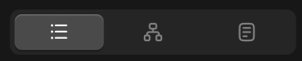

# 右侧边栏-详情面板-分段控制器



``` css
/* 切换信息-区块 */

box-sizing: border-box;

/* Auto layout */
display: flex;
flex-direction: row;
align-items: flex-start;
padding: 12px;

width: 264px;
height: 62px;

/* 通用/三级 */
border-top: 1px solid #242424;

/* Inside auto layout */
flex: none;
order: 2;
align-self: stretch;
flex-grow: 0;


/* 切换信息-按钮 */

/* Auto layout */
display: flex;
flex-direction: row;
align-items: center;
padding: 4px;
gap: 4px;

width: 240px;
height: 38px;

/* 亮色/半透明-3 */
background: rgba(242, 242, 242, 0.06);
border-radius: 8px;

/* Inside auto layout */
flex: none;
order: 0;
flex-grow: 1;


/* 基础信息-按钮 */

/* Auto layout */
display: flex;
flex-direction: row;
justify-content: center;
align-items: center;
padding: 6px;

width: 74.67px;
height: 30px;

/* 亮色/半透明-1 */
background: rgba(242, 242, 242, 0.18);
/* 立体感-通用 */
box-shadow: 0px 2px 1px rgba(0, 0, 0, 0.2), inset 0px 1px 1px rgba(255, 255, 255, 0.2);
border-radius: 6px;

/* Inside auto layout */
flex: none;
order: 0;
flex-grow: 1;


/* 基础信息-icon */

/* Auto layout */
display: flex;
flex-direction: row;
justify-content: center;
align-items: center;
padding: 0px;

width: 18px;
height: 18px;


/* Inside auto layout */
flex: none;
order: 0;
flex-grow: 0;


/* svg */

width: 12px;
height: 11.25px;


/* Inside auto layout */
flex: none;
order: 0;
flex-grow: 0;


/* Vector */

position: absolute;
left: 33.33%;
right: 16.67%;
top: 18.75%;
bottom: 81.25%;

/* 亮色/一级 */
border: 1.5px solid #F2F2F2;


/* Vector */

position: absolute;
left: 16.67%;
right: 83.3%;
top: 18.75%;
bottom: 77.08%;

/* 亮色/一级 */
border: 2px solid #F2F2F2;


/* Vector */

position: absolute;
left: 16.67%;
right: 83.3%;
top: 47.92%;
bottom: 47.92%;

/* 亮色/一级 */
border: 2px solid #F2F2F2;


/* Vector */

position: absolute;
left: 16.67%;
right: 83.3%;
top: 77.08%;
bottom: 18.75%;

/* 亮色/一级 */
border: 2px solid #F2F2F2;


/* Vector */

position: absolute;
left: 33.33%;
right: 16.67%;
top: 47.92%;
bottom: 52.08%;

/* 亮色/一级 */
border: 1.5px solid #F2F2F2;


/* Vector */

position: absolute;
left: 33.33%;
right: 16.67%;
top: 77.08%;
bottom: 22.92%;

/* 亮色/一级 */
border: 1.5px solid #F2F2F2;


/* 链接关系-按钮 */

/* Auto layout */
display: flex;
flex-direction: row;
justify-content: center;
align-items: center;
padding: 6px;

width: 74.67px;
height: 30px;

border-radius: 6px;

/* Inside auto layout */
flex: none;
order: 1;
flex-grow: 1;


/* 链接关系-icon */

/* Auto layout */
display: flex;
flex-direction: row;
justify-content: center;
align-items: center;
padding: 0px;

width: 18px;
height: 18px;


/* Inside auto layout */
flex: none;
order: 0;
flex-grow: 0;


/* svg */

width: 14px;
height: 14px;


/* Inside auto layout */
flex: none;
order: 0;
flex-grow: 0;


/* Vector 4868 */

position: absolute;
left: 22.78%;
right: 22.78%;
top: 34.44%;
bottom: 34.44%;

/* 亮色/三级 */
border: 1.5px solid #808080;


/* Rectangle 2394 */

position: absolute;
left: 11.11%;
right: 65.56%;
top: 65.56%;
bottom: 11.11%;

/* 亮色/三级 */
border: 1.5px solid #808080;


/* Rectangle 2395 */

position: absolute;
left: 65.56%;
right: 11.11%;
top: 65.56%;
bottom: 11.11%;

/* 亮色/三级 */
border: 1.5px solid #808080;


/* Rectangle 2392 */

position: absolute;
left: 34.44%;
right: 34.44%;
top: 11.11%;
bottom: 65.56%;

/* 亮色/三级 */
border: 1.5px solid #808080;


/* 提示词-按钮 */

/* Auto layout */
display: flex;
flex-direction: row;
justify-content: center;
align-items: center;
padding: 6px;

width: 74.67px;
height: 30px;

border-radius: 6px;

/* Inside auto layout */
flex: none;
order: 2;
flex-grow: 1;


/* 提示词-icon */

/* Auto layout */
display: flex;
flex-direction: row;
justify-content: center;
align-items: center;
padding: 0px;

width: 18px;
height: 18px;


/* Inside auto layout */
flex: none;
order: 0;
flex-grow: 0;


/* svg */

width: 12px;
height: 14.12px;


/* Inside auto layout */
flex: none;
order: 0;
flex-grow: 0;


/* Rectangle 120 */

position: absolute;
left: 16.67%;
right: 16.67%;
top: 10.78%;
bottom: 10.78%;

/* 亮色/三级 */
border: 1.5px solid #808080;


/* Vector */

position: absolute;
left: 34.31%;
right: 34.31%;
top: 30.39%;
bottom: 30.39%;

/* 亮色/三级 */
border: 1.5px solid #808080;
```

