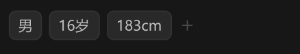

# 右侧边栏-详情面板-基础信息-标签



``` css
/* 属性标签-区块 */

box-sizing: border-box;

/* Auto layout */
display: flex;
flex-direction: column;
justify-content: center;
align-items: flex-start;
padding: 12px;
gap: 12px;

width: 264px;
height: 49px;

/* 通用/三级 */
border-top: 1px solid #242424;

/* Inside auto layout */
flex: none;
order: 1;
align-self: stretch;
flex-grow: 0;


/* 标签列表 */

/* Auto layout */
display: flex;
flex-direction: row;
align-items: center;
padding: 0px;
gap: 6px;

width: 158px;
height: 25px;


/* Inside auto layout */
flex: none;
order: 0;
flex-grow: 0;


/* 属性标签 */

box-sizing: border-box;

/* Auto layout */
display: flex;
flex-direction: row;
justify-content: center;
align-items: center;
padding: 4px 8px;
gap: 6px;

width: 28px;
height: 25px;

/* 通用/四级 */
background: #292929;
/* 通用/六级 */
border: 1px solid #333333;
border-radius: 6px;

/* Inside auto layout */
flex: none;
order: 0;
flex-grow: 0;


/* 男 */

width: 12px;
height: 17px;

/* 标签 */
font-family: 'Microsoft YaHei UI';
font-style: normal;
font-weight: 400;
font-size: 12px;
line-height: 17px;
/* identical to box height, or 142% */

/* 亮色/二级 */
color: #BFBFBF;


/* Inside auto layout */
flex: none;
order: 0;
flex-grow: 0;


/* 属性标签 */

box-sizing: border-box;

/* Auto layout */
display: flex;
flex-direction: row;
justify-content: center;
align-items: center;
padding: 4px 8px;
gap: 6px;

width: 43px;
height: 25px;

/* 通用/四级 */
background: #292929;
/* 通用/六级 */
border: 1px solid #333333;
border-radius: 6px;

/* Inside auto layout */
flex: none;
order: 1;
flex-grow: 0;


/* 16岁 */

width: 27px;
height: 17px;

/* 标签 */
font-family: 'Microsoft YaHei UI';
font-style: normal;
font-weight: 400;
font-size: 12px;
line-height: 17px;
/* identical to box height, or 142% */

/* 亮色/二级 */
color: #BFBFBF;


/* Inside auto layout */
flex: none;
order: 0;
flex-grow: 0;


/* 属性标签 */

box-sizing: border-box;

/* Auto layout */
display: flex;
flex-direction: row;
justify-content: center;
align-items: center;
padding: 4px 8px;
gap: 6px;

width: 55px;
height: 25px;

/* 通用/四级 */
background: #292929;
/* 通用/六级 */
border: 1px solid #333333;
border-radius: 6px;

/* Inside auto layout */
flex: none;
order: 2;
flex-grow: 0;


/* 183cm */

width: 39px;
height: 17px;

/* 标签 */
font-family: 'Microsoft YaHei UI';
font-style: normal;
font-weight: 400;
font-size: 12px;
line-height: 17px;
/* identical to box height, or 142% */

/* 亮色/二级 */
color: #BFBFBF;


/* Inside auto layout */
flex: none;
order: 0;
flex-grow: 0;


/* 添加-小-icon */

/* Auto layout */
display: flex;
flex-direction: row;
justify-content: center;
align-items: center;
padding: 0px;

width: 14px;
height: 14px;


/* Inside auto layout */
flex: none;
order: 3;
flex-grow: 0;


/* svg */

width: 8px;
height: 8px;

transform: matrix(1, 0, 0, -1, 0, 0);

/* Inside auto layout */
flex: none;
order: 0;
flex-grow: 0;


/* Vector */

position: absolute;
left: 50%;
right: 50%;
top: 21.43%;
bottom: 21.43%;

/* 亮色/四级 */
border: 1px solid #4D4D4D;


/* Vector */

position: absolute;
left: 21.43%;
right: 78.57%;
top: 50%;
bottom: -7.15%;

/* 亮色/四级 */
border: 1px solid #4D4D4D;
transform: rotate(90deg);
```

