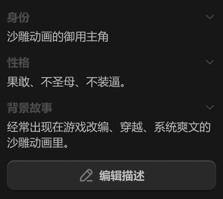

# 右侧边栏-详情面板-基础信息-详情



``` css
/* 描述-区块 */

box-sizing: border-box;

/* Auto layout */
display: flex;
flex-direction: column;
align-items: flex-start;
padding: 12px;
gap: 12px;

width: 264px;
height: 232px;

/* 通用/三级 */
border-top: 1px solid #242424;

/* Inside auto layout */
flex: none;
order: 2;
align-self: stretch;
flex-grow: 0;


/* 描述列表 */

/* Auto layout */
display: flex;
flex-direction: column;
align-items: flex-start;
padding: 0px;
gap: 12px;

width: 240px;
height: 162px;


/* Inside auto layout */
flex: none;
order: 0;
align-self: stretch;
flex-grow: 0;


/* 描述 */

/* Auto layout */
display: flex;
flex-direction: column;
align-items: flex-start;
padding: 0px;
gap: 4px;

width: 240px;
height: 40px;


/* Inside auto layout */
flex: none;
order: 0;
align-self: stretch;
flex-grow: 0;


/* 标题 */

/* Auto layout */
display: flex;
flex-direction: row;
justify-content: space-between;
align-items: center;
padding: 0px;
gap: 10px;

width: 240px;
height: 18px;


/* Inside auto layout */
flex: none;
order: 0;
align-self: stretch;
flex-grow: 0;


/* 身份 */

width: 26px;
height: 18px;

/* 通用/正文-加粗 */
font-family: 'Microsoft YaHei UI';
font-style: normal;
font-weight: 700;
font-size: 13px;
line-height: 18px;
/* identical to box height, or 138% */
display: flex;
align-items: center;

/* 亮色/四级 */
color: #4D4D4D;


/* Inside auto layout */
flex: none;
order: 0;
flex-grow: 0;


/* 展开按钮-icon */

/* Auto layout */
display: flex;
flex-direction: column;
justify-content: center;
align-items: center;
padding: 0px;

width: 14px;
height: 14px;


/* Inside auto layout */
flex: none;
order: 1;
flex-grow: 0;


/* svg */

width: 8px;
height: 4px;


/* Inside auto layout */
flex: none;
order: 0;
flex-grow: 0;


/* Vector */

position: absolute;
left: 21.43%;
right: 50%;
top: 35.71%;
bottom: 7.14%;

/* 亮色/四级 */
border: 1px solid #4D4D4D;
transform: matrix(0, -1, -1, 0, 0, 0);


/* 沙雕动画的御用主角 */

width: 117px;
height: 18px;

/* 通用/正文 */
font-family: 'Microsoft YaHei UI';
font-style: normal;
font-weight: 400;
font-size: 13px;
line-height: 18px;
/* identical to box height, or 138% */
display: flex;
align-items: center;

/* 亮色/二级 */
color: #BFBFBF;


/* Inside auto layout */
flex: none;
order: 1;
flex-grow: 0;


/* 描述 */

/* Auto layout */
display: flex;
flex-direction: column;
align-items: flex-start;
padding: 0px;
gap: 4px;

width: 240px;
height: 40px;


/* Inside auto layout */
flex: none;
order: 1;
align-self: stretch;
flex-grow: 0;


/* 标题 */

/* Auto layout */
display: flex;
flex-direction: row;
justify-content: space-between;
align-items: center;
padding: 0px;
gap: 10px;

width: 240px;
height: 18px;


/* Inside auto layout */
flex: none;
order: 0;
align-self: stretch;
flex-grow: 0;


/* 性格 */

width: 26px;
height: 18px;

/* 通用/正文-加粗 */
font-family: 'Microsoft YaHei UI';
font-style: normal;
font-weight: 700;
font-size: 13px;
line-height: 18px;
/* identical to box height, or 138% */
display: flex;
align-items: center;

/* 亮色/四级 */
color: #4D4D4D;


/* Inside auto layout */
flex: none;
order: 0;
flex-grow: 0;


/* 展开按钮-icon */

/* Auto layout */
display: flex;
flex-direction: column;
justify-content: center;
align-items: center;
padding: 0px;

width: 14px;
height: 14px;


/* Inside auto layout */
flex: none;
order: 1;
flex-grow: 0;


/* svg */

width: 8px;
height: 4px;


/* Inside auto layout */
flex: none;
order: 0;
flex-grow: 0;


/* Vector */

position: absolute;
left: 21.43%;
right: 50%;
top: 35.71%;
bottom: 7.14%;

/* 亮色/四级 */
border: 1px solid #4D4D4D;
transform: matrix(0, -1, -1, 0, 0, 0);


/* 果敢、不圣母、不装逼。 */

width: 143px;
height: 18px;

/* 通用/正文 */
font-family: 'Microsoft YaHei UI';
font-style: normal;
font-weight: 400;
font-size: 13px;
line-height: 18px;
/* identical to box height, or 138% */
display: flex;
align-items: center;

/* 亮色/二级 */
color: #BFBFBF;


/* Inside auto layout */
flex: none;
order: 1;
flex-grow: 0;


/* 描述 */

/* Auto layout */
display: flex;
flex-direction: column;
align-items: flex-start;
padding: 0px;
gap: 4px;

width: 240px;
height: 58px;


/* Inside auto layout */
flex: none;
order: 2;
align-self: stretch;
flex-grow: 0;


/* 标题 */

/* Auto layout */
display: flex;
flex-direction: row;
justify-content: space-between;
align-items: center;
padding: 0px;
gap: 10px;

width: 240px;
height: 18px;


/* Inside auto layout */
flex: none;
order: 0;
align-self: stretch;
flex-grow: 0;


/* 背景故事 */

width: 52px;
height: 18px;

/* 通用/正文-加粗 */
font-family: 'Microsoft YaHei UI';
font-style: normal;
font-weight: 700;
font-size: 13px;
line-height: 18px;
/* identical to box height, or 138% */
display: flex;
align-items: center;

/* 亮色/四级 */
color: #4D4D4D;


/* Inside auto layout */
flex: none;
order: 0;
flex-grow: 0;


/* 展开按钮-icon */

/* Auto layout */
display: flex;
flex-direction: column;
justify-content: center;
align-items: center;
padding: 0px;

width: 14px;
height: 14px;


/* Inside auto layout */
flex: none;
order: 1;
flex-grow: 0;


/* svg */

width: 8px;
height: 4px;


/* Inside auto layout */
flex: none;
order: 0;
flex-grow: 0;


/* Vector */

position: absolute;
left: 21.43%;
right: 50%;
top: 35.71%;
bottom: 7.14%;

/* 亮色/四级 */
border: 1px solid #4D4D4D;
transform: matrix(0, -1, -1, 0, 0, 0);


/* 经常出现在游戏改编、穿越、系统爽文的沙雕动画里。 */

width: 240px;
height: 36px;

/* 通用/正文 */
font-family: 'Microsoft YaHei UI';
font-style: normal;
font-weight: 400;
font-size: 13px;
line-height: 18px;
/* or 138% */
display: flex;
align-items: center;

/* 亮色/二级 */
color: #BFBFBF;


/* Inside auto layout */
flex: none;
order: 1;
align-self: stretch;
flex-grow: 0;


/* 编辑描述-按钮 */

/* Auto layout */
display: flex;
flex-direction: row;
justify-content: center;
align-items: center;
padding: 8px 0px;
gap: 6px;

width: 240px;
height: 34px;

/* 通用/四级 */
background: #292929;
/* 立体感-通用 */
box-shadow: 0px 2px 1px rgba(0, 0, 0, 0.2), inset 0px 1px 1px rgba(255, 255, 255, 0.2);
border-radius: 8px;

/* Inside auto layout */
flex: none;
order: 1;
align-self: stretch;
flex-grow: 0;


/* 铅笔-icon */

/* Auto layout */
display: flex;
flex-direction: row;
justify-content: center;
align-items: center;
padding: 0px;

width: 18px;
height: 18px;


/* Inside auto layout */
flex: none;
order: 0;
flex-grow: 0;


/* svg */

width: 13px;
height: 13px;


/* Inside auto layout */
flex: none;
order: 0;
flex-grow: 0;


/* Rectangle 2167 */

position: absolute;
left: 13.89%;
right: 13.89%;
top: 13.89%;
bottom: 13.89%;

/* 亮色/三级 */
border: 1.5px solid #808080;


/* Vector 4200 */

position: absolute;
left: 53.61%;
right: 21.11%;
top: 21.11%;
bottom: 53.61%;

/* 亮色/三级 */
border: 1.5px solid #808080;


/* Vector 4201 */

position: absolute;
left: 57.22%;
right: 13.89%;
top: 86.11%;
bottom: 13.89%;

/* 亮色/三级 */
border: 1.5px solid #808080;


/* 编辑描述 */

width: 52px;
height: 18px;

/* 通用/正文-加粗 */
font-family: 'Microsoft YaHei UI';
font-style: normal;
font-weight: 700;
font-size: 13px;
line-height: 18px;
/* identical to box height, or 138% */
display: flex;
align-items: center;

/* 亮色/二级 */
color: #BFBFBF;


/* Inside auto layout */
flex: none;
order: 1;
flex-grow: 0;
```

