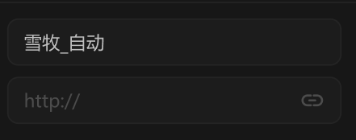

# 右侧边栏-详情面板-输入框



``` css
/* 输入框-区块 */

box-sizing: border-box;

/* Auto layout */
display: flex;
flex-direction: column;
align-items: flex-start;
padding: 12px;
gap: 8px;

width: 264px;
height: 100px;

/* 通用/三级 */
border-top: 1px solid #242424;

/* Inside auto layout */
flex: none;
order: 0;
align-self: stretch;
flex-grow: 0;


/* 名称输入框 */

box-sizing: border-box;

/* Auto layout */
display: flex;
flex-direction: row;
align-items: center;
padding: 8px 12px;

width: 240px;
height: 34px;

/* 通用/二级 */
background: #1C1C1C;
/* 通用/三级 */
border: 1px solid #242424;
border-radius: 8px;

/* Inside auto layout */
flex: none;
order: 0;
align-self: stretch;
flex-grow: 0;


/* 名称 */

width: 58px;
height: 18px;

/* 通用/正文 */
font-family: 'Microsoft YaHei UI';
font-style: normal;
font-weight: 400;
font-size: 13px;
line-height: 18px;
/* identical to box height, or 138% */
display: flex;
align-items: center;

/* 亮色/二级 */
color: #BFBFBF;


/* Inside auto layout */
flex: none;
order: 0;
flex-grow: 0;


/* 链接输入框 */

box-sizing: border-box;

/* Auto layout */
display: flex;
flex-direction: row;
justify-content: space-between;
align-items: center;
padding: 8px 12px;

width: 240px;
height: 34px;

/* 通用/二级 */
background: #1C1C1C;
/* 通用/三级 */
border: 1px solid #242424;
border-radius: 8px;

/* Inside auto layout */
flex: none;
order: 1;
align-self: stretch;
flex-grow: 0;


/* 链接 */

margin: 0 auto;
width: 41px;
height: 18px;

/* 通用/正文 */
font-family: 'Microsoft YaHei UI';
font-style: normal;
font-weight: 400;
font-size: 13px;
line-height: 18px;
/* identical to box height, or 138% */
display: flex;
align-items: center;

/* 亮色/四级 */
color: #4D4D4D;


/* Inside auto layout */
flex: none;
order: 0;
flex-grow: 0;


/* 链接-icon */

/* Auto layout */
display: flex;
flex-direction: column;
justify-content: center;
align-items: center;
padding: 0px;

margin: 0 auto;
width: 18px;
height: 18px;


/* Inside auto layout */
flex: none;
order: 1;
flex-grow: 0;


/* svg */

width: 14px;
height: 7px;


/* Inside auto layout */
flex: none;
order: 0;
flex-grow: 0;


/* Vector */

position: absolute;
left: 11.11%;
right: 11.11%;
top: 30.56%;
bottom: 30.56%;

/* 亮色/四级 */
border: 1.5px solid #4D4D4D;
border-radius: 6px;


/* Vector */

position: absolute;
left: 38.33%;
right: 38.33%;
top: 50%;
bottom: 50%;

/* 亮色/四级 */
border: 1.5px solid #4D4D4D;
border-radius: 6px;

```

