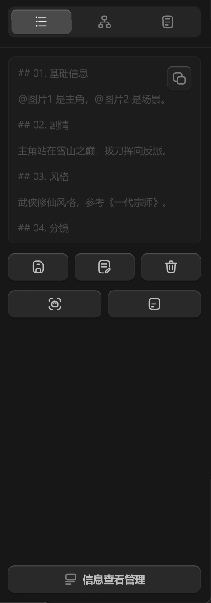

# 右侧边栏-详情面板-提示词



提示词按钮，根据上下文需求显示。

``` css
/* 提示词 */

/* Auto layout */
display: flex;
flex-direction: column;
align-items: flex-start;
padding: 0px;

width: 264px;
height: 632px;


/* Inside auto layout */
flex: none;
order: 5;
align-self: stretch;
flex-grow: 1;


/* 提示词-区块 */

box-sizing: border-box;

/* Auto layout */
display: flex;
flex-direction: column;
align-items: flex-start;
padding: 12px;
gap: 12px;

width: 264px;
height: 348px;

/* 通用/三级 */
border-top: 1px solid #242424;

/* Inside auto layout */
flex: none;
order: 0;
align-self: stretch;
flex-grow: 0;


/* 提示词编辑框 */

box-sizing: border-box;

/* Auto layout */
display: flex;
flex-direction: column;
align-items: flex-start;
padding: 12px;
isolation: isolate;

width: 240px;
height: 232px;

/* 通用/二级 */
background: #1C1C1C;
/* 通用/三级 */
border: 1px solid #242424;
border-radius: 8px;

/* Inside auto layout */
flex: none;
order: 0;
align-self: stretch;
flex-grow: 0;


/* ## 01. 基础信息 @图片1 是主角，@图片2 是场景。 ## 02. 剧情 主角站在雪山之巅，拔刀挥向反派。 ## 03. 风格 武侠修仙风格，参考《一代宗师》。 ## 04. 分镜 */

width: 192px;
height: 208px;

/* 通用/次要文字 */
font-family: 'Microsoft YaHei UI';
font-style: normal;
font-weight: 400;
font-size: 12px;
line-height: 16px;
/* or 133% */

/* 亮色/四级 */
color: #4D4D4D;


/* Inside auto layout */
flex: none;
order: 0;
flex-grow: 0;
z-index: 0;


/* 复制提示词-按钮 */

/* Auto layout */
display: flex;
flex-direction: row;
justify-content: center;
align-items: center;
padding: 6px;

position: absolute;
width: 30px;
height: 30px;
left: 198px;
top: 12px;

/* 通用/半透明-2 */
background: rgba(41, 41, 41, 0.5);
/* 立体感-通用 */
box-shadow: 0px 2px 1px rgba(0, 0, 0, 0.2), inset 0px 1px 1px rgba(255, 255, 255, 0.2);
border-radius: 6px;

/* Inside auto layout */
flex: none;
order: 1;
flex-grow: 0;
z-index: 1;


/* 复制-icon */

/* Auto layout */
display: flex;
flex-direction: row;
justify-content: center;
align-items: center;
padding: 0px;

width: 18px;
height: 18px;


/* Inside auto layout */
flex: none;
order: 0;
flex-grow: 0;


/* svg */

width: 14px;
height: 14px;


/* Inside auto layout */
flex: none;
order: 0;
flex-grow: 0;


/* Rectangle 1703 */

position: absolute;
left: 38.33%;
right: 11.11%;
top: 38.33%;
bottom: 11.11%;

/* 亮色/三级 */
border: 1.5px solid #808080;
border-radius: 3px;


/* Rectangle 1704 */

position: absolute;
left: 11.11%;
right: 30.56%;
top: 11.11%;
bottom: 30.56%;

/* 亮色/三级 */
border: 1.5px solid #808080;


/* 按钮组 */

/* Auto layout */
display: flex;
flex-direction: row;
align-items: flex-start;
padding: 0px;
gap: 8px;

width: 240px;
height: 34px;


/* Inside auto layout */
flex: none;
order: 1;
align-self: stretch;
flex-grow: 0;


/* 保存提示词-按钮 */

/* Auto layout */
display: flex;
flex-direction: row;
justify-content: center;
align-items: center;
padding: 8px 0px;

width: 74.67px;
height: 34px;

/* 通用/四级 */
background: #292929;
/* 立体感-通用 */
box-shadow: 0px 2px 1px rgba(0, 0, 0, 0.2), inset 0px 1px 1px rgba(255, 255, 255, 0.2);
border-radius: 8px;

/* Inside auto layout */
flex: none;
order: 0;
flex-grow: 1;


/* 保存-提示词-icon */

/* Auto layout */
display: flex;
flex-direction: row;
justify-content: center;
align-items: center;
padding: 0px;

width: 18px;
height: 18px;


/* Inside auto layout */
flex: none;
order: 0;
flex-grow: 0;


/* svg */

width: 12.6px;
height: 14px;


/* Inside auto layout */
flex: none;
order: 0;
flex-grow: 0;


/* Vector 3363 */

position: absolute;
left: 34.44%;
right: 34.44%;
top: 61.67%;
bottom: 11.11%;

/* 亮色/二级 */
border: 1.5px solid #BFBFBF;


/* Vector 3364 */

position: absolute;
left: 42.22%;
right: 42.22%;
top: 30.56%;
bottom: 69.44%;

/* 亮色/二级 */
border: 1.5px solid #BFBFBF;
border-radius: 2px;


/* Rectangle 1727 */

position: absolute;
left: 15%;
right: 15%;
top: 11.11%;
bottom: 11.11%;

/* 亮色/二级 */
border: 1.5px solid #BFBFBF;


/* 打开编辑器-按钮 */

/* Auto layout */
display: flex;
flex-direction: row;
justify-content: center;
align-items: center;
padding: 8px 0px;

width: 74.67px;
height: 34px;

/* 通用/四级 */
background: #292929;
/* 立体感-通用 */
box-shadow: 0px 2px 1px rgba(0, 0, 0, 0.2), inset 0px 1px 1px rgba(255, 255, 255, 0.2);
border-radius: 8px;

/* Inside auto layout */
flex: none;
order: 1;
flex-grow: 1;


/* 编辑器-icon */

/* Auto layout */
display: flex;
flex-direction: row;
justify-content: center;
align-items: center;
padding: 0px;

width: 18px;
height: 18px;


/* Inside auto layout */
flex: none;
order: 0;
flex-grow: 0;


/* svg */

width: 14px;
height: 15.14px;


/* Inside auto layout */
flex: none;
order: 0;
flex-grow: 0;


/* Rectangle 120 */

position: absolute;
left: 11.11%;
right: 17.42%;
top: 7.96%;
bottom: 7.96%;

/* 亮色/二级 */
border: 1.5px solid #BFBFBF;


/* Vector */

position: absolute;
left: 30.03%;
right: 36.34%;
top: 28.98%;
bottom: 50%;

/* 亮色/二级 */
border: 1.5px solid #BFBFBF;


/* Vector 8462 */

position: absolute;
left: 55.26%;
right: 11.11%;
top: 58.41%;
bottom: 7.96%;

/* 亮色/二级 */
border: 1.5px solid #BFBFBF;


/* 删除提示词-按钮 */

/* Auto layout */
display: flex;
flex-direction: row;
justify-content: center;
align-items: center;
padding: 8px 0px;

width: 74.67px;
height: 34px;

/* 通用/四级 */
background: #292929;
/* 立体感-通用 */
box-shadow: 0px 2px 1px rgba(0, 0, 0, 0.2), inset 0px 1px 1px rgba(255, 255, 255, 0.2);
border-radius: 8px;

/* Inside auto layout */
flex: none;
order: 2;
flex-grow: 1;


/* 回收站-icon */

/* Auto layout */
display: flex;
flex-direction: row;
justify-content: center;
align-items: center;
padding: 0px;

width: 18px;
height: 18px;


/* Inside auto layout */
flex: none;
order: 0;
flex-grow: 0;


/* svg */

width: 12.6px;
height: 14px;


/* Inside auto layout */
flex: none;
order: 0;
flex-grow: 0;


/* Rectangle 980 */

position: absolute;
left: 20.83%;
right: 20.83%;
top: 24.72%;
bottom: 11.11%;

/* 亮色/二级 */
border: 1.5px solid #BFBFBF;


/* Vector */

position: absolute;
left: 15%;
right: 15%;
top: 11.11%;
bottom: 75.28%;

/* 亮色/二级 */
border: 1.5px solid #BFBFBF;


/* Line 5 */

position: absolute;
left: 40.28%;
right: 36.39%;
top: 44.17%;
bottom: 55.83%;

/* 亮色/二级 */
border: 1.5px solid #BFBFBF;
transform: rotate(-90deg);


/* Line 6 */

position: absolute;
left: 59.72%;
right: 40.28%;
top: 44.17%;
bottom: 32.5%;

/* 亮色/二级 */
border: 1.5px solid #BFBFBF;


/* 按钮组 */

/* Auto layout */
display: flex;
flex-direction: row;
align-items: flex-start;
padding: 0px;
gap: 8px;

width: 240px;
height: 34px;


/* Inside auto layout */
flex: none;
order: 2;
align-self: stretch;
flex-grow: 0;


/* 分析提示词-按钮 */

/* Auto layout */
display: flex;
flex-direction: row;
justify-content: center;
align-items: center;
padding: 8px 0px;

width: 116px;
height: 34px;

/* 通用/四级 */
background: #292929;
/* 立体感-通用 */
box-shadow: 0px 2px 1px rgba(0, 0, 0, 0.2), inset 0px 1px 1px rgba(255, 255, 255, 0.2);
border-radius: 8px;

/* Inside auto layout */
flex: none;
order: 0;
flex-grow: 1;


/* 分析提示词-icon */

/* Auto layout */
display: flex;
flex-direction: row;
justify-content: center;
align-items: center;
padding: 0px;

width: 18px;
height: 18px;


/* Inside auto layout */
flex: none;
order: 0;
flex-grow: 0;


/* svg */

width: 14px;
height: 14px;


/* Inside auto layout */
flex: none;
order: 0;
flex-grow: 0;


/* Rectangle 1 */

position: absolute;
left: 11.11%;
right: 11.11%;
top: 11.11%;
bottom: 11.11%;

/* 亮色/二级 */
border: 1.5px solid #BFBFBF;
border-radius: 4px;


/* Vector */

position: absolute;
left: 29.53%;
right: 29.53%;
top: 27.49%;
bottom: 31.58%;

/* 亮色/二级 */
border: 1.5px solid #BFBFBF;


/* 指定提示词文件-按钮 */

/* Auto layout */
display: flex;
flex-direction: row;
justify-content: center;
align-items: center;
padding: 8px 0px;

width: 116px;
height: 34px;

/* 通用/四级 */
background: #292929;
/* 立体感-通用 */
box-shadow: 0px 2px 1px rgba(0, 0, 0, 0.2), inset 0px 1px 1px rgba(255, 255, 255, 0.2);
border-radius: 8px;

/* Inside auto layout */
flex: none;
order: 1;
flex-grow: 1;


/* 指定提示词文件-icon */

/* Auto layout */
display: flex;
flex-direction: row;
justify-content: center;
align-items: center;
padding: 0px;

width: 18px;
height: 18px;


/* Inside auto layout */
flex: none;
order: 0;
flex-grow: 0;


/* svg */

width: 12.6px;
height: 14px;


/* Inside auto layout */
flex: none;
order: 0;
flex-grow: 0;


/* Rectangle 17754 */

position: absolute;
left: 15%;
right: 15%;
top: 11.11%;
bottom: 11.11%;

/* 亮色/二级 */
border: 1.5px solid #BFBFBF;


/* Vector */

position: absolute;
left: 30.56%;
right: 38.33%;
top: 50%;
bottom: 30.56%;

/* 亮色/二级 */
border: 1.5px solid #BFBFBF;
```

