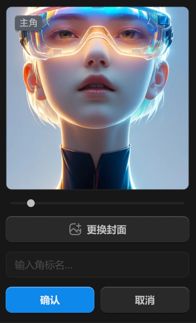

# 右侧边栏-详情面板-档案封面



## 1_hover-封面图

纯黑压暗 50%。

设为封面-icon 居中，颜色 icon-color：亮色 / 二级

## 2_点击-封面图

向下展开设置。

``` css
/* 封面图+更改封面 */

/* Auto layout */
display: flex;
flex-direction: column;
align-items: center;
padding: 12px;
gap: 12px;

width: 264px;
height: 424px;


/* Inside auto layout */
flex: none;
order: 1;
align-self: stretch;
flex-grow: 0;


/* 封面图-容器 */

box-sizing: border-box;

/* Auto layout */
display: flex;
flex-direction: column;
justify-content: center;
align-items: center;
padding: 0px;
isolation: isolate;

width: 240px;
height: 240px;

/* 通用/二级 */
background: #1C1C1C;
/* 通用/三级 */
border: 1px solid #242424;
border-radius: 8px;

/* Inside auto layout */
flex: none;
order: 0;
align-self: stretch;
flex-grow: 0;


/* 封面图 */

width: 240px;
height: 420px;

background: url(image.png);

/* Inside auto layout */
flex: none;
order: 0;
align-self: stretch;
flex-grow: 0;
z-index: 0;


/* 徽标 */

/* Auto layout */
display: flex;
flex-direction: row;
justify-content: center;
align-items: center;
padding: 2px 6px;

position: absolute;
width: 36px;
height: 20px;
left: 12px;
top: 12px;

/* 通用/半透明-2 */
background: rgba(41, 41, 41, 0.5);
/* 立体感-背景模糊 */
box-shadow: 0px 2px 1px rgba(0, 0, 0, 0.2), inset 0px 1px 1px rgba(255, 255, 255, 0.2);
backdrop-filter: blur(40px);
/* Note: backdrop-filter has minimal browser support */
border-radius: 4px;

/* Inside auto layout */
flex: none;
order: 1;
flex-grow: 0;
z-index: 1;


/* 主角 */

width: 24px;
height: 16px;

/* 通用/数字 */
font-family: 'Fira Mono';
font-style: normal;
font-weight: 500;
font-size: 12px;
line-height: 16px;
/* identical to box height, or 133% */
display: flex;
align-items: center;

/* 亮色/二级 */
color: #BFBFBF;


/* Inside auto layout */
flex: none;
order: 0;
flex-grow: 0;


/* 尺寸滑块 */

width: 224px;
height: 10px;


/* Inside auto layout */
flex: none;
order: 1;
flex-grow: 0;


/* 滑轨 */

position: absolute;
width: 224px;
height: 0px;
left: 20px;
top: 269px;

/* 通用/三级 */
border: 3px solid #242424;


/* 圆形按钮 */

position: absolute;
width: 10px;
height: 10px;
left: 40px;
top: 264px;

/* 亮色/二级 */
background: #BFBFBF;


/* 更换封面-按钮 */

/* Auto layout */
display: flex;
flex-direction: row;
justify-content: center;
align-items: center;
padding: 8px 0px;
gap: 6px;

width: 240px;
height: 34px;

/* 通用/四级 */
background: #292929;
/* 立体感-通用 */
box-shadow: 0px 2px 1px rgba(0, 0, 0, 0.2), inset 0px 1px 1px rgba(255, 255, 255, 0.2);
border-radius: 8px;

/* Inside auto layout */
flex: none;
order: 2;
align-self: stretch;
flex-grow: 0;


/* 更换封面-icon */

/* Auto layout */
display: flex;
flex-direction: row;
justify-content: center;
align-items: center;
padding: 0px;

width: 18px;
height: 18px;


/* Inside auto layout */
flex: none;
order: 0;
flex-grow: 0;


/* svg */

width: 14px;
height: 14px;


/* Inside auto layout */
flex: none;
order: 0;
flex-grow: 0;


/* Vector */

position: absolute;
left: 13.16%;
right: 13.16%;
top: 45.91%;
bottom: 29.53%;

/* 亮色/三级 */
border: 1.5px solid #808080;


/* Rectangle 2311 */

position: absolute;
left: 11.11%;
right: 11.11%;
top: 11.11%;
bottom: 11.11%;

/* 亮色/三级 */
border: 1.5px solid #808080;


/* Vector */

position: absolute;
left: 60.23%;
right: 11.11%;
top: 11.11%;
bottom: 60.23%;

/* 亮色/三级 */
border: 1.5px solid #808080;


/* 更换封面 */

width: 52px;
height: 18px;

/* 通用/正文-加粗 */
font-family: 'Microsoft YaHei UI';
font-style: normal;
font-weight: 700;
font-size: 13px;
line-height: 18px;
/* identical to box height, or 138% */
display: flex;
align-items: center;

/* 亮色/二级 */
color: #BFBFBF;


/* Inside auto layout */
flex: none;
order: 1;
flex-grow: 0;


/* 名称输入框 */

box-sizing: border-box;

/* Auto layout */
display: flex;
flex-direction: row;
align-items: center;
padding: 8px 12px;

width: 240px;
height: 34px;

/* 通用/二级 */
background: #1C1C1C;
/* 通用/三级 */
border: 1px solid #242424;
border-radius: 8px;

/* Inside auto layout */
flex: none;
order: 3;
align-self: stretch;
flex-grow: 0;


/* 名称 */

width: 76px;
height: 18px;

/* 通用/正文 */
font-family: 'Microsoft YaHei UI';
font-style: normal;
font-weight: 400;
font-size: 13px;
line-height: 18px;
/* identical to box height, or 138% */
display: flex;
align-items: center;

/* 亮色/四级 */
color: #4D4D4D;


/* Inside auto layout */
flex: none;
order: 0;
flex-grow: 0;


/* 按钮组 */

/* Auto layout */
display: flex;
flex-direction: row;
align-items: flex-start;
padding: 0px;
gap: 8px;

width: 240px;
height: 34px;


/* Inside auto layout */
flex: none;
order: 4;
align-self: stretch;
flex-grow: 0;


/* 确认-按钮 */

/* Auto layout */
display: flex;
flex-direction: row;
justify-content: center;
align-items: center;
padding: 8px 0px;
gap: 6px;

width: 116px;
height: 34px;

/* 品牌/常态 */
background: #0F89EC;
/* 立体感-主要按钮 */
box-shadow: 0px 2px 1px rgba(0, 0, 0, 0.2), inset 0px 1px 1px rgba(255, 255, 255, 0.4);
border-radius: 8px;

/* Inside auto layout */
flex: none;
order: 0;
flex-grow: 1;


/* 确认 */

width: 26px;
height: 18px;

/* 通用/正文-加粗 */
font-family: 'Microsoft YaHei UI';
font-style: normal;
font-weight: 700;
font-size: 13px;
line-height: 18px;
/* identical to box height, or 138% */
display: flex;
align-items: center;

/* 亮色/一级 */
color: #F2F2F2;


/* Inside auto layout */
flex: none;
order: 0;
flex-grow: 0;


/* 取消-按钮 */

/* Auto layout */
display: flex;
flex-direction: row;
justify-content: center;
align-items: center;
padding: 8px 0px;
gap: 6px;

width: 116px;
height: 34px;

/* 通用/四级 */
background: #292929;
/* 立体感-通用 */
box-shadow: 0px 2px 1px rgba(0, 0, 0, 0.2), inset 0px 1px 1px rgba(255, 255, 255, 0.2);
border-radius: 8px;

/* Inside auto layout */
flex: none;
order: 1;
flex-grow: 1;


/* 取消 */

width: 26px;
height: 18px;

/* 通用/正文-加粗 */
font-family: 'Microsoft YaHei UI';
font-style: normal;
font-weight: 700;
font-size: 13px;
line-height: 18px;
/* identical to box height, or 138% */
display: flex;
align-items: center;

/* 亮色/二级 */
color: #BFBFBF;


/* Inside auto layout */
flex: none;
order: 0;
flex-grow: 0;
```


