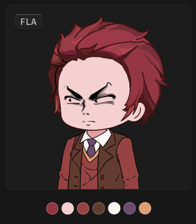

# 右侧边栏-详情面板-缩略图



## 1_hover-色块

放大动画。

``` css
/* 缩略图+颜色信息 */

/* Auto layout */
display: flex;
flex-direction: column;
align-items: center;
padding: 12px;
gap: 12px;

width: 264px;
height: 300px;


/* Inside auto layout */
flex: none;
order: 0;
align-self: stretch;
flex-grow: 0;


/* 缩略图-容器 */

box-sizing: border-box;

/* Auto layout */
display: flex;
flex-direction: column;
align-items: center;
padding: 0px;
isolation: isolate;

width: 240px;
height: 240px;

/* 通用/二级 */
background: #1C1C1C;
/* 通用/三级 */
border: 1px solid #242424;
border-radius: 8px;

/* Inside auto layout */
flex: none;
order: 0;
align-self: stretch;
flex-grow: 0;


/* 缩略图 */

width: 712px;
height: 401px;

background: url(雪牧.png);

/* Inside auto layout */
flex: none;
order: 0;
flex-grow: 0;
z-index: 0;


/* 徽标 */

/* Auto layout */
display: flex;
flex-direction: row;
justify-content: center;
align-items: center;
padding: 2px 6px;

position: absolute;
width: 34px;
height: 20px;
left: 12px;
top: 12px;

/* 通用/半透明-2 */
background: rgba(41, 41, 41, 0.5);
/* 立体感-背景模糊 */
box-shadow: 0px 2px 1px rgba(0, 0, 0, 0.2), inset 0px 1px 1px rgba(255, 255, 255, 0.2);
backdrop-filter: blur(40px);
/* Note: backdrop-filter has minimal browser support */
border-radius: 4px;

/* Inside auto layout */
flex: none;
order: 1;
flex-grow: 0;
z-index: 1;


/* FLA */

width: 22px;
height: 16px;

/* 通用/数字 */
font-family: 'Fira Mono';
font-style: normal;
font-weight: 500;
font-size: 12px;
line-height: 16px;
/* identical to box height, or 133% */
display: flex;
align-items: center;

/* 亮色/二级 */
color: #BFBFBF;


/* Inside auto layout */
flex: none;
order: 0;
flex-grow: 0;


/* 颜色列表 */

/* Auto layout */
display: flex;
flex-direction: row;
justify-content: center;
align-items: center;
padding: 4px;
gap: 4px;

width: 144px;
height: 24px;

border-radius: 14px;

/* Inside auto layout */
flex: none;
order: 1;
flex-grow: 0;


/* 色块 */

box-sizing: border-box;

width: 16px;
height: 16px;

background: #943743;
/* 亮色/半透明-1 */
border: 1px solid rgba(242, 242, 242, 0.18);

/* Inside auto layout */
flex: none;
order: 0;
flex-grow: 0;


/* 色块 */

box-sizing: border-box;

width: 16px;
height: 16px;

background: #F5D0D0;
/* 亮色/半透明-1 */
border: 1px solid rgba(242, 242, 242, 0.18);

/* Inside auto layout */
flex: none;
order: 1;
flex-grow: 0;


/* 色块 */

box-sizing: border-box;

width: 16px;
height: 16px;

background: #984343;
/* 亮色/半透明-1 */
border: 1px solid rgba(242, 242, 242, 0.18);

/* Inside auto layout */
flex: none;
order: 2;
flex-grow: 0;


/* 色块 */

box-sizing: border-box;

width: 16px;
height: 16px;

background: #623C30;
/* 亮色/半透明-1 */
border: 1px solid rgba(242, 242, 242, 0.18);

/* Inside auto layout */
flex: none;
order: 3;
flex-grow: 0;


/* 色块 */

box-sizing: border-box;

width: 16px;
height: 16px;

background: #FCF7F4;
/* 亮色/半透明-1 */
border: 1px solid rgba(242, 242, 242, 0.18);

/* Inside auto layout */
flex: none;
order: 4;
flex-grow: 0;


/* 色块 */

box-sizing: border-box;

width: 16px;
height: 16px;

background: #6B4B6E;
/* 亮色/半透明-1 */
border: 1px solid rgba(242, 242, 242, 0.18);

/* Inside auto layout */
flex: none;
order: 5;
flex-grow: 0;


/* 色块 */

box-sizing: border-box;

width: 16px;
height: 16px;

background: #E19E73;
/* 亮色/半透明-1 */
border: 1px solid rgba(242, 242, 242, 0.18);

/* Inside auto layout */
flex: none;
order: 6;
flex-grow: 0;
```

