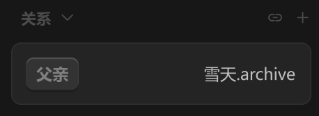

# 右侧边栏-详情面板-链接关系-关系区块



``` css
/* 关系-区块 */

box-sizing: border-box;

/* Auto layout */
display: flex;
flex-direction: column;
align-items: flex-start;
padding: 12px;
gap: 12px;

width: 264px;
height: 102px;

/* 通用/三级 */
border-top: 1px solid #242424;

/* Inside auto layout */
flex: none;
order: 2;
align-self: stretch;
flex-grow: 0;


/* 区块标题 */

/* Auto layout */
display: flex;
flex-direction: row;
justify-content: space-between;
align-items: center;
padding: 0px 0px 0px 8px;
gap: 10px;

width: 240px;
height: 16px;


/* Inside auto layout */
flex: none;
order: 0;
align-self: stretch;
flex-grow: 0;


/* 标题+展开按钮 */

/* Auto layout */
display: flex;
flex-direction: row;
align-items: center;
padding: 0px;
gap: 6px;

width: 44px;
height: 16px;


/* Inside auto layout */
flex: none;
order: 0;
flex-grow: 0;


/* 关系 */

width: 24px;
height: 16px;

/* 通用/次要文字-加粗 */
font-family: 'Microsoft YaHei UI';
font-style: normal;
font-weight: 700;
font-size: 12px;
line-height: 16px;
/* identical to box height, or 133% */
display: flex;
align-items: center;
text-align: center;

/* 亮色/四级 */
color: #4D4D4D;


/* Inside auto layout */
flex: none;
order: 0;
flex-grow: 0;


/* 展开按钮-icon */

/* Auto layout */
display: flex;
flex-direction: column;
justify-content: center;
align-items: center;
padding: 0px;

width: 14px;
height: 14px;


/* Inside auto layout */
flex: none;
order: 1;
flex-grow: 0;


/* svg */

width: 8px;
height: 4px;


/* Inside auto layout */
flex: none;
order: 0;
flex-grow: 0;


/* Vector */

position: absolute;
left: 21.43%;
right: 50%;
top: 35.71%;
bottom: 7.14%;

/* 亮色/四级 */
border: 1px solid #4D4D4D;
transform: matrix(0, -1, -1, 0, 0, 0);


/* 按钮组 */

/* Auto layout */
display: flex;
flex-direction: row;
align-items: center;
padding: 0px;
gap: 8px;

width: 36px;
height: 14px;


/* Inside auto layout */
flex: none;
order: 1;
flex-grow: 0;


/* 链接-小-icon */

/* Auto layout */
display: flex;
flex-direction: column;
justify-content: center;
align-items: center;
padding: 0px;

width: 14px;
height: 14px;


/* Inside auto layout */
flex: none;
order: 0;
flex-grow: 0;


/* svg */

width: 10px;
height: 5px;


/* Inside auto layout */
flex: none;
order: 0;
flex-grow: 0;


/* Vector */

position: absolute;
left: 14.29%;
right: 14.29%;
top: 32.14%;
bottom: 32.14%;

/* 亮色/四级 */
border: 1px solid #4D4D4D;
border-radius: 6px;


/* Vector */

position: absolute;
left: 39.29%;
right: 39.29%;
top: 50%;
bottom: 50%;

/* 亮色/四级 */
border: 1px solid #4D4D4D;
border-radius: 6px;


/* 添加-小-icon */

/* Auto layout */
display: flex;
flex-direction: row;
justify-content: center;
align-items: center;
padding: 0px;

width: 14px;
height: 14px;


/* Inside auto layout */
flex: none;
order: 1;
flex-grow: 0;


/* svg */

width: 8px;
height: 8px;

transform: matrix(1, 0, 0, -1, 0, 0);

/* Inside auto layout */
flex: none;
order: 0;
flex-grow: 0;


/* Vector */

position: absolute;
left: 50%;
right: 50%;
top: 21.43%;
bottom: 21.43%;

/* 亮色/四级 */
border: 1px solid #4D4D4D;


/* Vector */

position: absolute;
left: 21.43%;
right: 78.57%;
top: 50%;
bottom: -7.15%;

/* 亮色/四级 */
border: 1px solid #4D4D4D;
transform: rotate(90deg);


/* 关系卡片-列表 */

/* Auto layout */
display: flex;
flex-direction: column;
align-items: flex-start;
padding: 0px;
gap: 8px;

width: 240px;
height: 50px;


/* Inside auto layout */
flex: none;
order: 1;
align-self: stretch;
flex-grow: 0;


/* 关系卡片 */

box-sizing: border-box;

/* Auto layout */
display: flex;
flex-direction: row;
justify-content: space-between;
align-items: center;
padding: 12px;
gap: 6px;

width: 240px;
height: 50px;

/* 通用/三级 */
background: #242424;
/* 通用/五级 */
border: 1px solid #2E2E2E;
border-radius: 8px;

/* Inside auto layout */
flex: none;
order: 0;
align-self: stretch;
flex-grow: 0;


/* 关系 */

/* Auto layout */
display: flex;
flex-direction: row;
justify-content: center;
align-items: center;
padding: 4px 8px;

margin: 0 auto;
width: 42px;
height: 26px;

/* 通用/六级 */
background: #333333;
/* 立体感-通用 */
box-shadow: 0px 2px 1px rgba(0, 0, 0, 0.2), inset 0px 1px 1px rgba(255, 255, 255, 0.2);
border-radius: 6px;

/* Inside auto layout */
flex: none;
order: 0;
flex-grow: 0;


/* 父亲 */

width: 26px;
height: 18px;

/* 通用/正文-加粗 */
font-family: 'Microsoft YaHei UI';
font-style: normal;
font-weight: 700;
font-size: 13px;
line-height: 18px;
/* identical to box height, or 138% */
display: flex;
align-items: center;

/* 亮色/三级 */
color: #808080;


/* Inside auto layout */
flex: none;
order: 0;
flex-grow: 0;


/* 雪牧_自动.fla */

margin: 0 auto;
width: 74px;
height: 18px;

/* 通用/正文 */
font-family: 'Microsoft YaHei UI';
font-style: normal;
font-weight: 400;
font-size: 13px;
line-height: 18px;
/* identical to box height, or 138% */
display: flex;
align-items: center;

/* 亮色/二级 */
color: #BFBFBF;


/* Inside auto layout */
flex: none;
order: 1;
flex-grow: 0;
```

