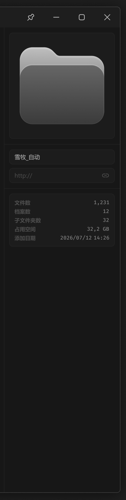

# 右侧面板-文件夹详情



文件夹详情不需要信息查看按钮。

当为选中文件时，右侧边栏显示当前停留视口的文件夹 / 档案信息。

``` css
/* 文件夹数据展示 */

/* Auto layout */
display: flex;
flex-direction: column;
align-items: flex-start;
padding: 0px;

width: 264px;
height: 1052px;


/* Inside auto layout */
flex: none;
order: 2;
align-self: stretch;
flex-grow: 1;


/* 缩略图 */

/* Auto layout */
display: flex;
flex-direction: column;
align-items: center;
padding: 12px;
gap: 12px;

width: 264px;
height: 264px;


/* Inside auto layout */
flex: none;
order: 0;
align-self: stretch;
flex-grow: 0;


/* 缩略图-容器 */

box-sizing: border-box;

/* Auto layout */
display: flex;
flex-direction: column;
justify-content: center;
align-items: center;
padding: 24px;

width: 240px;
height: 240px;

/* 通用/二级 */
background: #1C1C1C;
/* 通用/三级 */
border: 1px solid #242424;
border-radius: 8px;

/* Inside auto layout */
flex: none;
order: 0;
align-self: stretch;
flex-grow: 0;


/* 文件夹-详情面板-icon */

width: 192px;
height: 174px;


/* Inside auto layout */
flex: none;
order: 0;
flex-grow: 0;


/* Vector */

box-sizing: border-box;

position: absolute;
left: 10%;
right: 10%;
top: 13.75%;
bottom: 13.75%;

/* 亮色/渐变-1 */
background: linear-gradient(180deg, #BFBFBF 0%, #4D4D4D 100%);
/* 亮色/半透明-3 */
border: 1px solid rgba(242, 242, 242, 0.06);
box-shadow: inset 0px 4px 2px rgba(255, 255, 255, 0.2);


/* Vector */

box-sizing: border-box;

position: absolute;
left: 10%;
right: 10%;
top: 29.86%;
bottom: 13.75%;

/* 通用/半透明-2 */
background: rgba(41, 41, 41, 0.5);
/* 亮色/半透明-3 */
border: 1px solid rgba(242, 242, 242, 0.06);
box-shadow: inset 0px 2px 1px rgba(255, 255, 255, 0.5);


/* 输入框-区块 */

box-sizing: border-box;

/* Auto layout */
display: flex;
flex-direction: column;
align-items: flex-start;
padding: 12px;
gap: 8px;

width: 264px;
height: 100px;

/* 通用/三级 */
border-top: 1px solid #242424;

/* Inside auto layout */
flex: none;
order: 1;
align-self: stretch;
flex-grow: 0;


/* 名称输入框 */

box-sizing: border-box;

/* Auto layout */
display: flex;
flex-direction: row;
align-items: center;
padding: 8px 12px;

width: 240px;
height: 34px;

/* 通用/二级 */
background: #1C1C1C;
/* 通用/三级 */
border: 1px solid #242424;
border-radius: 8px;

/* Inside auto layout */
flex: none;
order: 0;
align-self: stretch;
flex-grow: 0;


/* 名称 */

width: 58px;
height: 18px;

/* 通用/正文 */
font-family: 'Microsoft YaHei UI';
font-style: normal;
font-weight: 400;
font-size: 13px;
line-height: 18px;
/* identical to box height, or 138% */
display: flex;
align-items: center;

/* 亮色/二级 */
color: #BFBFBF;


/* Inside auto layout */
flex: none;
order: 0;
flex-grow: 0;


/* 链接输入框 */

box-sizing: border-box;

/* Auto layout */
display: flex;
flex-direction: row;
justify-content: space-between;
align-items: center;
padding: 8px 12px;

width: 240px;
height: 34px;

/* 通用/二级 */
background: #1C1C1C;
/* 通用/三级 */
border: 1px solid #242424;
border-radius: 8px;

/* Inside auto layout */
flex: none;
order: 1;
align-self: stretch;
flex-grow: 0;


/* 链接 */

margin: 0 auto;
width: 41px;
height: 18px;

/* 通用/正文 */
font-family: 'Microsoft YaHei UI';
font-style: normal;
font-weight: 400;
font-size: 13px;
line-height: 18px;
/* identical to box height, or 138% */
display: flex;
align-items: center;

/* 亮色/四级 */
color: #4D4D4D;


/* Inside auto layout */
flex: none;
order: 0;
flex-grow: 0;


/* 链接-icon */

/* Auto layout */
display: flex;
flex-direction: column;
justify-content: center;
align-items: center;
padding: 0px;

margin: 0 auto;
width: 18px;
height: 18px;


/* Inside auto layout */
flex: none;
order: 1;
flex-grow: 0;


/* svg */

width: 14px;
height: 7px;


/* Inside auto layout */
flex: none;
order: 0;
flex-grow: 0;


/* Vector */

position: absolute;
left: 11.11%;
right: 11.11%;
top: 30.56%;
bottom: 30.56%;

/* 亮色/四级 */
border: 1.5px solid #4D4D4D;
border-radius: 6px;


/* Vector */

position: absolute;
left: 38.33%;
right: 38.33%;
top: 50%;
bottom: 50%;

/* 亮色/四级 */
border: 1.5px solid #4D4D4D;
border-radius: 6px;


/* 基础信息-区块 */

box-sizing: border-box;

/* Auto layout */
display: flex;
flex-direction: column;
align-items: flex-start;
padding: 12px;

width: 264px;
height: 144px;

/* 通用/三级 */
border-top: 1px solid #242424;

/* Inside auto layout */
flex: none;
order: 2;
align-self: stretch;
flex-grow: 0;


/* 信息列表 */

box-sizing: border-box;

/* Auto layout */
display: flex;
flex-direction: column;
align-items: flex-start;
padding: 12px;
gap: 4px;

width: 240px;
height: 120px;

/* 通用/二级 */
background: #1C1C1C;
/* 通用/三级 */
border: 1px solid #242424;
border-radius: 8px;

/* Inside auto layout */
flex: none;
order: 0;
align-self: stretch;
flex-grow: 0;


/* 文件数 */

/* Auto layout */
display: flex;
flex-direction: row;
justify-content: space-between;
align-items: center;
padding: 0px;
gap: 10px;

width: 216px;
height: 16px;


/* Inside auto layout */
flex: none;
order: 0;
align-self: stretch;
flex-grow: 0;


/* 文件数 */

width: 36px;
height: 16px;

/* 通用/次要文字-加粗 */
font-family: 'Microsoft YaHei UI';
font-style: normal;
font-weight: 700;
font-size: 12px;
line-height: 16px;
/* identical to box height, or 133% */

/* 亮色/四级 */
color: #4D4D4D;


/* Inside auto layout */
flex: none;
order: 0;
flex-grow: 0;


/* 1,231 */

width: 36px;
height: 16px;

/* 通用/数字 */
font-family: 'Fira Mono';
font-style: normal;
font-weight: 500;
font-size: 12px;
line-height: 16px;
/* identical to box height, or 133% */

/* 亮色/三级 */
color: #808080;


/* Inside auto layout */
flex: none;
order: 1;
flex-grow: 0;


/* 档案数 */

/* Auto layout */
display: flex;
flex-direction: row;
justify-content: space-between;
align-items: center;
padding: 0px;
gap: 10px;

width: 216px;
height: 16px;


/* Inside auto layout */
flex: none;
order: 1;
align-self: stretch;
flex-grow: 0;


/* 档案数 */

width: 36px;
height: 16px;

/* 通用/次要文字-加粗 */
font-family: 'Microsoft YaHei UI';
font-style: normal;
font-weight: 700;
font-size: 12px;
line-height: 16px;
/* identical to box height, or 133% */

/* 亮色/四级 */
color: #4D4D4D;


/* Inside auto layout */
flex: none;
order: 0;
flex-grow: 0;


/* 12 */

width: 15px;
height: 16px;

/* 通用/数字 */
font-family: 'Fira Mono';
font-style: normal;
font-weight: 500;
font-size: 12px;
line-height: 16px;
/* identical to box height, or 133% */

/* 亮色/三级 */
color: #808080;


/* Inside auto layout */
flex: none;
order: 1;
flex-grow: 0;


/* 子文件夹数 */

/* Auto layout */
display: flex;
flex-direction: row;
justify-content: space-between;
align-items: center;
padding: 0px;
gap: 10px;

width: 216px;
height: 16px;


/* Inside auto layout */
flex: none;
order: 2;
align-self: stretch;
flex-grow: 0;


/* 子文件夹数 */

width: 60px;
height: 16px;

/* 通用/次要文字-加粗 */
font-family: 'Microsoft YaHei UI';
font-style: normal;
font-weight: 700;
font-size: 12px;
line-height: 16px;
/* identical to box height, or 133% */

/* 亮色/四级 */
color: #4D4D4D;


/* Inside auto layout */
flex: none;
order: 0;
flex-grow: 0;


/* 32 */

width: 15px;
height: 16px;

/* 通用/数字 */
font-family: 'Fira Mono';
font-style: normal;
font-weight: 500;
font-size: 12px;
line-height: 16px;
/* identical to box height, or 133% */

/* 亮色/三级 */
color: #808080;


/* Inside auto layout */
flex: none;
order: 1;
flex-grow: 0;


/* 占用空间 */

/* Auto layout */
display: flex;
flex-direction: row;
justify-content: space-between;
align-items: center;
padding: 0px;
gap: 10px;

width: 216px;
height: 16px;


/* Inside auto layout */
flex: none;
order: 3;
align-self: stretch;
flex-grow: 0;


/* 占用空间 */

width: 48px;
height: 16px;

/* 通用/次要文字-加粗 */
font-family: 'Microsoft YaHei UI';
font-style: normal;
font-weight: 700;
font-size: 12px;
line-height: 16px;
/* identical to box height, or 133% */

/* 亮色/四级 */
color: #4D4D4D;


/* Inside auto layout */
flex: none;
order: 0;
flex-grow: 0;


/* 32,2 GB */

width: 51px;
height: 16px;

/* 通用/数字 */
font-family: 'Fira Mono';
font-style: normal;
font-weight: 500;
font-size: 12px;
line-height: 16px;
/* identical to box height, or 133% */

/* 亮色/三级 */
color: #808080;


/* Inside auto layout */
flex: none;
order: 1;
flex-grow: 0;


/* 添加日期 */

/* Auto layout */
display: flex;
flex-direction: row;
justify-content: space-between;
align-items: center;
padding: 0px;
gap: 10px;

width: 216px;
height: 16px;


/* Inside auto layout */
flex: none;
order: 4;
align-self: stretch;
flex-grow: 0;


/* 添加日期 */

width: 48px;
height: 16px;

/* 通用/次要文字-加粗 */
font-family: 'Microsoft YaHei UI';
font-style: normal;
font-weight: 700;
font-size: 12px;
line-height: 16px;
/* identical to box height, or 133% */

/* 亮色/四级 */
color: #4D4D4D;


/* Inside auto layout */
flex: none;
order: 0;
flex-grow: 0;


/* 添加日期 */

/* Auto layout */
display: flex;
flex-direction: row;
align-items: center;
padding: 0px;
gap: 4px;

width: 112px;
height: 16px;


/* Inside auto layout */
flex: none;
order: 1;
flex-grow: 0;


/* 2026/07/12 */

width: 72px;
height: 16px;

/* 通用/数字 */
font-family: 'Fira Mono';
font-style: normal;
font-weight: 500;
font-size: 12px;
line-height: 16px;
/* identical to box height, or 133% */

/* 亮色/三级 */
color: #808080;


/* Inside auto layout */
flex: none;
order: 0;
flex-grow: 0;


/* 14:26 */

width: 36px;
height: 16px;

/* 通用/数字 */
font-family: 'Fira Mono';
font-style: normal;
font-weight: 500;
font-size: 12px;
line-height: 16px;
/* identical to box height, or 133% */

/* 亮色/三级 */
color: #808080;


/* Inside auto layout */
flex: none;
order: 1;
flex-grow: 0;
```

