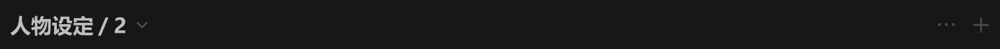

# 分组标题-item



## 1_hover

> 常态下展开、更多、新建三个按钮都不显示

展开、更多、新建三个按钮出现

## 2_hover-按钮组

icon-color：亮色 / 二级

``` css
/* 分组标题 */

/* Auto layout */
display: flex;
flex-direction: row;
justify-content: space-between;
align-items: center;
padding: 0px 0px 0px 8px;
gap: 10px;

width: 856px;
height: 26px;


/* Inside auto layout */
flex: none;
order: 0;
align-self: stretch;
flex-grow: 0;


/* 标题+展开按钮 */

/* Auto layout */
display: flex;
flex-direction: row;
align-items: center;
padding: 0px;
gap: 6px;

width: 121px;
height: 26px;


/* Inside auto layout */
flex: none;
order: 0;
flex-grow: 0;


/* 标题+数量 */

/* Auto layout */
display: flex;
flex-direction: row;
justify-content: center;
align-items: center;
padding: 0px;
gap: 4px;

width: 101px;
height: 26px;


/* Inside auto layout */
flex: none;
order: 0;
flex-grow: 0;


/* 人物设定 */

width: 72px;
height: 26px;

/* 通用/标题 */
font-family: 'Microsoft YaHei UI';
font-style: normal;
font-weight: 700;
font-size: 18px;
line-height: 26px;
/* identical to box height, or 144% */
display: flex;
align-items: center;
text-align: center;

/* 亮色/二级 */
color: #BFBFBF;


/* Inside auto layout */
flex: none;
order: 0;
flex-grow: 0;


/* / */

width: 9px;
height: 26px;

/* 通用/标题 */
font-family: 'Microsoft YaHei UI';
font-style: normal;
font-weight: 700;
font-size: 18px;
line-height: 26px;
/* identical to box height, or 144% */
display: flex;
align-items: center;
text-align: center;

/* 亮色/二级 */
color: #BFBFBF;


/* Inside auto layout */
flex: none;
order: 1;
flex-grow: 0;


/* 2 */

width: 12px;
height: 26px;

/* 通用/标题 */
font-family: 'Microsoft YaHei UI';
font-style: normal;
font-weight: 700;
font-size: 18px;
line-height: 26px;
/* identical to box height, or 144% */
display: flex;
align-items: center;
text-align: center;

/* 亮色/二级 */
color: #BFBFBF;


/* Inside auto layout */
flex: none;
order: 2;
flex-grow: 0;


/* 展开按钮-icon */

/* Auto layout */
display: flex;
flex-direction: column;
justify-content: center;
align-items: center;
padding: 0px;

width: 14px;
height: 14px;


/* Inside auto layout */
flex: none;
order: 1;
flex-grow: 0;


/* svg */

width: 8px;
height: 4px;


/* Inside auto layout */
flex: none;
order: 0;
flex-grow: 0;


/* Vector */

position: absolute;
left: 21.43%;
right: 50%;
top: 35.71%;
bottom: 7.14%;

/* 亮色/四级 */
border: 1.5px solid #4D4D4D;
transform: matrix(0, -1, -1, 0, 0, 0);


/* 按钮组 */

/* Auto layout */
display: flex;
flex-direction: row;
align-items: center;
padding: 0px;
gap: 12px;

width: 48px;
height: 18px;


/* Inside auto layout */
flex: none;
order: 1;
flex-grow: 0;


/* 更多-大-icon */

/* Auto layout */
display: flex;
flex-direction: column;
justify-content: center;
align-items: center;
padding: 0px;

width: 18px;
height: 18px;


/* Inside auto layout */
flex: none;
order: 0;
flex-grow: 0;


/* svg */

width: 12px;
height: 1px;


/* Inside auto layout */
flex: none;
order: 0;
flex-grow: 0;


/* Vector */

position: absolute;
left: 49.95%;
right: 50%;
top: 47.22%;
bottom: 47.22%;

/* 亮色/四级 */
border: 2.5px solid #4D4D4D;


/* Vector */

position: absolute;
left: 83.28%;
right: 16.67%;
top: 47.22%;
bottom: 47.22%;

/* 亮色/四级 */
border: 2.5px solid #4D4D4D;


/* Vector */

position: absolute;
left: 16.67%;
right: 83.28%;
top: 47.22%;
bottom: 47.22%;

/* 亮色/四级 */
border: 2.5px solid #4D4D4D;


/* 添加-大-icon */

/* Auto layout */
display: flex;
flex-direction: row;
justify-content: center;
align-items: center;
padding: 0px;

width: 18px;
height: 18px;


/* Inside auto layout */
flex: none;
order: 1;
flex-grow: 0;


/* svg */

width: 12px;
height: 12px;

transform: matrix(1, 0, 0, -1, 0, 0);

/* Inside auto layout */
flex: none;
order: 0;
flex-grow: 0;


/* Vector */

position: absolute;
left: 50%;
right: 50%;
top: 16.67%;
bottom: 16.67%;

/* 亮色/四级 */
border: 1.5px solid #4D4D4D;


/* Vector */

position: absolute;
left: 16.67%;
right: 83.33%;
top: 50%;
bottom: -16.67%;

/* 亮色/四级 */
border: 1.5px solid #4D4D4D;
transform: rotate(90deg);

```

