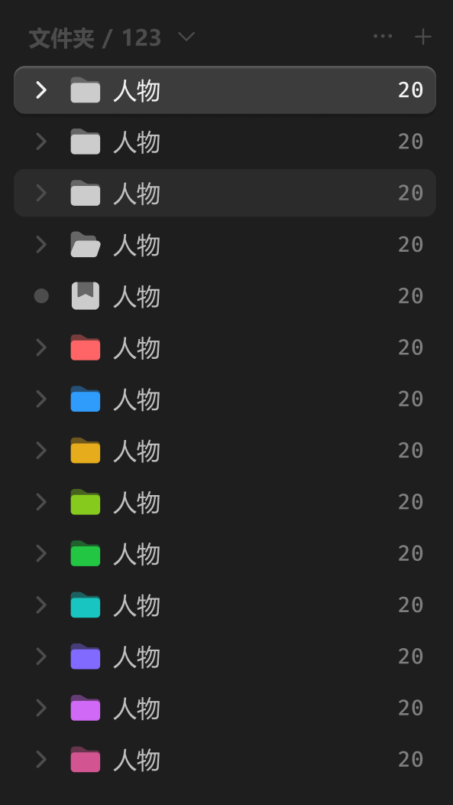

# 文件夹 item



## 1_hover

background-color：亮色 / 半透明-3

## 2_选中

background-color：亮色 / 半透明-2

效果：立体感-通用

展开按钮-color：亮色 / 一级

名称-color：亮色 / 一级

数量文本：亮色 / 一级

``` css
/* 文件夹-常态-item */

/* Auto layout */
display: flex;
flex-direction: row;
justify-content: space-between;
align-items: center;
padding: 4px 6px;
gap: 6px;

width: 230px;
height: 26px;

border-radius: 6px;

/* Inside auto layout */
flex: none;
order: 1;
align-self: stretch;
flex-grow: 0;


/* 展开按钮+图标+名称 */

/* Auto layout */
display: flex;
flex-direction: row;
align-items: center;
padding: 0px;
gap: 6px;

width: 74px;
height: 18px;


/* Inside auto layout */
flex: none;
order: 0;
flex-grow: 0;


/* 展开按钮-icon */

/* Auto layout */
display: flex;
flex-direction: column;
justify-content: center;
align-items: center;
padding: 0px;

width: 18px;
height: 18px;

transform: rotate(-90deg);

/* Inside auto layout */
flex: none;
order: 0;
flex-grow: 0;


/* svg */

width: 8px;
height: 4px;

transform: rotate(-90deg);

/* Inside auto layout */
flex: none;
order: 0;
flex-grow: 0;


/* Vector */

position: absolute;
left: 38.89%;
right: 38.89%;
top: 27.78%;
bottom: 27.78%;

/* 亮色/四级 */
border: 1.5px solid #4D4D4D;
transform: matrix(-1, 0, 0, 1, 0, 0);


/* 文件夹-关闭-icon */

/* Auto layout */
display: flex;
flex-direction: column;
justify-content: center;
align-items: center;
padding: 0px;

width: 18px;
height: 18px;


/* Inside auto layout */
flex: none;
order: 1;
flex-grow: 0;


/* svg */

width: 16px;
height: 14px;


/* Inside auto layout */
flex: none;
order: 0;
flex-grow: 0;


/* Rectangle 17755 */

position: absolute;
width: 16px;
height: 14px;
left: 1px;
top: 2px;

/* 自定义/常态-2 */
background: #666666;
border-radius: 2px;


/* Rectangle 17756 */

position: absolute;
width: 16px;
height: 10.77px;
left: 1px;
top: 5.23px;

/* 自定义/常态-1 */
background: #CCCCCC;
border-radius: 2px;


/* 人物 */

width: 26px;
height: 18px;

/* 通用/正文 */
font-family: 'Microsoft YaHei UI';
font-style: normal;
font-weight: 400;
font-size: 13px;
line-height: 18px;
/* identical to box height, or 138% */

/* 亮色/二级 */
color: #BFBFBF;


/* Inside auto layout */
flex: none;
order: 2;
flex-grow: 0;


/* 20 */

width: 15px;
height: 16px;

/* 通用/数字 */
font-family: 'Fira Mono';
font-style: normal;
font-weight: 500;
font-size: 12px;
line-height: 16px;
/* identical to box height, or 133% */

/* 亮色/三级 */
color: #808080;


/* Inside auto layout */
flex: none;
order: 1;
flex-grow: 0;

```

