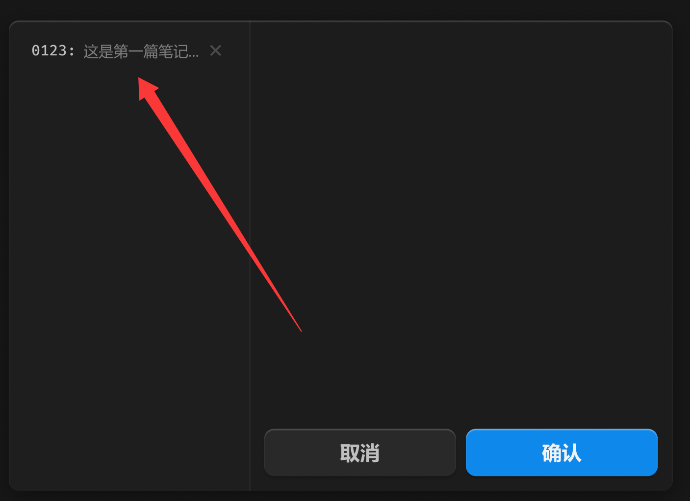

# 笔记



>  关闭按钮常态不显示，不产生视觉噪音，hover 时右至左滑入

## 1_hover

background：亮色 / 半透明-3

## 2_选中

background：亮色 / 半透明-2

text-color：亮色 / 二级

``` css
/* 笔记item */

/* Auto layout */
display: flex;
flex-direction: row;
align-items: center;
padding: 4px 6px;
gap: 6px;

width: 169px;
height: 24px;

border-radius: 6px;

/* Inside auto layout */
flex: none;
order: 0;
align-self: stretch;
flex-grow: 0;


/* 0123: */

width: 36px;
height: 16px;

/* 通用/数字 */
font-family: 'Fira Mono';
font-style: normal;
font-weight: 500;
font-size: 12px;
line-height: 16px;
/* identical to box height, or 133% */
display: flex;
align-items: center;

/* 亮色/二级 */
color: #BFBFBF;


/* Inside auto layout */
flex: none;
order: 0;
flex-grow: 0;


/* 这是第一篇笔记... */

width: 93px;
height: 16px;

/* 通用/次要文字 */
font-family: 'Microsoft YaHei UI';
font-style: normal;
font-weight: 400;
font-size: 12px;
line-height: 16px;
/* identical to box height, or 133% */
display: flex;
align-items: center;

/* 亮色/三级 */
color: #808080;


/* Inside auto layout */
flex: none;
order: 1;
flex-grow: 0;


/* 关闭-小-icon */

/* Auto layout */
display: flex;
flex-direction: row;
justify-content: center;
align-items: center;
padding: 0px;

width: 14px;
height: 14px;


/* Inside auto layout */
flex: none;
order: 2;
flex-grow: 0;


/* svg */

width: 7px;
height: 7px;


/* Inside auto layout */
flex: none;
order: 0;
flex-grow: 0;


/* Vector */

position: absolute;
left: 25%;
right: 25%;
top: 25%;
bottom: 25%;

/* 亮色/四级 */
border: 1.5px solid #4D4D4D;
```

