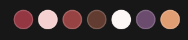

# 色块



## 1_hover-色块

放大。

``` css
/* 颜色列表 */

/* Auto layout */
display: flex;
flex-direction: row;
justify-content: center;
align-items: center;
padding: 4px;
gap: 4px;

width: 144px;
height: 24px;

border-radius: 14px;

/* Inside auto layout */
flex: none;
order: 1;
flex-grow: 0;


/* 色块 */

box-sizing: border-box;

width: 16px;
height: 16px;

background: #943743;
/* 亮色/半透明-1 */
border: 1px solid rgba(242, 242, 242, 0.18);

/* Inside auto layout */
flex: none;
order: 0;
flex-grow: 0;


/* 色块 */

box-sizing: border-box;

width: 16px;
height: 16px;

background: #F5D0D0;
/* 亮色/半透明-1 */
border: 1px solid rgba(242, 242, 242, 0.18);

/* Inside auto layout */
flex: none;
order: 1;
flex-grow: 0;


/* 色块 */

box-sizing: border-box;

width: 16px;
height: 16px;

background: #984343;
/* 亮色/半透明-1 */
border: 1px solid rgba(242, 242, 242, 0.18);

/* Inside auto layout */
flex: none;
order: 2;
flex-grow: 0;


/* 色块 */

box-sizing: border-box;

width: 16px;
height: 16px;

background: #623C30;
/* 亮色/半透明-1 */
border: 1px solid rgba(242, 242, 242, 0.18);

/* Inside auto layout */
flex: none;
order: 3;
flex-grow: 0;


/* 色块 */

box-sizing: border-box;

width: 16px;
height: 16px;

background: #FCF7F4;
/* 亮色/半透明-1 */
border: 1px solid rgba(242, 242, 242, 0.18);

/* Inside auto layout */
flex: none;
order: 4;
flex-grow: 0;


/* 色块 */

box-sizing: border-box;

width: 16px;
height: 16px;

background: #6B4B6E;
/* 亮色/半透明-1 */
border: 1px solid rgba(242, 242, 242, 0.18);

/* Inside auto layout */
flex: none;
order: 5;
flex-grow: 0;


/* 色块 */

box-sizing: border-box;

width: 16px;
height: 16px;

background: #E19E73;
/* 亮色/半透明-1 */
border: 1px solid rgba(242, 242, 242, 0.18);

/* Inside auto layout */
flex: none;
order: 6;
flex-grow: 0;
```

