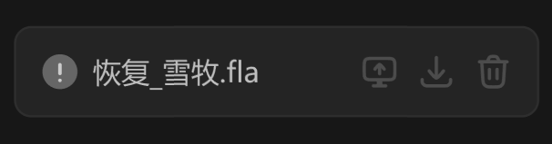

# 污染文件 item



## 1_hover-item

background-color：通用 / 四级

border-color：通用 / 六级

按钮组常态不显示，不产生视觉噪音，hover 时右至左滑入

## 2_hover-按钮组

icon-color：亮色 / 二级

``` css
/* 污染文件卡片列表 */

/* Auto layout */
display: flex;
flex-direction: column;
align-items: flex-start;
padding: 0px;
gap: 8px;

width: 240px;
height: 42px;


/* Inside auto layout */
flex: none;
order: 1;
align-self: stretch;
flex-grow: 0;


/* 污染文件卡片 */

box-sizing: border-box;

/* Auto layout */
display: flex;
flex-direction: row;
justify-content: space-between;
align-items: center;
padding: 12px;

width: 240px;
height: 42px;

/* 通用/三级 */
background: #242424;
/* 通用/五级 */
border: 1px solid #2E2E2E;
border-radius: 8px;

/* Inside auto layout */
flex: none;
order: 0;
align-self: stretch;
flex-grow: 0;


/* 图标+名称 */

/* Auto layout */
display: flex;
flex-direction: row;
align-items: center;
padding: 0px;
gap: 6px;

margin: 0 auto;
width: 101px;
height: 18px;


/* Inside auto layout */
flex: none;
order: 0;
flex-grow: 0;


/* 警告-小-icon */

/* Auto layout */
display: flex;
flex-direction: row;
justify-content: center;
align-items: center;
padding: 0px;

width: 18px;
height: 18px;


/* Inside auto layout */
flex: none;
order: 0;
flex-grow: 0;


/* svg */

width: 16px;
height: 16px;


/* Inside auto layout */
flex: none;
order: 0;
flex-grow: 0;


/* Vector */

position: absolute;
left: 5.56%;
right: 5.56%;
top: 5.56%;
bottom: 5.56%;

/* 自定义/常态-2 */
background: #666666;


/* Vector */

position: absolute;
left: 45.56%;
right: 45.56%;
top: 27.78%;
bottom: 41.11%;

/* 自定义/常态-1 */
background: #CCCCCC;


/* Vector */

position: absolute;
left: 45.56%;
right: 45.56%;
top: 67.78%;
bottom: 23.33%;

/* 自定义/常态-1 */
background: #CCCCCC;


/* 恢复_雪牧.fla */

width: 77px;
height: 18px;

/* 通用/正文 */
font-family: 'Microsoft YaHei UI';
font-style: normal;
font-weight: 400;
font-size: 13px;
line-height: 18px;
/* identical to box height, or 138% */

/* 亮色/二级 */
color: #BFBFBF;


/* Inside auto layout */
flex: none;
order: 1;
flex-grow: 0;


/* 按钮组 */

/* Auto layout */
display: flex;
flex-direction: row;
justify-content: flex-end;
align-items: center;
padding: 0px;
gap: 8px;

margin: 0 auto;
width: 70px;
height: 18px;


/* Inside auto layout */
flex: none;
order: 1;
flex-grow: 0;


/* 打开资源管理器-icon */

/* Auto layout */
display: flex;
flex-direction: column;
align-items: flex-start;
padding: 3px 2px;
gap: 10px;

width: 18px;
height: 18px;


/* Inside auto layout */
flex: none;
order: 0;
flex-grow: 0;


/* svg */

width: 14px;
height: 12.6px;


/* Inside auto layout */
flex: none;
order: 0;
flex-grow: 0;


/* Vector 9495 */

position: absolute;
left: 11.11%;
right: 11.11%;
top: 16.67%;
bottom: 28.89%;

/* 亮色/四级 */
border: 1.5px solid #4D4D4D;


/* Vector 9605 */

position: absolute;
left: 34.44%;
right: 34.44%;
top: 71.11%;
bottom: 13.33%;

/* 亮色/四级 */
border: 1.5px solid #4D4D4D;


/* Vector */

position: absolute;
left: 38.33%;
right: 38.33%;
top: 32.22%;
bottom: 44.44%;

/* 亮色/四级 */
border: 1.5px solid #4D4D4D;


/* 导入-icon */

/* Auto layout */
display: flex;
flex-direction: row;
justify-content: center;
align-items: center;
padding: 0px;

width: 18px;
height: 18px;


/* Inside auto layout */
flex: none;
order: 1;
flex-grow: 0;


/* svg */

width: 13px;
height: 13px;


/* Inside auto layout */
flex: none;
order: 0;
flex-grow: 0;


/* Vector 9655 */

position: absolute;
left: 13.89%;
right: 13.89%;
top: 70.06%;
bottom: 13.89%;

/* 亮色/四级 */
border: 1.5px solid #4D4D4D;


/* Vector */

position: absolute;
left: 31.94%;
right: 31.94%;
top: 13.89%;
bottom: 33.95%;

/* 亮色/四级 */
border: 1.5px solid #4D4D4D;


/* 回收站-icon */

/* Auto layout */
display: flex;
flex-direction: row;
justify-content: center;
align-items: center;
padding: 0px;

width: 18px;
height: 18px;


/* Inside auto layout */
flex: none;
order: 2;
flex-grow: 0;


/* svg */

width: 12.6px;
height: 14px;


/* Inside auto layout */
flex: none;
order: 0;
flex-grow: 0;


/* Rectangle 980 */

position: absolute;
left: 20.83%;
right: 20.83%;
top: 24.72%;
bottom: 11.11%;

/* 亮色/四级 */
border: 1.5px solid #4D4D4D;


/* Vector */

position: absolute;
left: 15%;
right: 15%;
top: 11.11%;
bottom: 75.28%;

/* 亮色/四级 */
border: 1.5px solid #4D4D4D;


/* Line 5 */

position: absolute;
left: 40.28%;
right: 36.39%;
top: 44.17%;
bottom: 55.83%;

/* 亮色/四级 */
border: 1.5px solid #4D4D4D;
transform: rotate(-90deg);


/* Line 6 */

position: absolute;
left: 59.72%;
right: 40.28%;
top: 44.17%;
bottom: 32.5%;

/* 亮色/四级 */
border: 1.5px solid #4D4D4D;

```

