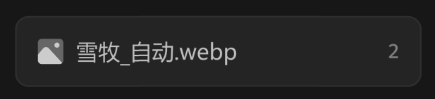

# 链接缩略图 item



## 1_hover-item

background-color：通用 / 四级

border-color：通用 / 六级

关闭按钮常态不显示，不产生视觉噪音，hover 时右至左滑入

## 2_hover-关闭按钮

icon-color：亮色 / 二级

``` css
/* 缩略图卡片-列表 */

/* Auto layout */
display: flex;
flex-direction: column;
align-items: flex-start;
padding: 0px;
gap: 8px;

width: 240px;
height: 42px;


/* Inside auto layout */
flex: none;
order: 1;
align-self: stretch;
flex-grow: 0;


/* 缩略图卡片 */

box-sizing: border-box;

/* Auto layout */
display: flex;
flex-direction: row;
justify-content: space-between;
align-items: center;
padding: 12px;

width: 240px;
height: 42px;

/* 通用/三级 */
background: #242424;
/* 通用/五级 */
border: 1px solid #2E2E2E;
border-radius: 8px;

/* Inside auto layout */
flex: none;
order: 0;
align-self: stretch;
flex-grow: 0;


/* 图标+名称 */

/* Auto layout */
display: flex;
flex-direction: row;
align-items: center;
padding: 0px;
gap: 6px;

margin: 0 auto;
width: 120px;
height: 18px;


/* Inside auto layout */
flex: none;
order: 0;
flex-grow: 0;


/* 图片-icon */

/* Auto layout */
display: flex;
flex-direction: row;
justify-content: center;
align-items: center;
padding: 0px;

width: 18px;
height: 18px;


/* Inside auto layout */
flex: none;
order: 0;
flex-grow: 0;


/* svg */

width: 15px;
height: 15px;


/* Inside auto layout */
flex: none;
order: 0;
flex-grow: 0;


/* Vector */

position: absolute;
left: 8.33%;
right: 8.33%;
top: 8.33%;
bottom: 8.33%;

/* 自定义/常态-2 */
background: #666666;


/* Vector */

position: absolute;
left: 62.5%;
right: 20.83%;
top: 20.83%;
bottom: 62.5%;

/* 自定义/常态-1 */
background: #CCCCCC;


/* Vector */

position: absolute;
left: 8.33%;
right: 11.83%;
top: 35.65%;
bottom: 8.33%;

/* 自定义/常态-1 */
background: #CCCCCC;


/* 雪牧_自动.webp */

width: 96px;
height: 18px;

/* 通用/正文 */
font-family: 'Microsoft YaHei UI';
font-style: normal;
font-weight: 400;
font-size: 13px;
line-height: 18px;
/* identical to box height, or 138% */

/* 亮色/二级 */
color: #BFBFBF;


/* Inside auto layout */
flex: none;
order: 1;
flex-grow: 0;


/* 2 */

margin: 0 auto;
width: 8px;
height: 16px;

/* 通用/数字 */
font-family: 'Fira Mono';
font-style: normal;
font-weight: 500;
font-size: 12px;
line-height: 16px;
/* identical to box height, or 133% */

/* 亮色/三级 */
color: #808080;


/* Inside auto layout */
flex: none;
order: 1;
flex-grow: 0;

```

