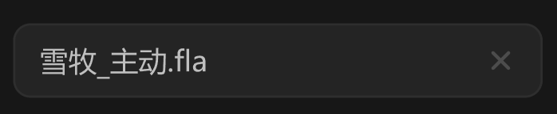

# 选择文件-通用 item



## 1_hover-item

background-color：通用 / 四级

border-color：通用 / 六级

输入指针

## 2_hover-关闭按钮

icon-color：亮色 / 二级

## 3_选中进入输入状态

background-color：通用 / 二级

border-color：亮色 / 半透明-1

``` css
/* 文件链接选择-item */

box-sizing: border-box;

/* Auto layout */
display: flex;
flex-direction: row;
justify-content: space-between;
align-items: center;
padding: 8px 12px;

width: 240px;
height: 34px;

/* 通用/三级 */
background: #242424;
/* 通用/五级 */
border: 1px solid #2E2E2E;
border-radius: 8px;

/* Inside auto layout */
flex: none;
order: 0;
align-self: stretch;
flex-grow: 0;


/* 雪牧_主动.fla */

width: 77px;
height: 18px;

/* 通用/正文 */
font-family: 'Microsoft YaHei UI';
font-style: normal;
font-weight: 400;
font-size: 13px;
line-height: 18px;
/* identical to box height, or 138% */

/* 亮色/二级 */
color: #BFBFBF;


/* Inside auto layout */
flex: none;
order: 0;
flex-grow: 0;


/* 关闭-小-icon */

/* Auto layout */
display: flex;
flex-direction: row;
justify-content: center;
align-items: center;
padding: 0px;

width: 14px;
height: 14px;


/* Inside auto layout */
flex: none;
order: 1;
flex-grow: 0;


/* svg */

width: 7px;
height: 7px;


/* Inside auto layout */
flex: none;
order: 0;
flex-grow: 0;


/* Vector */

position: absolute;
left: 25%;
right: 25%;
top: 25%;
bottom: 25%;

/* 亮色/四级 */
border: 1.5px solid #4D4D4D;

```

