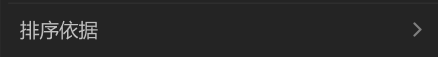

# 右键菜单-箭头



## 1_hover

background-color：亮色 / 半透明-3

``` css
/* 排序依据 */

/* Auto layout */
display: flex;
flex-direction: row;
justify-content: space-between;
align-items: center;
padding: 4px 8px;

width: 288px;
height: 26px;

border-radius: 6px;

/* Inside auto layout */
flex: none;
order: 16;
align-self: stretch;
flex-grow: 0;


/* 排序依据 */

width: 52px;
height: 18px;

/* 通用/正文 */
font-family: 'Microsoft YaHei UI';
font-style: normal;
font-weight: 400;
font-size: 13px;
line-height: 18px;
/* identical to box height, or 138% */

/* 亮色/二级 */
color: #BFBFBF;


/* Inside auto layout */
flex: none;
order: 0;
flex-grow: 0;


/* 展开按钮-icon */

/* Auto layout */
display: flex;
flex-direction: column;
justify-content: center;
align-items: center;
padding: 0px;

width: 14px;
height: 14px;

transform: rotate(-90deg);

/* Inside auto layout */
flex: none;
order: 1;
flex-grow: 0;


/* svg */

width: 8px;
height: 4px;

transform: rotate(-90deg);

/* Inside auto layout */
flex: none;
order: 0;
flex-grow: 0;


/* Vector */

position: absolute;
left: 35.71%;
right: 35.71%;
top: 21.43%;
bottom: 21.43%;

/* 亮色/三级 */
border: 1.5px solid #808080;
transform: matrix(-1, 0, 0, 1, 0, 0);
```

