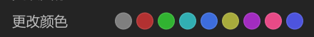

# 右键菜单-更改颜色



## 1_hover

background-color：亮色 / 半透明-3

## 2_hover-色块

缩放：125%；有已写好的组件。

``` css
/* 更改颜色 */

/* Auto layout */
display: flex;
flex-direction: row;
justify-content: space-between;
align-items: center;
padding: 4px 8px;
gap: 4px;

width: 288px;
height: 26px;

border-radius: 6px;

/* Inside auto layout */
flex: none;
order: 22;
align-self: stretch;
flex-grow: 0;


/* 更改颜色 */

width: 52px;
height: 18px;

/* 通用/正文 */
font-family: 'Microsoft YaHei UI';
font-style: normal;
font-weight: 400;
font-size: 13px;
line-height: 18px;
/* identical to box height, or 138% */

/* 亮色/二级 */
color: #BFBFBF;


/* Inside auto layout */
flex: none;
order: 0;
flex-grow: 0;


/* 颜色列表 */

/* Auto layout */
display: flex;
flex-direction: row;
align-items: center;
padding: 0px;
gap: 4px;

width: 176px;
height: 16px;


/* Inside auto layout */
flex: none;
order: 1;
flex-grow: 0;


/* 色块 */

box-sizing: border-box;

width: 16px;
height: 16px;

background: #7F7F7F;
/* 文本和图标和状态/F7 */
border: 1px solid rgba(242, 242, 242, 0.1);

/* Inside auto layout */
flex: none;
order: 0;
flex-grow: 0;


/* 色块 */

box-sizing: border-box;

width: 16px;
height: 16px;

background: #B33131;
/* 文本和图标和状态/F7 */
border: 1px solid rgba(242, 242, 242, 0.1);

/* Inside auto layout */
flex: none;
order: 1;
flex-grow: 0;


/* 色块 */

box-sizing: border-box;

width: 16px;
height: 16px;

background: #31B331;
/* 文本和图标和状态/F7 */
border: 1px solid rgba(242, 242, 242, 0.1);

/* Inside auto layout */
flex: none;
order: 2;
flex-grow: 0;


/* 色块 */

box-sizing: border-box;

width: 16px;
height: 16px;

background: #31AFB3;
/* 文本和图标和状态/F7 */
border: 1px solid rgba(242, 242, 242, 0.1);

/* Inside auto layout */
flex: none;
order: 3;
flex-grow: 0;


/* 色块 */

box-sizing: border-box;

width: 16px;
height: 16px;

background: #3E6DDC;
/* 文本和图标和状态/F7 */
border: 1px solid rgba(242, 242, 242, 0.1);

/* Inside auto layout */
flex: none;
order: 4;
flex-grow: 0;


/* 色块 */

box-sizing: border-box;

width: 16px;
height: 16px;

background: #A8AB3C;
/* 文本和图标和状态/F7 */
border: 1px solid rgba(242, 242, 242, 0.1);

/* Inside auto layout */
flex: none;
order: 5;
flex-grow: 0;


/* 色块 */

box-sizing: border-box;

width: 16px;
height: 16px;

background: #A22CC0;
/* 文本和图标和状态/F7 */
border: 1px solid rgba(242, 242, 242, 0.1);

/* Inside auto layout */
flex: none;
order: 6;
flex-grow: 0;


/* 色块 */

box-sizing: border-box;

width: 16px;
height: 16px;

background: #E84A87;
/* 文本和图标和状态/F7 */
border: 1px solid rgba(242, 242, 242, 0.1);

/* Inside auto layout */
flex: none;
order: 7;
flex-grow: 0;


/* 色块 */

box-sizing: border-box;

width: 16px;
height: 16px;

background: #4D54DE;
/* 文本和图标和状态/F7 */
border: 1px solid rgba(242, 242, 242, 0.1);

/* Inside auto layout */
flex: none;
order: 8;
flex-grow: 0;
```

