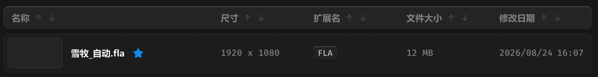

# 列表卡片



## 1_hover

background-color：通用 / 三级

border-color：通用 / 五级

## 2_选中

border-color：品牌色 / 常态，2px

``` css
/* 列表-item */

box-sizing: border-box;

/* Auto layout */
display: flex;
flex-direction: row;
align-items: center;
padding: 6px 12px 6px 6px;
gap: 12px;

width: 856px;
height: 57px;

/* 通用/二级 */
background: #1C1C1C;
/* 通用/三级 */
border: 1px solid #242424;
border-radius: 8px;

/* Inside auto layout */
flex: none;
order: 1;
align-self: stretch;
flex-grow: 0;


/* 缩略图容器 */

box-sizing: border-box;

/* Auto layout */
display: flex;
flex-direction: row;
align-items: flex-start;
padding: 0px;

width: 80px;
height: 45px;

/* 通用/三级 */
background: #242424;
/* 通用/五级 */
border: 1px solid #2E2E2E;
border-radius: 6px;

/* Inside auto layout */
flex: none;
order: 0;
flex-grow: 0;


/* 名称+徽章 */

/* Auto layout */
display: flex;
flex-direction: row;
align-items: center;
padding: 0px;
gap: 12px;

width: 206px;
height: 18px;


/* Inside auto layout */
flex: none;
order: 1;
flex-grow: 1;


/* 雪牧_自动.fla */

width: 79px;
height: 18px;

/* 通用/正文-加粗 */
font-family: 'Microsoft YaHei UI';
font-style: normal;
font-weight: 700;
font-size: 13px;
line-height: 18px;
/* identical to box height, or 138% */
display: flex;
align-items: center;

/* 亮色/一级 */
color: #F2F2F2;


/* Inside auto layout */
flex: none;
order: 0;
flex-grow: 0;


/* 原始文件-徽章 */

width: 14px;
height: 14px;


/* Inside auto layout */
flex: none;
order: 1;
flex-grow: 0;


/* svg */

position: absolute;
width: 14px;
height: 14px;
left: 91px;
top: 2px;

/* 品牌/常态 */
background: #0F89EC;


/* 尺寸 */

/* Auto layout */
display: flex;
flex-direction: row;
align-items: center;
padding: 0px;
gap: 6px;

width: 123px;
height: 18px;


/* Inside auto layout */
flex: none;
order: 2;
flex-grow: 0;


/* 1920 x 1080 */

width: 86px;
height: 18px;

/* 通用/数字-大 */
font-family: 'Fira Mono';
font-style: normal;
font-weight: 500;
font-size: 13px;
line-height: 18px;
/* identical to box height, or 138% */
display: flex;
align-items: center;

/* 亮色/三级 */
color: #808080;


/* Inside auto layout */
flex: none;
order: 0;
flex-grow: 0;


/* 徽章容器 */

/* Auto layout */
display: flex;
flex-direction: row;
align-items: center;
padding: 0px;

width: 123px;
height: 20px;


/* Inside auto layout */
flex: none;
order: 3;
flex-grow: 0;


/* 徽标 */

/* Auto layout */
display: flex;
flex-direction: row;
justify-content: center;
align-items: center;
padding: 2px 6px;

width: 34px;
height: 20px;

/* 通用/半透明-2 */
background: rgba(41, 41, 41, 0.5);
/* 立体感-背景模糊 */
box-shadow: 0px 2px 1px rgba(0, 0, 0, 0.2), inset 0px 1px 1px rgba(255, 255, 255, 0.2);
backdrop-filter: blur(40px);
/* Note: backdrop-filter has minimal browser support */
border-radius: 4px;

/* Inside auto layout */
flex: none;
order: 0;
flex-grow: 0;


/* FLA */

width: 22px;
height: 16px;

/* 通用/数字 */
font-family: 'Fira Mono';
font-style: normal;
font-weight: 500;
font-size: 12px;
line-height: 16px;
/* identical to box height, or 133% */
display: flex;
align-items: center;

/* 亮色/二级 */
color: #BFBFBF;


/* Inside auto layout */
flex: none;
order: 0;
flex-grow: 0;


/* 文件大小 */

/* Auto layout */
display: flex;
flex-direction: row;
align-items: center;
padding: 0px;

width: 123px;
height: 18px;


/* Inside auto layout */
flex: none;
order: 4;
flex-grow: 0;


/* 12 MB */

width: 39px;
height: 18px;

/* 通用/数字-大 */
font-family: 'Fira Mono';
font-style: normal;
font-weight: 500;
font-size: 13px;
line-height: 18px;
/* identical to box height, or 138% */
display: flex;
align-items: center;

/* 亮色/三级 */
color: #808080;


/* Inside auto layout */
flex: none;
order: 0;
flex-grow: 0;


/* 修改时间 */

/* Auto layout */
display: flex;
flex-direction: row;
align-items: center;
padding: 0px;
gap: 6px;

width: 123px;
height: 18px;


/* Inside auto layout */
flex: none;
order: 5;
flex-grow: 0;


/* 日期 */

width: 78px;
height: 18px;

/* 通用/数字-大 */
font-family: 'Fira Mono';
font-style: normal;
font-weight: 500;
font-size: 13px;
line-height: 18px;
/* identical to box height, or 138% */
display: flex;
align-items: center;

/* 亮色/三级 */
color: #808080;


/* Inside auto layout */
flex: none;
order: 0;
flex-grow: 0;


/* 时间 */

width: 39px;
height: 18px;

/* 通用/数字-大 */
font-family: 'Fira Mono';
font-style: normal;
font-weight: 500;
font-size: 13px;
line-height: 18px;
/* identical to box height, or 138% */
display: flex;
align-items: center;

/* 亮色/三级 */
color: #808080;


/* Inside auto layout */
flex: none;
order: 1;
flex-grow: 0;
```

