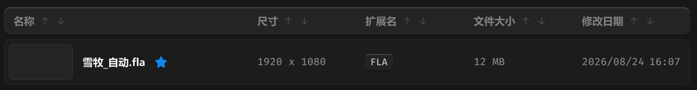

# 列表表头

> 上下箭头不是同时出现，而是旋转改变方向。

## 目录

- [01_hover-文字](列表表头/01_hover-文字.md) —— hover 文字态：出现箭头，文字用亮色/二级
- [02_hover-箭头](列表表头/02_hover-箭头.md) —— hover 箭头态：图标用亮色/三级
- [03_点击-箭头](列表表头/03_点击-箭头.md) —— 点击态：箭头旋转改变朝向，含完整 CSS
