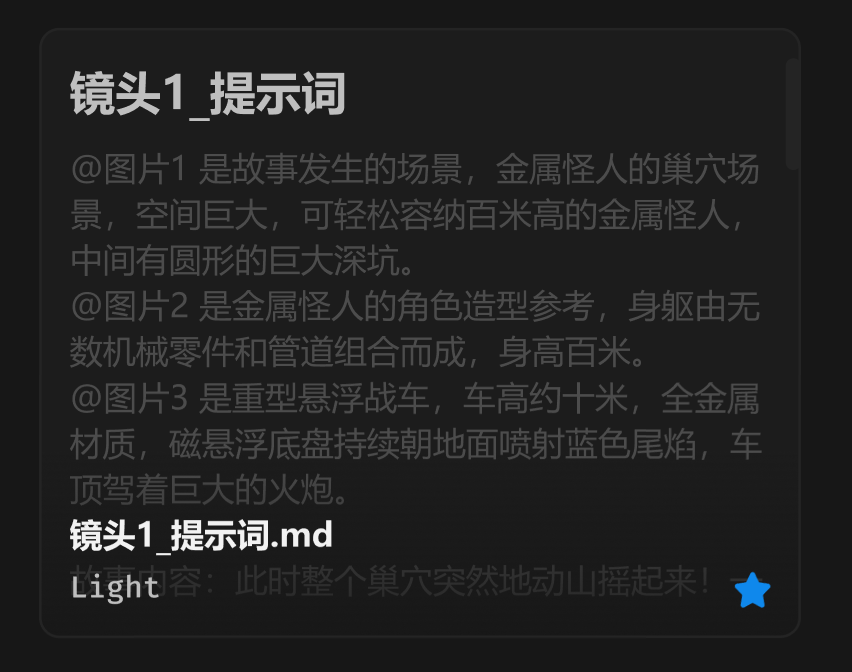

# 文件卡片-txt-md



## 1_hover

border-color：通用 / 六级

位移 Y：-4px

效果：小阴影

## 2_选中

border-color：品牌色 / 常态，2px

## 3_hover-滚动条

icon-color：通用 / 五级

``` css
/* 文本卡片 */

box-sizing: border-box;

/* Auto layout */
display: flex;
flex-direction: column;
justify-content: center;
align-items: center;
padding: 12px;
isolation: isolate;

position: absolute;
width: 300px;
height: 240px;

/* 通用/二级 */
background: #1C1C1C;
/* 通用/三级 */
border: 1px solid #242424;
border-radius: 8px;


/* 文本内容 */

/* Auto layout */
display: flex;
flex-direction: column;
align-items: flex-start;
padding: 0px;
gap: 8px;

width: 276px;
height: 216px;


/* Inside auto layout */
flex: none;
order: 0;
align-self: stretch;
flex-grow: 1;
z-index: 0;


/* 镜头1_提示词 */

width: 110px;
height: 26px;

/* 通用/标题 */
font-family: 'Microsoft YaHei UI';
font-style: normal;
font-weight: 700;
font-size: 18px;
line-height: 26px;
/* identical to box height, or 144% */
display: flex;
align-items: center;

/* 亮色/二级 */
color: #BFBFBF;


/* Inside auto layout */
flex: none;
order: 0;
flex-grow: 0;


/* @图片1 是故事发生的场景，金属怪人的巢穴场景，空间巨大，可轻松容纳百米高的金属怪人，中间有圆形的巨大深坑。
@图片2 是金属怪人的角色造型参考，身躯由无数机械零件和管道组合而成，身高百米。
@图片3 是重型悬浮战车，车高约十米，全金属材质，磁悬浮底盘持续朝地面喷射蓝色尾焰，车顶驾着巨大的火炮。

故事内容：此时整个巢穴突然地动山摇起来！一只体型足有百米高、浑身由扭曲的钢铁和狂暴的沙暴能量组成的恐怖金属怪人，缓缓从地面爬出。周围的空气瞬间被抽干，形成了恐怖的龙卷风。导演阐述：营造出金属怪人出场时的压迫感。 */

width: 276px;
height: 270px;

/* 通用/正文 */
font-family: 'Microsoft YaHei UI';
font-style: normal;
font-weight: 400;
font-size: 13px;
line-height: 18px;
/* or 138% */
display: flex;
align-items: center;

/* 亮色/四级 */
color: #4D4D4D;


/* Inside auto layout */
flex: none;
order: 1;
align-self: stretch;
flex-grow: 0;


/* 名称+简介 */

/* Auto layout */
display: flex;
flex-direction: column;
justify-content: flex-end;
align-items: flex-start;
padding: 24px 12px 12px;
gap: 4px;

position: absolute;
width: 300px;
height: 74px;
left: 0px;
top: 166px;

background: linear-gradient(180deg, rgba(23, 23, 23, 0) 0%, rgba(23, 23, 23, 0.8) 100%);

/* Inside auto layout */
flex: none;
order: 1;
flex-grow: 0;
z-index: 1;


/* 镜头1_提示词.md */

width: 104px;
height: 18px;

/* 通用/正文-加粗 */
font-family: 'Microsoft YaHei UI';
font-style: normal;
font-weight: 700;
font-size: 13px;
line-height: 18px;
/* identical to box height, or 138% */
display: flex;
align-items: center;

/* 亮色/一级 */
color: #F2F2F2;


/* Inside auto layout */
flex: none;
order: 0;
flex-grow: 0;


/* Light */

width: 36px;
height: 16px;

/* 通用/数字 */
font-family: 'Fira Mono';
font-style: normal;
font-weight: 500;
font-size: 12px;
line-height: 16px;
/* identical to box height, or 133% */
display: flex;
align-items: center;

/* 亮色/二级 */
color: #BFBFBF;


/* Inside auto layout */
flex: none;
order: 1;
flex-grow: 0;


/* 原始文件-徽章 */

position: absolute;
width: 14px;
height: 14px;
left: 274px;
top: 214px;


/* Inside auto layout */
flex: none;
order: 2;
flex-grow: 0;
z-index: 2;


/* svg */

position: absolute;
width: 14px;
height: 14px;
left: 274px;
top: 214px;

/* 品牌/常态 */
background: #0F89EC;


/* 滚动条 */

position: absolute;
width: 6px;
height: 44px;
left: 294px;
top: 12px;

/* 通用/三级 */
background: #242424;
border-radius: 99px;
transform: matrix(-1, 0, 0, 1, 0, 0);

/* Inside auto layout */
flex: none;
order: 3;
flex-grow: 0;
z-index: 3;
```

