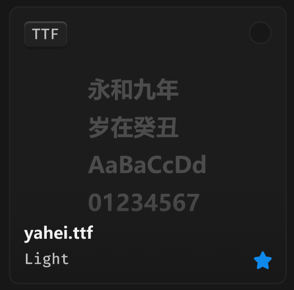

# 文件卡片-字体



> 永和九年、岁在癸丑这几个字要在日文和韩文时更换。

## 1_hover

border-color：通用 / 六级

位移 Y：-4px

效果：小阴影

## 2_选中

border-color：品牌色 / 常态，2px

``` css
/* 文字卡片 */

box-sizing: border-box;

/* Auto layout */
display: flex;
flex-direction: column;
justify-content: center;
align-items: center;
padding: 12px;
isolation: isolate;

position: absolute;
width: 220px;
height: 220px;

/* 通用/二级 */
background: #1C1C1C;
/* 通用/三级 */
border: 1px solid #242424;
border-radius: 8px;


/* 波形图 */

/* Auto layout */
display: flex;
flex-direction: column;
align-items: flex-start;
padding: 0px;
gap: 4px;

width: 95px;
height: 116px;


/* Inside auto layout */
flex: none;
order: 0;
flex-grow: 0;
z-index: 0;


/* 永和九年 */

width: 72px;
height: 26px;

/* 通用/标题 */
font-family: 'Microsoft YaHei UI';
font-style: normal;
font-weight: 700;
font-size: 18px;
line-height: 26px;
/* identical to box height, or 144% */
display: flex;
align-items: center;

/* 亮色/四级 */
color: #4D4D4D;


/* Inside auto layout */
flex: none;
order: 0;
flex-grow: 0;


/* 岁在癸丑 */

width: 72px;
height: 26px;

/* 通用/标题 */
font-family: 'Microsoft YaHei UI';
font-style: normal;
font-weight: 700;
font-size: 18px;
line-height: 26px;
/* identical to box height, or 144% */
display: flex;
align-items: center;

/* 亮色/四级 */
color: #4D4D4D;


/* Inside auto layout */
flex: none;
order: 1;
flex-grow: 0;


/* AaBaCcDd */

width: 95px;
height: 26px;

/* 通用/标题 */
font-family: 'Microsoft YaHei UI';
font-style: normal;
font-weight: 700;
font-size: 18px;
line-height: 26px;
/* identical to box height, or 144% */
display: flex;
align-items: center;

/* 亮色/四级 */
color: #4D4D4D;


/* Inside auto layout */
flex: none;
order: 2;
flex-grow: 0;


/* 01234567 */

width: 89px;
height: 26px;

/* 通用/标题 */
font-family: 'Microsoft YaHei UI';
font-style: normal;
font-weight: 700;
font-size: 18px;
line-height: 26px;
/* identical to box height, or 144% */
display: flex;
align-items: center;

/* 亮色/四级 */
color: #4D4D4D;


/* Inside auto layout */
flex: none;
order: 3;
flex-grow: 0;


/* 名称+简介 */

/* Auto layout */
display: flex;
flex-direction: column;
justify-content: flex-end;
align-items: flex-start;
padding: 24px 12px 12px;
gap: 4px;

position: absolute;
width: 220px;
height: 74px;
left: 0px;
top: 146px;

background: linear-gradient(180deg, rgba(23, 23, 23, 0) 0%, rgba(23, 23, 23, 0.8) 100%);

/* Inside auto layout */
flex: none;
order: 1;
flex-grow: 0;
z-index: 1;


/* yahei.ttf */

width: 55px;
height: 18px;

/* 通用/正文-加粗 */
font-family: 'Microsoft YaHei UI';
font-style: normal;
font-weight: 700;
font-size: 13px;
line-height: 18px;
/* identical to box height, or 138% */
display: flex;
align-items: center;

/* 亮色/一级 */
color: #F2F2F2;


/* Inside auto layout */
flex: none;
order: 0;
flex-grow: 0;


/* Light */

width: 36px;
height: 16px;

/* 通用/数字 */
font-family: 'Fira Mono';
font-style: normal;
font-weight: 500;
font-size: 12px;
line-height: 16px;
/* identical to box height, or 133% */
display: flex;
align-items: center;

/* 亮色/二级 */
color: #BFBFBF;


/* Inside auto layout */
flex: none;
order: 1;
flex-grow: 0;


/* 原始文件-徽章 */

position: absolute;
width: 14px;
height: 14px;
left: 194px;
top: 194px;


/* Inside auto layout */
flex: none;
order: 2;
flex-grow: 0;
z-index: 2;


/* svg */

position: absolute;
width: 14px;
height: 14px;
left: 194px;
top: 194px;

/* 品牌/常态 */
background: #0F89EC;


/* 徽标 */

/* Auto layout */
display: flex;
flex-direction: row;
justify-content: center;
align-items: center;
padding: 2px 6px;

position: absolute;
width: 34px;
height: 20px;
left: 12px;
top: 12px;

/* 通用/半透明-2 */
background: rgba(41, 41, 41, 0.5);
/* 立体感-背景模糊 */
box-shadow: 0px 2px 1px rgba(0, 0, 0, 0.2), inset 0px 1px 1px rgba(255, 255, 255, 0.2);
backdrop-filter: blur(40px);
/* Note: backdrop-filter has minimal browser support */
border-radius: 4px;

/* Inside auto layout */
flex: none;
order: 3;
flex-grow: 0;
z-index: 3;


/* TTF */

width: 22px;
height: 16px;

/* 通用/数字 */
font-family: 'Fira Mono';
font-style: normal;
font-weight: 500;
font-size: 12px;
line-height: 16px;
/* identical to box height, or 133% */
display: flex;
align-items: center;

/* 亮色/二级 */
color: #BFBFBF;


/* Inside auto layout */
flex: none;
order: 0;
flex-grow: 0;


/* 安装-按钮 */

box-sizing: border-box;

/* Auto layout */
display: flex;
flex-direction: row;
justify-content: center;
align-items: center;
padding: 0px;

position: absolute;
width: 18px;
height: 18px;
left: 190px;
top: 12px;

/* 通用/一级 */
background: #171717;
/* 亮色/半透明-3 */
border: 1px solid rgba(242, 242, 242, 0.06);
border-radius: 99px;

/* Inside auto layout */
flex: none;
order: 4;
flex-grow: 0;
z-index: 4;
```

