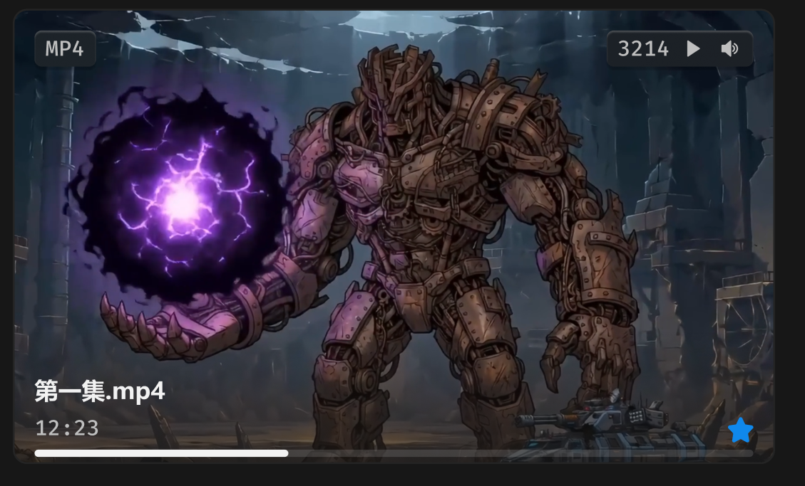

# 文件卡片-视频



## 1_hover

border-color：通用 / 六级

位移 Y：-4px

效果：小阴影

## 2_选中

border-color：品牌色 / 常态，2px

## 3_hover-播放-音量按钮

icon-color：亮色 / 一级

``` css
/* 视频卡片 */

box-sizing: border-box;

/* Auto layout */
display: flex;
flex-direction: column;
justify-content: center;
align-items: center;
padding: 0px;
isolation: isolate;

position: absolute;
width: 421px;
height: 251.95px;

/* 通用/二级 */
background: #1C1C1C;
/* 通用/三级 */
border: 1px solid #242424;
border-radius: 8px;


/* 视频图片 */

width: 421px;
height: 251.95px;

background: url(image.png);

/* Inside auto layout */
flex: none;
order: 0;
flex-grow: 0;
z-index: 0;


/* 名称+简介 */

/* Auto layout */
display: flex;
flex-direction: column;
justify-content: flex-end;
align-items: flex-start;
padding: 24px 12px 12px;
gap: 4px;

position: absolute;
width: 421px;
height: 74px;
left: 0px;
top: 178px;

background: linear-gradient(180deg, rgba(23, 23, 23, 0) 0%, rgba(23, 23, 23, 0.8) 100%);

/* Inside auto layout */
flex: none;
order: 1;
flex-grow: 0;
z-index: 1;


/* 第一集.mp4 */

width: 73px;
height: 18px;

/* 通用/正文-加粗 */
font-family: 'Microsoft YaHei UI';
font-style: normal;
font-weight: 700;
font-size: 13px;
line-height: 18px;
/* identical to box height, or 138% */
display: flex;
align-items: center;

/* 亮色/一级 */
color: #F2F2F2;


/* Inside auto layout */
flex: none;
order: 0;
flex-grow: 0;


/* 12:23 */

width: 36px;
height: 16px;

/* 通用/数字 */
font-family: 'Fira Mono';
font-style: normal;
font-weight: 500;
font-size: 12px;
line-height: 16px;
/* identical to box height, or 133% */
display: flex;
align-items: center;

/* 亮色/二级 */
color: #BFBFBF;


/* Inside auto layout */
flex: none;
order: 1;
flex-grow: 0;


/* 原始文件-徽章 */

position: absolute;
width: 14px;
height: 14px;
left: 395px;
top: 226px;


/* Inside auto layout */
flex: none;
order: 2;
flex-grow: 0;
z-index: 2;


/* svg */

position: absolute;
width: 14px;
height: 14px;
left: 395px;
top: 226px;

/* 品牌/常态 */
background: #0F89EC;


/* 徽标 */

/* Auto layout */
display: flex;
flex-direction: row;
justify-content: center;
align-items: center;
padding: 2px 6px;

position: absolute;
width: 34px;
height: 20px;
left: 12px;
top: 12px;

/* 通用/半透明-2 */
background: rgba(41, 41, 41, 0.5);
/* 立体感-背景模糊 */
box-shadow: 0px 2px 1px rgba(0, 0, 0, 0.2), inset 0px 1px 1px rgba(255, 255, 255, 0.2);
backdrop-filter: blur(40px);
/* Note: backdrop-filter has minimal browser support */
border-radius: 4px;

/* Inside auto layout */
flex: none;
order: 3;
flex-grow: 0;
z-index: 3;


/* MP4 */

width: 22px;
height: 16px;

/* 通用/数字 */
font-family: 'Fira Mono';
font-style: normal;
font-weight: 500;
font-size: 12px;
line-height: 16px;
/* identical to box height, or 133% */
display: flex;
align-items: center;

/* 亮色/二级 */
color: #BFBFBF;


/* Inside auto layout */
flex: none;
order: 0;
flex-grow: 0;


/* 视频卡片-悬停-按钮 */

/* Auto layout */
display: flex;
flex-direction: row;
justify-content: center;
align-items: center;
padding: 2px 6px;
gap: 6px;

position: absolute;
width: 81px;
height: 20px;
left: 328px;
top: 12px;

/* 通用/半透明-2 */
background: rgba(41, 41, 41, 0.5);
/* 立体感-背景模糊 */
box-shadow: 0px 2px 1px rgba(0, 0, 0, 0.2), inset 0px 1px 1px rgba(255, 255, 255, 0.2);
backdrop-filter: blur(40px);
/* Note: backdrop-filter has minimal browser support */
border-radius: 4px;

/* Inside auto layout */
flex: none;
order: 4;
flex-grow: 0;
z-index: 4;


/* 3214 */

width: 29px;
height: 16px;

/* 通用/数字 */
font-family: 'Fira Mono';
font-style: normal;
font-weight: 500;
font-size: 12px;
line-height: 16px;
/* identical to box height, or 133% */
display: flex;
align-items: center;

/* 亮色/二级 */
color: #BFBFBF;


/* Inside auto layout */
flex: none;
order: 0;
flex-grow: 0;


/* 卡片-悬停-播放-icon */

/* Auto layout */
display: flex;
flex-direction: row;
justify-content: center;
align-items: center;
padding: 0px;

width: 14px;
height: 14px;


/* Inside auto layout */
flex: none;
order: 1;
flex-grow: 0;


/* Vector */

width: 7px;
height: 9px;

/* 亮色/二级 */
background: #BFBFBF;

/* Inside auto layout */
flex: none;
order: 0;
flex-grow: 0;


/* 卡片-悬停-暂停-icon */

/* Auto layout */
display: flex;
flex-direction: row;
justify-content: center;
align-items: center;
padding: 0px;

display: none;
width: 14px;
height: 14px;


/* Inside auto layout */
flex: none;
order: 2;
flex-grow: 0;


/* svg */

width: 6px;
height: 9px;


/* Inside auto layout */
flex: none;
order: 0;
flex-grow: 0;


/* Rectangle 17758 */

position: absolute;
width: 2px;
height: 9px;
left: 4px;
top: 2.5px;

/* 亮色/二级 */
background: #BFBFBF;
border-radius: 0.3px;


/* Rectangle 17759 */

position: absolute;
width: 2px;
height: 9px;
left: 8px;
top: 2.5px;

/* 亮色/二级 */
background: #BFBFBF;
border-radius: 0.3px;


/* 卡片-悬停-声音-icon */

/* Auto layout */
display: flex;
flex-direction: row;
justify-content: center;
align-items: center;
padding: 0px;

width: 14px;
height: 14px;


/* Inside auto layout */
flex: none;
order: 3;
flex-grow: 0;


/* svg */

width: 9.16px;
height: 9px;


/* Inside auto layout */
flex: none;
order: 0;
flex-grow: 0;


/* Vector */

position: absolute;
left: 59.5%;
right: 29.17%;
top: 36.75%;
bottom: 36.75%;

/* 亮色/二级 */
background: #BFBFBF;


/* Vector */

position: absolute;
left: 65.21%;
right: 17.27%;
top: 28.22%;
bottom: 28.2%;

/* 亮色/二级 */
background: #BFBFBF;


/* Vector */

position: absolute;
left: 17.27%;
right: 44.05%;
top: 17.86%;
bottom: 17.86%;

/* 亮色/二级 */
background: #BFBFBF;


/* 卡片-悬停-静音-icon */

/* Auto layout */
display: flex;
flex-direction: row;
justify-content: center;
align-items: center;
padding: 0px;

display: none;
width: 14px;
height: 14px;


/* Inside auto layout */
flex: none;
order: 4;
flex-grow: 0;


/* svg */

width: 8.33px;
height: 9px;


/* Inside auto layout */
flex: none;
order: 0;
flex-grow: 0;


/* Vector */

position: absolute;
left: 26.21%;
right: 35.11%;
top: 35.12%;
bottom: 17.86%;

/* 亮色/二级 */
background: #BFBFBF;


/* Vector */

position: absolute;
left: 44.66%;
right: 35.11%;
top: 17.86%;
bottom: 47.77%;

/* 亮色/二级 */
background: #BFBFBF;


/* Vector */

position: absolute;
left: 20.25%;
right: 20.25%;
top: 20.24%;
bottom: 20.27%;

/* 亮色/二级 */
background: #BFBFBF;


/* 播放条 */

position: absolute;
width: 397px;
height: 4px;
left: 12px;
top: 244px;


/* Inside auto layout */
flex: none;
order: 5;
flex-grow: 0;
z-index: 5;


/* 播放条 */

position: absolute;
width: 140.19px;
height: 4px;
left: 12px;
top: 244px;

/* 亮色/一级 */
background: #F2F2F2;
border-radius: 99px;


/* 播放条-轨道 */

position: absolute;
width: 397px;
height: 4px;
left: 12px;
top: 244px;

/* 亮色/半透明-2 */
background: rgba(242, 242, 242, 0.14);
border-radius: 99px;
```

