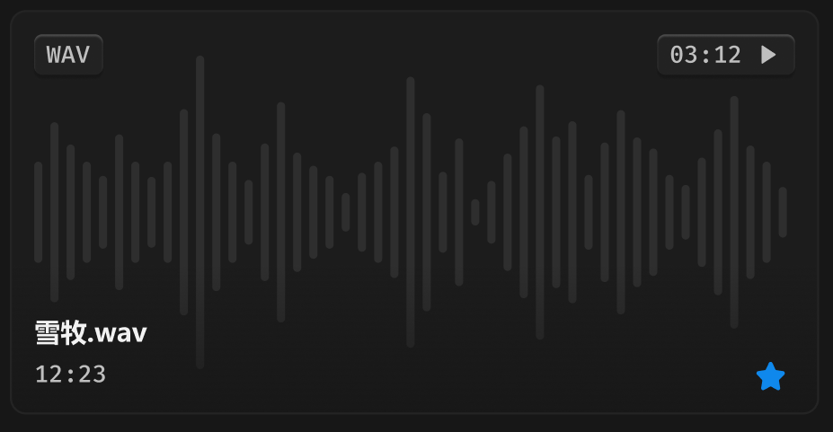

# 文件卡片-音频

> 波形图简化，不用分析上下立体声差异，不论是 5 秒音频还是 3 分钟音频都保证根数一致，美观第一位，我们不是专业的音频管理，准确度不必要求精准。
>
> 走带颜色把进度和波形根数解耦，不要出现比如 3 分钟的音频，波形十几秒后才突然填充了一根，而是丝滑的扫过。

## 目录

- [01_hover](文件卡片-音频/01_hover.md) —— hover 态：边框通用六级、上移 4px、小阴影
- [02_选中](文件卡片-音频/02_选中.md) —— 选中态：品牌色常态 2px 边框
- [03_hover-播放按钮](文件卡片-音频/03_hover-播放按钮.md) —— 播放按钮图标色与音频卡片完整 CSS 标注
