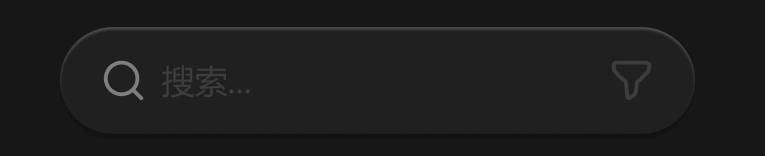

# 搜索栏



> 搜索栏 / 搜索栏展开成筛选 / 播放条 / MarkDown 工具栏，这四个是同一个容器，切换时底色不变，宽度平滑伸缩，功能按钮 Y 轴出场入场。
>
> 其中搜索栏至搜索栏展开成筛选，搜索图标和搜索区域是不变的，横向展开筛选按钮组。反向折叠回去也是。
>
> 当有些预览界面无需悬浮栏时，宽度和透明度退场。

## 1_输入聚焦

宽度：450px

## 2_hover-筛选 / 搜索

icon-color：亮色 / 二级

> 搜索栏是自动实时搜索，不用非要点击搜索图标，图标有交互是未来点击展开向量、AI搜索选项的。

``` css
/* 搜索栏 */

/* Auto layout */
display: flex;
flex-direction: row;
align-items: center;
padding: 12px 16px;
gap: 8px;

position: absolute;
width: 250px;
height: 42px;
left: 313px;
top: 998px;

/* 通用/半透明-2 */
background: rgba(41, 41, 41, 0.5);
/* 立体感-背景模糊 */
box-shadow: 0px 2px 1px rgba(0, 0, 0, 0.2), inset 0px 1px 1px rgba(255, 255, 255, 0.2);
backdrop-filter: blur(40px);
/* Note: backdrop-filter has minimal browser support */
border-radius: 21px;


/* 图标+占位符 */

/* Auto layout */
display: flex;
flex-direction: row;
align-items: center;
padding: 0px;
gap: 6px;

width: 192px;
height: 18px;


/* Inside auto layout */
flex: none;
order: 0;
flex-grow: 1;


/* 搜索-icon */

/* Auto layout */
display: flex;
flex-direction: row;
justify-content: center;
align-items: center;
padding: 0px;

width: 18px;
height: 18px;


/* Inside auto layout */
flex: none;
order: 0;
flex-grow: 0;


/* svg */

width: 14px;
height: 14px;

transform: matrix(1, 0, 0, -1, 0, 0);

/* Inside auto layout */
flex: none;
order: 0;
flex-grow: 0;


/* Vector */

position: absolute;
left: 71.61%;
right: 11.11%;
top: 71.61%;
bottom: 11.11%;

/* 亮色/三级 */
border: 1.5px solid #808080;


/* Vector */

position: absolute;
left: 11.11%;
right: 19.75%;
top: 11.11%;
bottom: 19.75%;

/* 亮色/三级 */
border: 1.5px solid #808080;


/* 搜索... */

width: 36px;
height: 18px;

/* 通用/正文 */
font-family: 'Microsoft YaHei UI';
font-style: normal;
font-weight: 400;
font-size: 13px;
line-height: 18px;
/* identical to box height, or 138% */

/* 亮色/半透明-2 */
color: rgba(242, 242, 242, 0.14);


/* Inside auto layout */
flex: none;
order: 1;
flex-grow: 0;


/* 筛选-icon */

/* Auto layout */
display: flex;
flex-direction: row;
justify-content: center;
align-items: center;
padding: 0px;

width: 18px;
height: 18px;


/* Inside auto layout */
flex: none;
order: 1;
flex-grow: 0;


/* svg */

width: 14px;
height: 14px;


/* Inside auto layout */
flex: none;
order: 0;
flex-grow: 0;


/* Vector */

position: absolute;
left: 11.11%;
right: 11.11%;
top: 11.11%;
bottom: 11.11%;

/* 亮色/半透明-2 */
border: 1.5px solid rgba(242, 242, 242, 0.14);
```

