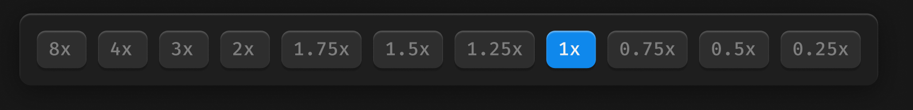

# 播放条-倍率播放



## 1_hover

background-color：通用-六级

## 2_选中

background-color：品牌色 / 常态

text-color：亮色 / 一级

效果：立体感-主要按钮

``` css
/* 倍速播放 */

/* Auto layout */
display: flex;
flex-direction: row;
align-items: center;
padding: 12px;
gap: 8px;

position: absolute;
width: 590px;
height: 50px;
left: 223px;
top: 950px;

/* 通用/半透明-1 */
background: rgba(31, 31, 31, 0.93);
/* 立体感-模糊-大阴影 */
box-shadow: 0px 4px 20px rgba(0, 0, 0, 0.4), inset 0px 1px 1px rgba(255, 255, 255, 0.2);
backdrop-filter: blur(40px);
/* Note: backdrop-filter has minimal browser support */
border-radius: 8px;


/* 8x */

/* Auto layout */
display: flex;
flex-direction: row;
justify-content: center;
align-items: center;
padding: 4px 8px;

width: 34px;
height: 26px;

/* 通用/五级 */
background: #2E2E2E;
/* 立体感-通用 */
box-shadow: 0px 2px 1px rgba(0, 0, 0, 0.2), inset 0px 1px 1px rgba(255, 255, 255, 0.2);
border-radius: 6px;

/* Inside auto layout */
flex: none;
order: 0;
flex-grow: 0;


/* 8x */

width: 18px;
height: 18px;

/* 通用/数字-大 */
font-family: 'Fira Mono';
font-style: normal;
font-weight: 500;
font-size: 13px;
line-height: 18px;
/* identical to box height, or 138% */

/* 亮色/三级 */
color: #808080;


/* Inside auto layout */
flex: none;
order: 0;
flex-grow: 0;


/* 4x */

/* Auto layout */
display: flex;
flex-direction: row;
justify-content: center;
align-items: center;
padding: 4px 8px;

width: 34px;
height: 26px;

/* 通用/五级 */
background: #2E2E2E;
/* 立体感-通用 */
box-shadow: 0px 2px 1px rgba(0, 0, 0, 0.2), inset 0px 1px 1px rgba(255, 255, 255, 0.2);
border-radius: 6px;

/* Inside auto layout */
flex: none;
order: 1;
flex-grow: 0;


/* 4x */

width: 18px;
height: 18px;

/* 通用/数字-大 */
font-family: 'Fira Mono';
font-style: normal;
font-weight: 500;
font-size: 13px;
line-height: 18px;
/* identical to box height, or 138% */

/* 亮色/三级 */
color: #808080;


/* Inside auto layout */
flex: none;
order: 0;
flex-grow: 0;


/* 3x */

/* Auto layout */
display: flex;
flex-direction: row;
justify-content: center;
align-items: center;
padding: 4px 8px;

width: 34px;
height: 26px;

/* 通用/五级 */
background: #2E2E2E;
/* 立体感-通用 */
box-shadow: 0px 2px 1px rgba(0, 0, 0, 0.2), inset 0px 1px 1px rgba(255, 255, 255, 0.2);
border-radius: 6px;

/* Inside auto layout */
flex: none;
order: 2;
flex-grow: 0;


/* 3x */

width: 18px;
height: 18px;

/* 通用/数字-大 */
font-family: 'Fira Mono';
font-style: normal;
font-weight: 500;
font-size: 13px;
line-height: 18px;
/* identical to box height, or 138% */

/* 亮色/三级 */
color: #808080;


/* Inside auto layout */
flex: none;
order: 0;
flex-grow: 0;


/* 2x */

/* Auto layout */
display: flex;
flex-direction: row;
justify-content: center;
align-items: center;
padding: 4px 8px;

width: 34px;
height: 26px;

/* 通用/五级 */
background: #2E2E2E;
/* 立体感-通用 */
box-shadow: 0px 2px 1px rgba(0, 0, 0, 0.2), inset 0px 1px 1px rgba(255, 255, 255, 0.2);
border-radius: 6px;

/* Inside auto layout */
flex: none;
order: 3;
flex-grow: 0;


/* 2x */

width: 18px;
height: 18px;

/* 通用/数字-大 */
font-family: 'Fira Mono';
font-style: normal;
font-weight: 500;
font-size: 13px;
line-height: 18px;
/* identical to box height, or 138% */

/* 亮色/三级 */
color: #808080;


/* Inside auto layout */
flex: none;
order: 0;
flex-grow: 0;


/* 1.75x */

/* Auto layout */
display: flex;
flex-direction: row;
justify-content: center;
align-items: center;
padding: 4px 8px;

width: 55px;
height: 26px;

/* 通用/五级 */
background: #2E2E2E;
/* 立体感-通用 */
box-shadow: 0px 2px 1px rgba(0, 0, 0, 0.2), inset 0px 1px 1px rgba(255, 255, 255, 0.2);
border-radius: 6px;

/* Inside auto layout */
flex: none;
order: 4;
flex-grow: 0;


/* 1.75x */

width: 39px;
height: 18px;

/* 通用/数字-大 */
font-family: 'Fira Mono';
font-style: normal;
font-weight: 500;
font-size: 13px;
line-height: 18px;
/* identical to box height, or 138% */

/* 亮色/三级 */
color: #808080;


/* Inside auto layout */
flex: none;
order: 0;
flex-grow: 0;


/* 1.5x */

/* Auto layout */
display: flex;
flex-direction: row;
justify-content: center;
align-items: center;
padding: 4px 8px;

width: 48px;
height: 26px;

/* 通用/五级 */
background: #2E2E2E;
/* 立体感-通用 */
box-shadow: 0px 2px 1px rgba(0, 0, 0, 0.2), inset 0px 1px 1px rgba(255, 255, 255, 0.2);
border-radius: 6px;

/* Inside auto layout */
flex: none;
order: 5;
flex-grow: 0;


/* 1.5x */

width: 32px;
height: 18px;

/* 通用/数字-大 */
font-family: 'Fira Mono';
font-style: normal;
font-weight: 500;
font-size: 13px;
line-height: 18px;
/* identical to box height, or 138% */

/* 亮色/三级 */
color: #808080;


/* Inside auto layout */
flex: none;
order: 0;
flex-grow: 0;


/* 1.25x */

/* Auto layout */
display: flex;
flex-direction: row;
justify-content: center;
align-items: center;
padding: 4px 8px;

width: 55px;
height: 26px;

/* 通用/五级 */
background: #2E2E2E;
/* 立体感-通用 */
box-shadow: 0px 2px 1px rgba(0, 0, 0, 0.2), inset 0px 1px 1px rgba(255, 255, 255, 0.2);
border-radius: 6px;

/* Inside auto layout */
flex: none;
order: 6;
flex-grow: 0;


/* 1.25x */

width: 39px;
height: 18px;

/* 通用/数字-大 */
font-family: 'Fira Mono';
font-style: normal;
font-weight: 500;
font-size: 13px;
line-height: 18px;
/* identical to box height, or 138% */

/* 亮色/三级 */
color: #808080;


/* Inside auto layout */
flex: none;
order: 0;
flex-grow: 0;


/* 1x */

/* Auto layout */
display: flex;
flex-direction: row;
justify-content: center;
align-items: center;
padding: 4px 8px;

width: 34px;
height: 26px;

/* 品牌/常态 */
background: #0F89EC;
/* 立体感-主要按钮 */
box-shadow: 0px 2px 1px rgba(0, 0, 0, 0.2), inset 0px 1px 1px rgba(255, 255, 255, 0.4);
border-radius: 6px;

/* Inside auto layout */
flex: none;
order: 7;
flex-grow: 0;


/* 1x */

width: 18px;
height: 18px;

/* 通用/数字-大 */
font-family: 'Fira Mono';
font-style: normal;
font-weight: 500;
font-size: 13px;
line-height: 18px;
/* identical to box height, or 138% */

/* 亮色/一级 */
color: #F2F2F2;


/* Inside auto layout */
flex: none;
order: 0;
flex-grow: 0;


/* 0.75x */

/* Auto layout */
display: flex;
flex-direction: row;
justify-content: center;
align-items: center;
padding: 4px 8px;

width: 55px;
height: 26px;

/* 通用/五级 */
background: #2E2E2E;
/* 立体感-通用 */
box-shadow: 0px 2px 1px rgba(0, 0, 0, 0.2), inset 0px 1px 1px rgba(255, 255, 255, 0.2);
border-radius: 6px;

/* Inside auto layout */
flex: none;
order: 8;
flex-grow: 0;


/* 0.75x */

width: 39px;
height: 18px;

/* 通用/数字-大 */
font-family: 'Fira Mono';
font-style: normal;
font-weight: 500;
font-size: 13px;
line-height: 18px;
/* identical to box height, or 138% */

/* 亮色/三级 */
color: #808080;


/* Inside auto layout */
flex: none;
order: 0;
flex-grow: 0;


/* 0.5x */

/* Auto layout */
display: flex;
flex-direction: row;
justify-content: center;
align-items: center;
padding: 4px 8px;

width: 48px;
height: 26px;

/* 通用/五级 */
background: #2E2E2E;
/* 立体感-通用 */
box-shadow: 0px 2px 1px rgba(0, 0, 0, 0.2), inset 0px 1px 1px rgba(255, 255, 255, 0.2);
border-radius: 6px;

/* Inside auto layout */
flex: none;
order: 9;
flex-grow: 0;


/* 0.5x */

width: 32px;
height: 18px;

/* 通用/数字-大 */
font-family: 'Fira Mono';
font-style: normal;
font-weight: 500;
font-size: 13px;
line-height: 18px;
/* identical to box height, or 138% */

/* 亮色/三级 */
color: #808080;


/* Inside auto layout */
flex: none;
order: 0;
flex-grow: 0;


/* 0.25x */

/* Auto layout */
display: flex;
flex-direction: row;
justify-content: center;
align-items: center;
padding: 4px 8px;

width: 55px;
height: 26px;

/* 通用/五级 */
background: #2E2E2E;
/* 立体感-通用 */
box-shadow: 0px 2px 1px rgba(0, 0, 0, 0.2), inset 0px 1px 1px rgba(255, 255, 255, 0.2);
border-radius: 6px;

/* Inside auto layout */
flex: none;
order: 10;
flex-grow: 0;


/* 0.25x */

width: 39px;
height: 18px;

/* 通用/数字-大 */
font-family: 'Fira Mono';
font-style: normal;
font-weight: 500;
font-size: 13px;
line-height: 18px;
/* identical to box height, or 138% */

/* 亮色/三级 */
color: #808080;


/* Inside auto layout */
flex: none;
order: 0;
flex-grow: 0;
```

