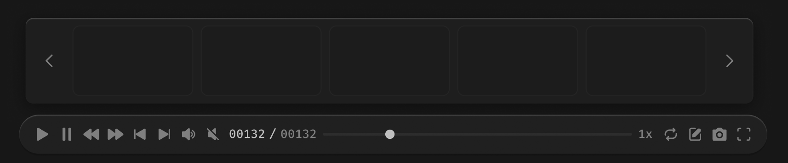

# 播放条-帧条



帧条的宽度要和播放条保持一致，和播放条之间保持 12px 间距

``` css
/* 帧条 */

/* Auto layout */
display: flex;
flex-direction: row;
align-items: center;
padding: 8px;
gap: 8px;

position: absolute;
width: 777px;
height: 92px;
left: 51px;
top: 893px;

/* 通用/半透明-1 */
background: rgba(31, 31, 31, 0.93);
/* 立体感-模糊-大阴影 */
box-shadow: 0px 4px 20px rgba(0, 0, 0, 0.4), inset 0px 1px 1px rgba(255, 255, 255, 0.2);
backdrop-filter: blur(40px);
/* Note: backdrop-filter has minimal browser support */
border-radius: 8px;


/* 上一帧 */

/* Auto layout */
display: flex;
flex-direction: row;
justify-content: center;
align-items: center;
padding: 4px 8px;

width: 34px;
height: 76px;

border-radius: 6px;

/* Inside auto layout */
flex: none;
order: 0;
align-self: stretch;
flex-grow: 0;


/* 尖括号-icon */

/* Auto layout */
display: flex;
flex-direction: row;
justify-content: center;
align-items: center;
padding: 0px;

width: 18px;
height: 18px;


/* Inside auto layout */
flex: none;
order: 0;
flex-grow: 0;


/* svg */

width: 6px;
height: 12px;


/* Inside auto layout */
flex: none;
order: 0;
flex-grow: 0;


/* Vector */

position: absolute;
left: 33.33%;
right: 33.33%;
top: 16.67%;
bottom: 16.67%;

/* 亮色/三级 */
border: 1.5px solid #808080;


/* 帧图 */

box-sizing: border-box;

/* Auto layout */
display: flex;
flex-direction: column;
align-items: flex-start;
padding: 0px;

width: 129px;
height: 76px;

/* 通用/二级 */
background: #1C1C1C;
/* 通用/三级 */
border: 1px solid #242424;
border-radius: 8px;

/* Inside auto layout */
flex: none;
order: 1;
flex-grow: 0;


/* 帧图 */

box-sizing: border-box;

/* Auto layout */
display: flex;
flex-direction: column;
align-items: flex-start;
padding: 0px;

width: 129px;
height: 76px;

/* 通用/二级 */
background: #1C1C1C;
/* 通用/三级 */
border: 1px solid #242424;
border-radius: 8px;

/* Inside auto layout */
flex: none;
order: 2;
flex-grow: 0;


/* 帧图 */

box-sizing: border-box;

/* Auto layout */
display: flex;
flex-direction: column;
align-items: flex-start;
padding: 0px;

width: 129px;
height: 76px;

/* 通用/二级 */
background: #1C1C1C;
/* 通用/三级 */
border: 1px solid #242424;
border-radius: 8px;

/* Inside auto layout */
flex: none;
order: 3;
flex-grow: 0;


/* 帧图 */

box-sizing: border-box;

/* Auto layout */
display: flex;
flex-direction: column;
align-items: flex-start;
padding: 0px;

width: 129px;
height: 76px;

/* 通用/二级 */
background: #1C1C1C;
/* 通用/三级 */
border: 1px solid #242424;
border-radius: 8px;

/* Inside auto layout */
flex: none;
order: 4;
flex-grow: 0;


/* 帧图 */

box-sizing: border-box;

/* Auto layout */
display: flex;
flex-direction: column;
align-items: flex-start;
padding: 0px;

width: 129px;
height: 76px;

/* 通用/二级 */
background: #1C1C1C;
/* 通用/三级 */
border: 1px solid #242424;
border-radius: 8px;

/* Inside auto layout */
flex: none;
order: 5;
flex-grow: 0;


/* 下一帧 */

/* Auto layout */
display: flex;
flex-direction: row;
justify-content: center;
align-items: center;
padding: 4px 8px;

width: 34px;
height: 76px;

border-radius: 6px;

/* Inside auto layout */
flex: none;
order: 6;
align-self: stretch;
flex-grow: 0;


/* 尖括号-icon */

/* Auto layout */
display: flex;
flex-direction: row;
justify-content: center;
align-items: center;
padding: 0px;

width: 18px;
height: 18px;

transform: matrix(-1, 0, 0, 1, 0, 0);

/* Inside auto layout */
flex: none;
order: 0;
flex-grow: 0;


/* svg */

width: 6px;
height: 12px;

transform: matrix(-1, 0, 0, 1, 0, 0);

/* Inside auto layout */
flex: none;
order: 0;
flex-grow: 0;


/* Vector */

position: absolute;
left: 33.33%;
right: 33.33%;
top: 16.67%;
bottom: 16.67%;

/* 亮色/三级 */
border: 1.5px solid #808080;
transform: matrix(-1, 0, 0, 1, 0, 0);
```

