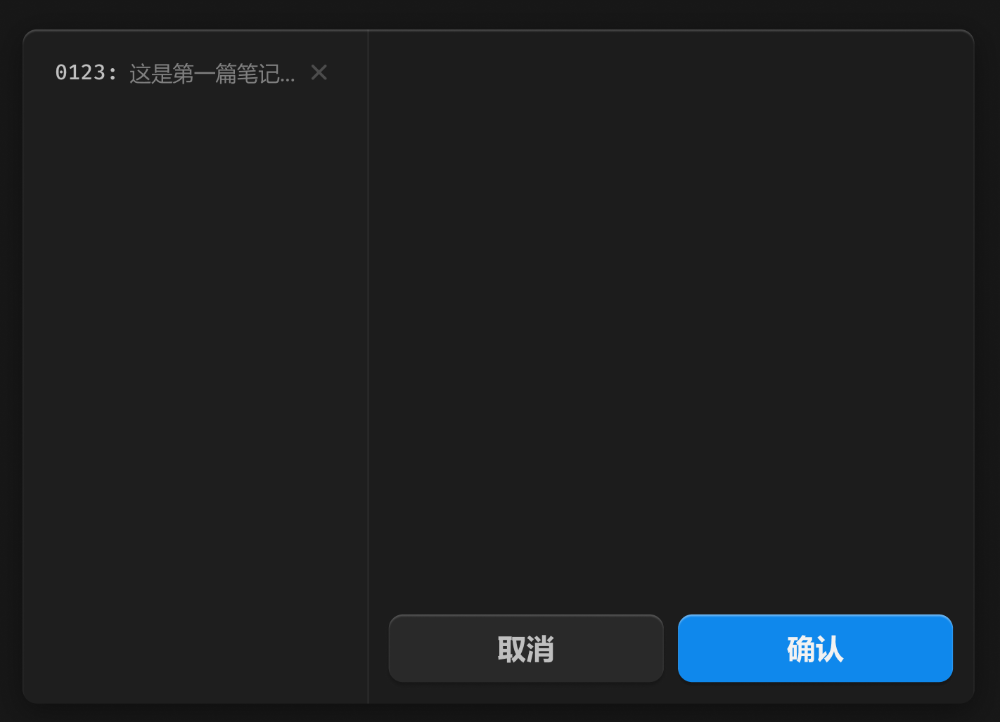

# 播放条-笔记



> 打开就聚焦输入闪烁。

## 1_hover-item

background：亮色 / 半透明-3

## 2_选中-item

background：亮色 / 半透明-2

text-color：亮色 / 二级

``` css
/* 笔记 */

/* Auto layout */
display: flex;
flex-direction: row;
align-items: center;
padding: 0px;

position: absolute;
width: 533px;
height: 378px;
left: 316px;
top: 585px;

/* 通用/半透明-1 */
background: rgba(31, 31, 31, 0.93);
/* 立体感-模糊-大阴影 */
box-shadow: 0px 4px 20px rgba(0, 0, 0, 0.4), inset 0px 1px 1px rgba(255, 255, 255, 0.2);
backdrop-filter: blur(40px);
/* Note: backdrop-filter has minimal browser support */
border-radius: 8px;


/* 列表 */

/* Auto layout */
display: flex;
flex-direction: column;
align-items: flex-start;
padding: 12px;
gap: 2px;

width: 193px;
height: 378px;


/* Inside auto layout */
flex: none;
order: 0;
align-self: stretch;
flex-grow: 1;


/* 笔记item */

/* Auto layout */
display: flex;
flex-direction: row;
align-items: center;
padding: 4px 6px;
gap: 6px;

width: 169px;
height: 24px;

border-radius: 6px;

/* Inside auto layout */
flex: none;
order: 0;
align-self: stretch;
flex-grow: 0;


/* 0123: */

width: 36px;
height: 16px;

/* 通用/数字 */
font-family: 'Fira Mono';
font-style: normal;
font-weight: 500;
font-size: 12px;
line-height: 16px;
/* identical to box height, or 133% */
display: flex;
align-items: center;

/* 亮色/二级 */
color: #BFBFBF;


/* Inside auto layout */
flex: none;
order: 0;
flex-grow: 0;


/* 这是第一篇笔记... */

width: 93px;
height: 16px;

/* 通用/次要文字 */
font-family: 'Microsoft YaHei UI';
font-style: normal;
font-weight: 400;
font-size: 12px;
line-height: 16px;
/* identical to box height, or 133% */
display: flex;
align-items: center;

/* 亮色/三级 */
color: #808080;


/* Inside auto layout */
flex: none;
order: 1;
flex-grow: 0;


/* 关闭-小-icon */

/* Auto layout */
display: flex;
flex-direction: row;
justify-content: center;
align-items: center;
padding: 0px;

width: 14px;
height: 14px;


/* Inside auto layout */
flex: none;
order: 2;
flex-grow: 0;


/* svg */

width: 7px;
height: 7px;


/* Inside auto layout */
flex: none;
order: 0;
flex-grow: 0;


/* Vector */

position: absolute;
left: 25%;
right: 25%;
top: 25%;
bottom: 25%;

/* 亮色/四级 */
border: 1.5px solid #4D4D4D;


/* 输入框 */

box-sizing: border-box;

/* Auto layout */
display: flex;
flex-direction: column;
align-items: flex-start;
padding: 12px;
gap: 12px;

width: 340px;
height: 378px;

/* 通用/二级 */
background: #1C1C1C;
/* 亮色/半透明-3 */
border-left: 1px solid rgba(242, 242, 242, 0.06);

/* Inside auto layout */
flex: none;
order: 1;
align-self: stretch;
flex-grow: 0;


/* 输入区域 */

/* Auto layout */
display: flex;
flex-direction: row;
justify-content: center;
align-items: center;
padding: 12px;

width: 316px;
height: 304px;

border-radius: 8px;

/* Inside auto layout */
flex: none;
order: 0;
align-self: stretch;
flex-grow: 1;


/* 按钮 */

/* Auto layout */
display: flex;
flex-direction: row;
justify-content: center;
align-items: center;
padding: 0px;
gap: 8px;

width: 316px;
height: 38px;


/* Inside auto layout */
flex: none;
order: 1;
align-self: stretch;
flex-grow: 0;


/* 取消-按钮 */

/* Auto layout */
display: flex;
flex-direction: row;
justify-content: center;
align-items: center;
padding: 8px 0px;

width: 154px;
height: 38px;

/* 通用/四级 */
background: #292929;
box-shadow: 0px 2px 2px rgba(0, 0, 0, 0.2), inset 0px 1px 1px rgba(255, 255, 255, 0.2);
border-radius: 8px;

/* Inside auto layout */
flex: none;
order: 0;
flex-grow: 1;


/* 取消 */

width: 32px;
height: 22px;

/* 通用/按钮文字-大 */
font-family: 'Microsoft YaHei UI';
font-style: normal;
font-weight: 700;
font-size: 16px;
line-height: 22px;
/* identical to box height, or 138% */

/* 亮色/二级 */
color: #BFBFBF;


/* Inside auto layout */
flex: none;
order: 0;
flex-grow: 0;


/* 确认-按钮 */

/* Auto layout */
display: flex;
flex-direction: row;
justify-content: center;
align-items: center;
padding: 8px 0px;

width: 154px;
height: 38px;

/* 品牌/常态 */
background: #0F89EC;
/* 立体感-主要按钮 */
box-shadow: 0px 2px 1px rgba(0, 0, 0, 0.2), inset 0px 1px 1px rgba(255, 255, 255, 0.4);
border-radius: 8px;

/* Inside auto layout */
flex: none;
order: 1;
flex-grow: 1;


/* 确认 */

width: 32px;
height: 22px;

/* 通用/按钮文字-大 */
font-family: 'Microsoft YaHei UI';
font-style: normal;
font-weight: 700;
font-size: 16px;
line-height: 22px;
/* identical to box height, or 138% */

/* 亮色/一级 */
color: #F2F2F2;


/* Inside auto layout */
flex: none;
order: 0;
flex-grow: 0;
```

