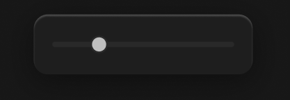

# 播放条-音量滑块



``` css
/* 音量滑块 */

/* Auto layout */
display: flex;
flex-direction: row;
align-items: center;
padding: 12px;
gap: 8px;

position: absolute;
width: 124px;
height: 34px;
left: 70px;
top: 952px;

/* 通用/半透明-1 */
background: rgba(31, 31, 31, 0.93);
/* 立体感-模糊-大阴影 */
box-shadow: 0px 4px 20px rgba(0, 0, 0, 0.4), inset 0px 1px 1px rgba(255, 255, 255, 0.2);
backdrop-filter: blur(40px);
/* Note: backdrop-filter has minimal browser support */
border-radius: 8px;


/* 尺寸滑块 */

width: 100px;
height: 10px;


/* Inside auto layout */
flex: none;
order: 0;
flex-grow: 0;


/* 滑轨 */

position: absolute;
width: 100px;
height: 0px;
left: 12px;
top: 17px;

/* 通用/四级 */
border: 3px solid #292929;


/* 圆形按钮 */

box-sizing: border-box;

position: absolute;
width: 10px;
height: 10px;
left: 32px;
top: 12px;

/* 亮色/二级 */
background: #BFBFBF;
/* 通用/四级 */
border: 1px solid #292929;
```

