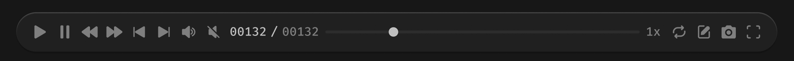

# 播放条



> 根据上下文，选择保留哪些按钮

## 1_hover-按钮组

icon-color：亮色 / 二级

``` css
/* 播放条 */

/* Auto layout */
display: flex;
flex-direction: row;
align-items: center;
padding: 12px 16px;
gap: 8px;

position: absolute;
width: 799px;
height: 42px;
left: 43px;
top: 998px;

/* 通用/半透明-2 */
background: rgba(41, 41, 41, 0.5);
/* 立体感-背景模糊 */
box-shadow: 0px 2px 1px rgba(0, 0, 0, 0.2), inset 0px 1px 1px rgba(255, 255, 255, 0.2);
backdrop-filter: blur(40px);
/* Note: backdrop-filter has minimal browser support */
border-radius: 21px;


/* 播放-icon */

/* Auto layout */
display: flex;
flex-direction: row;
justify-content: center;
align-items: center;
padding: 0px;

width: 18px;
height: 18px;


/* Inside auto layout */
flex: none;
order: 0;
flex-grow: 0;


/* Vector */

width: 12px;
height: 14px;

/* 亮色/三级 */
background: #808080;

/* Inside auto layout */
flex: none;
order: 0;
flex-grow: 0;


/* 暂停-icon */

/* Auto layout */
display: flex;
flex-direction: row;
justify-content: center;
align-items: center;
padding: 0px;

width: 18px;
height: 18px;


/* Inside auto layout */
flex: none;
order: 1;
flex-grow: 0;


/* svg */

width: 9.33px;
height: 14px;


/* Inside auto layout */
flex: none;
order: 0;
flex-grow: 0;


/* Rectangle 17758 */

position: absolute;
width: 3.11px;
height: 14px;
left: 4.33px;
top: 2px;

/* 亮色/三级 */
background: #808080;
border-radius: 1px;


/* Rectangle 17759 */

position: absolute;
width: 3.11px;
height: 14px;
left: 10.56px;
top: 2px;

/* 亮色/三级 */
background: #808080;
border-radius: 1px;


/* 快退-快进-icon */

/* Auto layout */
display: flex;
flex-direction: row;
justify-content: center;
align-items: center;
padding: 0px;

width: 18px;
height: 18px;


/* Inside auto layout */
flex: none;
order: 2;
flex-grow: 0;


/* svg */

width: 16.79px;
height: 12px;

transform: matrix(-1, 0, 0, 1, 0, 0);

/* Inside auto layout */
flex: none;
order: 0;
flex-grow: 0;


/* Vector */

position: absolute;
left: 47.78%;
right: 3.35%;
top: 16.67%;
bottom: 16.67%;

/* 亮色/三级 */
background: #808080;
transform: matrix(-1, 0, 0, 1, 0, 0);


/* Vector */

position: absolute;
left: 3.35%;
right: 47.78%;
top: 16.67%;
bottom: 16.67%;

/* 亮色/三级 */
background: #808080;
transform: matrix(-1, 0, 0, 1, 0, 0);


/* 快退-快进-icon */

/* Auto layout */
display: flex;
flex-direction: row;
justify-content: center;
align-items: center;
padding: 0px;

width: 18px;
height: 18px;


/* Inside auto layout */
flex: none;
order: 3;
flex-grow: 0;


/* svg */

width: 16.79px;
height: 12px;


/* Inside auto layout */
flex: none;
order: 0;
flex-grow: 0;


/* Vector */

position: absolute;
left: 3.35%;
right: 47.78%;
top: 16.67%;
bottom: 16.67%;

/* 亮色/三级 */
background: #808080;


/* Vector */

position: absolute;
left: 47.78%;
right: 3.35%;
top: 16.67%;
bottom: 16.67%;

/* 亮色/三级 */
background: #808080;


/* 上一帧-下一帧-icon */

/* Auto layout */
display: flex;
flex-direction: row;
justify-content: center;
align-items: center;
padding: 0px;

width: 18px;
height: 18px;


/* Inside auto layout */
flex: none;
order: 4;
flex-grow: 0;


/* svg */

width: 12.15px;
height: 12px;

transform: matrix(-1, 0, 0, 1, 0, 0);

/* Inside auto layout */
flex: none;
order: 0;
flex-grow: 0;


/* Vector */

position: absolute;
left: 25.46%;
right: 16.24%;
top: 16.67%;
bottom: 16.67%;

/* 亮色/三级 */
background: #808080;
transform: matrix(-1, 0, 0, 1, 0, 0);


/* Vector */

position: absolute;
left: 16.24%;
right: 76.26%;
top: 19.97%;
bottom: 20.01%;

/* 亮色/三级 */
background: #808080;
transform: matrix(-1, 0, 0, 1, 0, 0);


/* 下一帧-下一帧-icon */

/* Auto layout */
display: flex;
flex-direction: row;
justify-content: center;
align-items: center;
padding: 0px;

width: 18px;
height: 18px;


/* Inside auto layout */
flex: none;
order: 5;
flex-grow: 0;


/* svg */

width: 12.15px;
height: 12px;


/* Inside auto layout */
flex: none;
order: 0;
flex-grow: 0;


/* Vector */

position: absolute;
left: 16.24%;
right: 25.46%;
top: 16.67%;
bottom: 16.67%;

/* 亮色/三级 */
background: #808080;


/* Vector */

position: absolute;
left: 76.26%;
right: 16.24%;
top: 19.97%;
bottom: 20.01%;

/* 亮色/三级 */
background: #808080;


/* 声音-icon */

/* Auto layout */
display: flex;
flex-direction: row;
justify-content: center;
align-items: center;
padding: 0px;

width: 18px;
height: 18px;


/* Inside auto layout */
flex: none;
order: 6;
flex-grow: 0;


/* svg */

width: 14.03px;
height: 13px;


/* Inside auto layout */
flex: none;
order: 0;
flex-grow: 0;


/* Vector */

position: absolute;
left: 61.31%;
right: 25.21%;
top: 34.26%;
bottom: 34.19%;

/* 亮色/三级 */
background: #808080;


/* Vector */

position: absolute;
left: 68.1%;
right: 11.04%;
top: 24.07%;
bottom: 24.05%;

/* 亮色/三级 */
background: #808080;


/* Vector */

position: absolute;
left: 11.04%;
right: 42.92%;
top: 13.89%;
bottom: 13.89%;

/* 亮色/三级 */
background: #808080;


/* 静音-icon */

/* Auto layout */
display: flex;
flex-direction: row;
justify-content: center;
align-items: center;
padding: 0px;

width: 18px;
height: 18px;


/* Inside auto layout */
flex: none;
order: 7;
flex-grow: 0;


/* svg */

width: 12.75px;
height: 13px;


/* Inside auto layout */
flex: none;
order: 0;
flex-grow: 0;


/* Vector */

position: absolute;
left: 21.68%;
right: 32.26%;
top: 32.28%;
bottom: 13.89%;

/* 亮色/三级 */
background: #808080;


/* Vector */

position: absolute;
left: 43.59%;
right: 32.3%;
top: 13.89%;
bottom: 47.33%;

/* 亮色/三级 */
background: #808080;


/* Vector */

position: absolute;
left: 14.59%;
right: 14.59%;
top: 14.61%;
bottom: 14.6%;

/* 亮色/三级 */
background: #808080;


/* 时间码 */

/* Auto layout */
display: flex;
flex-direction: row;
justify-content: center;
align-items: center;
padding: 0px;
gap: 4px;

width: 94px;
height: 18px;


/* Inside auto layout */
flex: none;
order: 8;
flex-grow: 0;


/* 00132 */

width: 39px;
height: 18px;

/* 通用/数字-大 */
font-family: 'Fira Mono';
font-style: normal;
font-weight: 500;
font-size: 13px;
line-height: 18px;
/* identical to box height, or 138% */

/* 亮色/二级 */
color: #BFBFBF;


/* Inside auto layout */
flex: none;
order: 0;
flex-grow: 0;


/* / */

width: 8px;
height: 18px;

/* 通用/数字-大 */
font-family: 'Fira Mono';
font-style: normal;
font-weight: 500;
font-size: 13px;
line-height: 18px;
/* identical to box height, or 138% */

/* 亮色/二级 */
color: #BFBFBF;


/* Inside auto layout */
flex: none;
order: 1;
flex-grow: 0;


/* 00132 */

width: 39px;
height: 18px;

/* 通用/数字-大 */
font-family: 'Fira Mono';
font-style: normal;
font-weight: 500;
font-size: 13px;
line-height: 18px;
/* identical to box height, or 138% */

/* 亮色/三级 */
color: #808080;


/* Inside auto layout */
flex: none;
order: 2;
flex-grow: 0;


/* 进度条 */

/* Auto layout */
display: flex;
flex-direction: row;
align-items: center;
padding: 0px;
gap: 4px;

width: 327px;
height: 10px;


/* Inside auto layout */
flex: none;
order: 9;
flex-grow: 0;


/* 进度条 */

width: 327px;
height: 10px;


/* Inside auto layout */
flex: none;
order: 0;
flex-grow: 1;


/* 轨道 */

position: absolute;
width: 327px;
height: 0px;
left: 0px;
top: 5px;

/* 亮色/二级 */
background: #BFBFBF;
/* 亮色/半透明-3 */
border: 3px solid rgba(242, 242, 242, 0.06);


/* 圆形按钮 */

box-sizing: border-box;

position: absolute;
width: 10px;
height: 10px;
left: 65px;
top: 0px;

/* 亮色/二级 */
background: #BFBFBF;
/* 亮色/半透明-3 */
border: 1px solid rgba(242, 242, 242, 0.06);


/* 倍速 */

/* Auto layout */
display: flex;
flex-direction: column;
justify-content: center;
align-items: center;
padding: 0px;

width: 18px;
height: 18px;


/* Inside auto layout */
flex: none;
order: 10;
flex-grow: 0;


/* 1x */

width: 18px;
height: 18px;

/* 通用/数字-大 */
font-family: 'Fira Mono';
font-style: normal;
font-weight: 500;
font-size: 13px;
line-height: 18px;
/* identical to box height, or 138% */

/* 亮色/三级 */
color: #808080;


/* Inside auto layout */
flex: none;
order: 0;
align-self: stretch;
flex-grow: 0;


/* 循环播放-icon */

/* Auto layout */
display: flex;
flex-direction: column;
justify-content: center;
align-items: center;
padding: 0px;

width: 18px;
height: 18px;


/* Inside auto layout */
flex: none;
order: 11;
flex-grow: 0;


/* svg */

width: 13.27px;
height: 14px;


/* Inside auto layout */
flex: none;
order: 0;
flex-grow: 0;


/* Vector */

position: absolute;
left: 13.15%;
right: 22.19%;
top: 11.11%;
bottom: 41.79%;

/* 亮色/三级 */
background: #808080;


/* Vector */

position: absolute;
left: 22.19%;
right: 13.15%;
top: 41.83%;
bottom: 11.11%;

/* 亮色/三级 */
background: #808080;


/* 笔记-icon */

/* Auto layout */
display: flex;
flex-direction: column;
justify-content: center;
align-items: center;
padding: 0px;

width: 18px;
height: 18px;


/* Inside auto layout */
flex: none;
order: 12;
flex-grow: 0;


/* svg */

width: 12.6px;
height: 14px;


/* Inside auto layout */
flex: none;
order: 0;
flex-grow: 0;


/* Vector */

position: absolute;
left: 15%;
right: 15%;
top: 11.11%;
bottom: 11.11%;

/* 亮色/三级 */
background: #808080;


/* Vector */

position: absolute;
left: 58.79%;
right: 16.06%;
top: 15.94%;
bottom: 58.91%;

/* 亮色/三级 */
background: #808080;


/* Vector */

position: absolute;
left: 31.76%;
right: 24.72%;
top: 24.64%;
bottom: 31.79%;

/* 亮色/三级 */
background: #808080;


/* 设为封面-icon */

/* Auto layout */
display: flex;
flex-direction: column;
justify-content: center;
align-items: center;
padding: 0px;

width: 18px;
height: 18px;


/* Inside auto layout */
flex: none;
order: 13;
flex-grow: 0;


/* Vector */

width: 15px;
height: 14px;

/* 亮色/三级 */
background: #808080;

/* Inside auto layout */
flex: none;
order: 0;
flex-grow: 0;


/* 全屏-icon */

/* Auto layout */
display: flex;
flex-direction: column;
justify-content: center;
align-items: center;
padding: 0px;

width: 18px;
height: 18px;


/* Inside auto layout */
flex: none;
order: 14;
flex-grow: 0;


/* svg */

width: 14px;
height: 14px;


/* Inside auto layout */
flex: none;
order: 0;
flex-grow: 0;


/* Vector */

position: absolute;
left: 11.11%;
right: 65.56%;
top: 11.11%;
bottom: 65.56%;

/* 亮色/三级 */
background: #808080;


/* Vector */

position: absolute;
left: 11.11%;
right: 65.56%;
top: 65.56%;
bottom: 11.11%;

/* 亮色/三级 */
background: #808080;


/* Vector */

position: absolute;
left: 65.56%;
right: 11.11%;
top: 65.56%;
bottom: 11.11%;

/* 亮色/三级 */
background: #808080;


/* Vector */

position: absolute;
left: 65.56%;
right: 11.11%;
top: 11.11%;
bottom: 65.56%;

/* 亮色/三级 */
background: #808080;
```

