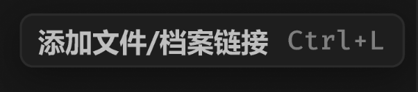

# 悬停 tip



``` css
/* 悬停 TIP */

box-sizing: border-box;

/* Auto layout */
display: flex;
flex-direction: row;
align-items: flex-start;
padding: 4px 8px;
gap: 8px;

position: absolute;
width: 170px;
height: 24px;

/* 通用/半透明-1 */
background: rgba(31, 31, 31, 0.93);
/* 亮色/半透明-3 */
border: 1px solid rgba(242, 242, 242, 0.06);
box-shadow: 0px 4px 20px rgba(0, 0, 0, 0.4);
backdrop-filter: blur(40px);
/* Note: backdrop-filter has minimal browser support */
border-radius: 6px;


/* 添加文件/档案链接 */

width: 102px;
height: 16px;

/* 通用/次要文字-加粗 */
font-family: 'Microsoft YaHei UI';
font-style: normal;
font-weight: 700;
font-size: 12px;
line-height: 16px;
/* identical to box height, or 133% */
display: flex;
align-items: center;

/* 亮色/二级 */
color: #BFBFBF;


/* Inside auto layout */
flex: none;
order: 0;
flex-grow: 0;


/* Ctrl+L */

width: 44px;
height: 16px;

/* 通用/数字 */
font-family: 'Fira Mono';
font-style: normal;
font-weight: 500;
font-size: 12px;
line-height: 16px;
/* identical to box height, or 133% */
display: flex;
align-items: center;

/* 亮色/三级 */
color: #808080;


/* Inside auto layout */
flex: none;
order: 1;
flex-grow: 0;
```

