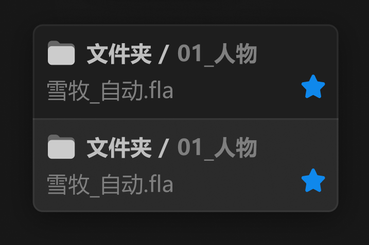

# 悬停-链接列表



``` css
/* 悬停-链接列表 */

box-sizing: border-box;

/* Auto layout */
display: flex;
flex-direction: column;
align-items: flex-start;
padding: 0px;

position: absolute;
width: 182px;
height: 112px;

/* 通用/半透明-1 */
background: rgba(31, 31, 31, 0.93);
/* 亮色/半透明-3 */
border: 1px solid rgba(242, 242, 242, 0.06);
box-shadow: 0px 4px 20px rgba(0, 0, 0, 0.4);
backdrop-filter: blur(40px);
/* Note: backdrop-filter has minimal browser support */
border-radius: 6px;


/* item */

/* Auto layout */
display: flex;
flex-direction: column;
align-items: flex-start;
padding: 8px;
gap: 4px;

width: 182px;
height: 56px;


/* Inside auto layout */
flex: none;
order: 0;
align-self: stretch;
flex-grow: 0;


/* 图标+路径 */

/* Auto layout */
display: flex;
flex-direction: row;
align-items: center;
padding: 0px;
gap: 6px;

width: 166px;
height: 18px;


/* Inside auto layout */
flex: none;
order: 0;
align-self: stretch;
flex-grow: 0;


/* 文件夹-关闭-icon */

/* Auto layout */
display: flex;
flex-direction: column;
justify-content: center;
align-items: center;
padding: 0px;

width: 18px;
height: 18px;


/* Inside auto layout */
flex: none;
order: 0;
flex-grow: 0;


/* svg */

width: 16px;
height: 14.4px;


/* Inside auto layout */
flex: none;
order: 0;
flex-grow: 0;


/* Vector */

position: absolute;
left: 5.56%;
right: 5.56%;
top: 10%;
bottom: 10%;

/* 自定义/常态-2 */
background: #666666;


/* Vector */

position: absolute;
left: 5.56%;
right: 5.56%;
top: 27.78%;
bottom: 10%;

/* 自定义/常态-1 */
background: #CCCCCC;


/* 路径 */

/* Auto layout */
display: flex;
flex-direction: row;
justify-content: center;
align-items: center;
padding: 0px;
gap: 4px;

width: 102px;
height: 18px;


/* Inside auto layout */
flex: none;
order: 1;
flex-grow: 0;


/* 文件夹 */

width: 39px;
height: 18px;

/* 通用/正文-加粗 */
font-family: 'Microsoft YaHei UI';
font-style: normal;
font-weight: 700;
font-size: 13px;
line-height: 18px;
/* identical to box height, or 138% */
display: flex;
align-items: center;

/* 亮色/二级 */
color: #BFBFBF;


/* Inside auto layout */
flex: none;
order: 0;
flex-grow: 0;


/* / */

width: 7px;
height: 18px;

/* 通用/正文-加粗 */
font-family: 'Microsoft YaHei UI';
font-style: normal;
font-weight: 700;
font-size: 13px;
line-height: 18px;
/* identical to box height, or 138% */
display: flex;
align-items: center;

/* 亮色/二级 */
color: #BFBFBF;


/* Inside auto layout */
flex: none;
order: 1;
flex-grow: 0;


/* 01_人物 */

width: 48px;
height: 18px;

/* 通用/正文-加粗 */
font-family: 'Microsoft YaHei UI';
font-style: normal;
font-weight: 700;
font-size: 13px;
line-height: 18px;
/* identical to box height, or 138% */
display: flex;
align-items: center;

/* 亮色/三级 */
color: #808080;


/* Inside auto layout */
flex: none;
order: 2;
flex-grow: 0;


/* 文件夹+链接状态徽章 */

/* Auto layout */
display: flex;
flex-direction: row;
justify-content: space-between;
align-items: flex-start;
padding: 0px;
gap: 8px;

width: 166px;
height: 18px;


/* Inside auto layout */
flex: none;
order: 1;
align-self: stretch;
flex-grow: 0;


/* 雪牧_自动.fla */

width: 77px;
height: 18px;

/* 通用/正文 */
font-family: 'Microsoft YaHei UI';
font-style: normal;
font-weight: 400;
font-size: 13px;
line-height: 18px;
/* identical to box height, or 138% */
display: flex;
align-items: center;

/* 亮色/三级 */
color: #808080;


/* Inside auto layout */
flex: none;
order: 0;
flex-grow: 0;


/* 原始文件-徽章 */

width: 14px;
height: 14px;


/* Inside auto layout */
flex: none;
order: 1;
flex-grow: 0;


/* svg */

position: absolute;
width: 14px;
height: 14px;
left: 152px;
top: 0px;

/* 品牌/常态 */
background: #0F89EC;


/* item-悬停 */

box-sizing: border-box;

/* Auto layout */
display: flex;
flex-direction: column;
align-items: flex-start;
padding: 8px;
gap: 4px;

width: 182px;
height: 56px;

/* 亮色/半透明-3 */
background: rgba(242, 242, 242, 0.06);
/* 亮色/半透明-3 */
border-top: 1px solid rgba(242, 242, 242, 0.06);

/* Inside auto layout */
flex: none;
order: 1;
align-self: stretch;
flex-grow: 0;


/* 图标+路径 */

/* Auto layout */
display: flex;
flex-direction: row;
align-items: center;
padding: 0px;
gap: 6px;

width: 166px;
height: 18px;


/* Inside auto layout */
flex: none;
order: 0;
align-self: stretch;
flex-grow: 0;


/* 文件夹-关闭-icon */

/* Auto layout */
display: flex;
flex-direction: column;
justify-content: center;
align-items: center;
padding: 0px;

width: 18px;
height: 18px;


/* Inside auto layout */
flex: none;
order: 0;
flex-grow: 0;


/* svg */

width: 16px;
height: 14.4px;


/* Inside auto layout */
flex: none;
order: 0;
flex-grow: 0;


/* Vector */

position: absolute;
left: 5.56%;
right: 5.56%;
top: 10%;
bottom: 10%;

/* 自定义/常态-2 */
background: #666666;


/* Vector */

position: absolute;
left: 5.56%;
right: 5.56%;
top: 27.78%;
bottom: 10%;

/* 自定义/常态-1 */
background: #CCCCCC;


/* 路径 */

/* Auto layout */
display: flex;
flex-direction: row;
justify-content: center;
align-items: center;
padding: 0px;
gap: 4px;

width: 102px;
height: 18px;


/* Inside auto layout */
flex: none;
order: 1;
flex-grow: 0;


/* 文件夹 */

width: 39px;
height: 18px;

/* 通用/正文-加粗 */
font-family: 'Microsoft YaHei UI';
font-style: normal;
font-weight: 700;
font-size: 13px;
line-height: 18px;
/* identical to box height, or 138% */
display: flex;
align-items: center;

/* 亮色/二级 */
color: #BFBFBF;


/* Inside auto layout */
flex: none;
order: 0;
flex-grow: 0;


/* / */

width: 7px;
height: 18px;

/* 通用/正文-加粗 */
font-family: 'Microsoft YaHei UI';
font-style: normal;
font-weight: 700;
font-size: 13px;
line-height: 18px;
/* identical to box height, or 138% */
display: flex;
align-items: center;

/* 亮色/二级 */
color: #BFBFBF;


/* Inside auto layout */
flex: none;
order: 1;
flex-grow: 0;


/* 01_人物 */

width: 48px;
height: 18px;

/* 通用/正文-加粗 */
font-family: 'Microsoft YaHei UI';
font-style: normal;
font-weight: 700;
font-size: 13px;
line-height: 18px;
/* identical to box height, or 138% */
display: flex;
align-items: center;

/* 亮色/三级 */
color: #808080;


/* Inside auto layout */
flex: none;
order: 2;
flex-grow: 0;


/* 文件夹+链接状态徽章 */

/* Auto layout */
display: flex;
flex-direction: row;
justify-content: space-between;
align-items: flex-start;
padding: 0px;
gap: 8px;

width: 166px;
height: 18px;


/* Inside auto layout */
flex: none;
order: 1;
align-self: stretch;
flex-grow: 0;


/* 雪牧_自动.fla */

width: 77px;
height: 18px;

/* 通用/正文 */
font-family: 'Microsoft YaHei UI';
font-style: normal;
font-weight: 400;
font-size: 13px;
line-height: 18px;
/* identical to box height, or 138% */
display: flex;
align-items: center;

/* 亮色/三级 */
color: #808080;


/* Inside auto layout */
flex: none;
order: 0;
flex-grow: 0;


/* 原始文件-徽章 */

width: 14px;
height: 14px;


/* Inside auto layout */
flex: none;
order: 1;
flex-grow: 0;


/* svg */

position: absolute;
width: 14px;
height: 14px;
left: 152px;
top: 0px;

/* 品牌/常态 */
background: #0F89EC;
```

